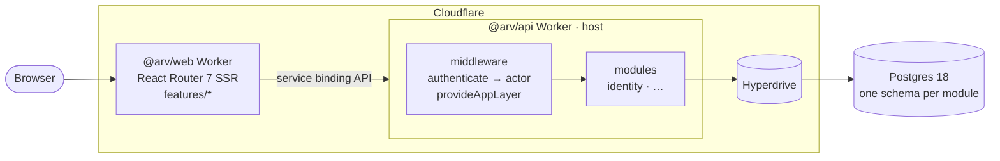
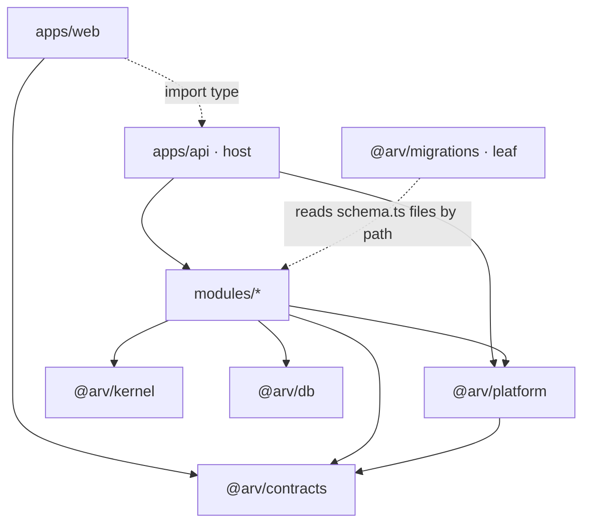
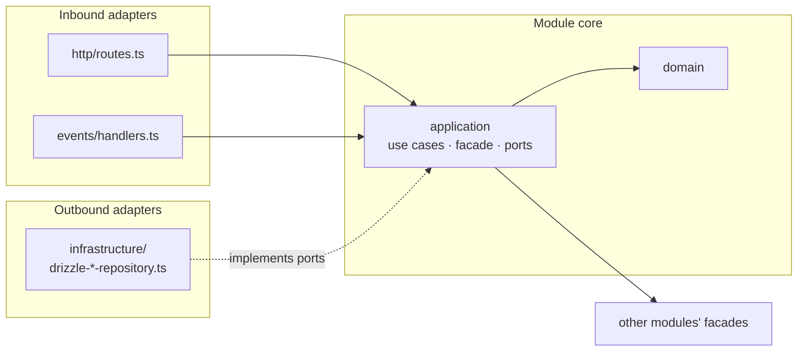
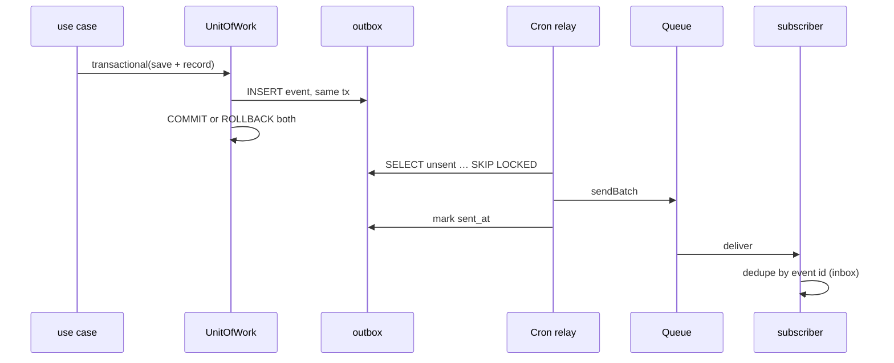
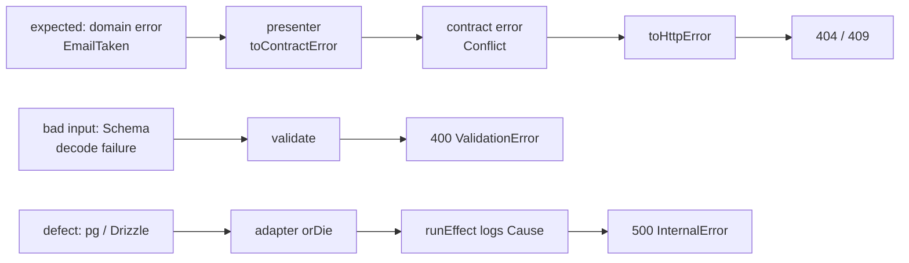

# Architecture

arv-intranet is a **modular monolith with hexagonal modules** on Cloudflare Workers. There are two deployables: the public web Worker and the private api Worker. The api is split into business modules. Each module keeps its domain at the centre and reaches HTTP, Postgres and other modules only through ports.

This file explains why the code is shaped the way it is. Decisions are recorded in [`docs/adr/`](docs/adr/).

## Contents

- [Runtime topology](#runtime-topology)
- [Principles](#principles)
- [Package map](#package-map)
- [Module catalog](#module-catalog)
- [Module anatomy](#module-anatomy)
- [Data](#data)
- [Cross-module communication](#cross-module-communication)
- [Errors](#errors)
- [Web](#web)
- [Testing](#testing)
- [Cloudflare constraints](#cloudflare-constraints)
- [How-to](#how-to)
- [Decisions](#decisions)

## Runtime topology



The api has no public URL; only web can call it. Today it has one entry point, `fetch`. A `scheduled` entry point (outbox relay) and a `queue` entry point (event consumers) are added together with the first asynchronous use case (see [Cross-module communication](#cross-module-communication)). All entry points go through the same composition root.

## Principles

- **Organise by business capability, not by technical layer.** Code that changes together lives in `modules/<name>`.
- **Dependencies point inward.** Domain ← application ← adapters. The domain knows nothing about Hono, Drizzle or Postgres.
- **Boundaries are enforced, not just agreed.** Each module is a pnpm package; undeclared imports don't resolve. Biome forbids imports that cross a layer, and `pnpm check:modules` checks the module graph below.
- **The package graph is acyclic.** `apps → modules → platform → db · kernel · contracts`. Nothing imports upward, and nothing imports `apps/*`.
- **One deployable, many seams.** Module facades are plain Effect services, so a module can later move into its own Worker behind a service binding without changing its callers.
- **Effect is the dependency-injection mechanism.** Ports are `Context.Tag`s, adapters are `Layer`s, and use cases are plain Effect functions whose requirements show up in their types.

## Package map

```
arv-intranet/
├── apps/
│   ├── api/                       @arv/api: host Worker. No business logic.
│   │   ├── src/index.ts           entry point; mounts module routers; exports route types
│   │   ├── src/composition.ts     builds the app Layer from module Layers
│   │   ├── src/middleware/        authenticate → actor; provideAppLayer → Hono context
│   │   └── test/integration/<m>/  workerd + arv_test, one folder per module
│   └── web/                       @arv/web: React Router 7
│       └── app/features/<m>/      routes, components, <m>.server.ts gateway
├── modules/
│   ├── identity/                  @arv/identity: users; resolves the actor of a request
│   └── _template/                 copied by `pnpm new:module <name>` (not a workspace package)
├── packages/
│   ├── kernel/                    @arv/kernel: shared branded IDs, Actor + CurrentActor,
│   │                                DomainEvent, UnitOfWork + DomainEvents ports. effect only.
│   ├── contracts/                 @arv/contracts: wire DTOs. /shared, /identity, … effect only.
│   ├── db/                        @arv/db: Database, query, DbError, /testing, /migrate. No tables.
│   ├── platform/                  @arv/platform: /http (runEffect, validate, toHttpError)
│   ├── migrations/                @arv/migrations: leaf. drizzle.config, drizzle/ SQL, db:* scripts
│   └── tsconfig/
├── e2e/
├── scripts/                       new-module.mts, check-module-graph.mts
└── docs/adr/
```



Every arrow points toward packages that change less often. `@arv/migrations` is a leaf: drizzle-kit loads `modules/*/src/infrastructure/schema.ts` by path, so no package depends on it and the tables never flow back into `@arv/db`.

## Module catalog

| Module | Purpose | Postgres schema | May call | Events published |
|---|---|---|---|---|
| `identity` | Users. Resolves the actor of each request. | `identity` | none (foundation) | none yet |

**Tiers.** *Foundation* modules (identity) depend on `@arv/kernel` only, and every other module may call them. *Core* modules may call the foundation and core modules listed before them. *Supporting* modules (notifications, search, audit) react to events and are never called synchronously.

The graph below is checked by `pnpm check:modules` (part of `pnpm lint`) against each module's `package.json`. A new edge needs review. Never add a cycle.

<!-- module-graph:start -->
- identity → (none)
<!-- module-graph:end -->

Domains we expect to add, as examples of how the graph grows: `org` (people, departments) → identity; `documents`, `requests` → identity, org; `booking`, `news` → identity; `notifications`, `search`, `audit` → events only.

## Module anatomy

Every module has the same shape, generated from `modules/_template`. The application layer is the hexagon. Inbound adapters (HTTP routes, event handlers) call it, and outbound adapters (Drizzle repositories) implement its ports.

```
modules/identity/
├── package.json          exports: "." (facade), "./http" (router + type), "./layer" (module Layer)
└── src/
    ├── domain/           entities (Schema.Class), domain errors (Schema.TaggedError), events, policies
    ├── application/      ports.ts, one file per use case, identity-api.ts (facade)
    ├── infrastructure/   schema.ts (pgSchema tables), drizzle-*-repository.ts
    ├── http/             routes.ts (Hono sub-app), presenter.ts (domain → DTO, domain error → contract error)
    ├── events/           optional: handlers for other modules' events
    ├── layer.ts          <Name>ModuleLive
    └── index.ts          public API: facade tag, public IDs, public events
```



**Import rules** (enforced by Biome overrides in `biome.json`):

| Layer | May import |
|---|---|
| `domain/` | `effect`, `@arv/kernel`, its own domain |
| `application/` | the above, its own application, other modules' facades (root export only) |
| `infrastructure/` | the above minus facades, its application's ports, `@arv/db`, `drizzle-orm` |
| `http/` | its domain and application, `hono`, `@arv/contracts/*`, `@arv/platform/http` |
| `apps/web` | `@arv/contracts/*`, `import type` from `@arv/api` |

A domain never imports another module, not even for an ID type. IDs that cross modules (`UserId`, …) live in `@arv/kernel`. IDs used by one module stay in its domain.

**Code shape**, from `modules/identity`:

```ts
// application/ports.ts: the outbound port. Database failures are defects, so no error channel.
export class UserRepository extends Context.Tag('identity/UserRepository')<
  UserRepository,
  {
    readonly findByEmail: (email: string) => Effect.Effect<Option.Option<User>>;
    readonly create: (input: NewUser) => Effect.Effect<User>;
    // …
  }
>() {}

// application/create-user.ts: a use case is a function; its requirements are in its type.
export const createUser = (input: NewUser) =>
  Effect.gen(function* () {
    const repo = yield* UserRepository;
    const existing = yield* repo.findByEmail(input.email);
    if (Option.isSome(existing)) return yield* new EmailTaken({ email: input.email });
    return yield* repo.create(input);
  });
// Effect<User, EmailTaken, UserRepository>

// infrastructure/drizzle-user-repository.ts: every query goes through query() from @arv/db.
create: (input) =>
  run(query((db) => db.insert(users).values(input).returning()).pipe(Effect.map(…))),
```

## Data

- **One database, one Postgres schema per module.** Tables live in the module's `infrastructure/schema.ts`, via `pgSchema('<module>')`. Only that folder imports them; they aren't exported.
- **Foreign keys inside a module are fine. Across modules there are none:** no FKs, joins or queries across schemas. Modules reference each other's rows by ID only.
- **Integrity across modules** is checked in the application layer: validate an ID through the owner's facade on write, and react to lifecycle events (e.g. `UserDeactivated`). This keeps every module movable to its own database.
- **Migrations** live in the leaf package `@arv/migrations`. Its `drizzle.config.ts` loads every `modules/*/src/infrastructure/schema.ts` by path (folders starting with `_` are skipped) and lists the module schemas in `schemaFilter`. Applied migrations are never edited.
- **Test reset.** `resetDatabase` (`@arv/db/testing`) reads the table list from `information_schema` and truncates every table outside Postgres' own schemas and drizzle's journal. There's nothing to register.
- **Read models** that combine several modules (dashboards, search) are projections built from events, in the module that owns the screen.
- **IDs** are UUIDv7 (`uuidv7()`, Postgres 18): time-ordered, so index inserts stay sequential.

## Cross-module communication

| Mechanism | Use when | Consistency | Example |
|---|---|---|---|
| Facade query | You need another module's data to decide something | Read in the same request | `OrgApi.approverChain(userId)` |
| Facade command | Rare: the caller must know the outcome right away | Joins the caller's `UnitOfWork` while both share a database. Becomes an event + compensation if either moves out. | `IdentityApi.provisionUser(…)` |
| Domain event via outbox | Side effects the publisher shouldn't know about | Eventual, at-least-once | `RequestApproved` → notifications, audit |

**Status.** The `UnitOfWork` and `DomainEvents` ports exist in `@arv/kernel`. Their implementations are added with the first real asynchronous use case: `UnitOfWorkLive` (runs `db.transaction` and puts the transaction in a `CurrentTx` FiberRef that `query()` reads), `DomainEventsLive` (inserts into `platform.outbox`), a Cron relay that forwards unsent rows to a Queue, and Queue consumers that dedupe through `platform.inbox`. Repositories need no changes then, because they already go through `query()`.



Event schemas extend `DomainEvent` from `@arv/kernel`, live in the publisher's `domain/events.ts`, and are exported from its public API. They are versioned contracts like HTTP DTOs: changes are additive only, and a breaking change is a new event.

## Errors

There are three kinds of failure, and each is handled in one place. Adding a module never touches a central list of errors.



- Domain errors are `Schema.TaggedError`s in the module's `domain/errors.ts`.
- The module's `http/presenter.ts` maps them to the shared contract errors in `@arv/contracts/shared` (`NotFound`, `Conflict`).
- `ContractError` and `toHttpError` live in `@arv/platform/http`. Only a new *kind* of HTTP failure needs a new contract error there, which should be rare.
- Every error response has the shape `{ error: { _tag, message } }` (`ApiErrorBody`).

## Web

The web app mirrors the modules as feature folders. Each feature has its own typed client, so Hono's type inference stays fast as routes grow.

```
apps/web/app/
├── routes.ts                         registers feature routes
├── routes/home.tsx                   pages that belong to no feature
├── features/identity/
│   ├── routes/users.tsx              loader · action · UI
│   ├── components/user-list.tsx
│   └── identity.server.ts            hc<IdentityRoutes> + decode with @arv/contracts/identity
└── shared/lib/api.server.ts          API_BASE_URL, bindingFetch, ApiResult, failure()
```

- Loaders and actions stay thin. They call the feature's `*.server.ts` gateway, which wraps the client, decodes responses with contract schemas, and turns `ApiErrorBody` into a UI message (`ApiResult`).
- Features don't import each other. Shared code goes in `shared/`; a page that combines several domains is composed at route level.
- Web never imports `@arv/db`, `@arv/kernel`, `@arv/platform` or a module package.

## Testing

| Level | Scope | Runs in | Doubles | Command |
|---|---|---|---|---|
| Domain | Entities, policies | Node, module package | none (pure) | `pnpm --filter @arv/<m> test` |
| Application | Use cases, facade | Node, module package | in-memory ports via `Layer.succeed` | `pnpm --filter @arv/<m> test` |
| Presenter | DTO encoding, error mapping | Node, module package | none | `pnpm --filter @arv/<m> test` |
| Contracts | Schema decode/encode rules | Node | none | `pnpm --filter @arv/contracts test` |
| Adapters + routes | SQL, status codes, error bodies | workerd + `arv_test` | none | `pnpm test:integration` |
| Web | Loaders, actions, components | jsdom | `fakeApi` | `pnpm --filter @arv/web test` |
| E2E | Critical journeys | Playwright | none | `pnpm test:e2e` |

Turbo caches each package separately, so a change in one module reruns only its own tests and those of packages that depend on it.

## Cloudflare constraints

- **Hyperdrive caching.** Create the main Hyperdrive config with query caching disabled, so a read right after a write sees it. Use a separate cached config only for data that may be stale.
- **Connections.** `DatabaseLive` opens one lazy `pg.Pool` (max 5) per request; Hyperdrive holds the real pool. Never close connections explicitly ("socket has been closed").
- **Transactions on Hyperdrive** hold one connection for their whole duration. Keep them short and never await network calls (other Workers, Queues) inside one.
- **Per-request Layers.** Bindings are request-scoped, so the app Layer is built per request in `provideAppLayer`.
- **Cron** triggers fire at most once a minute. When the outbox exists, publish from `ctx.waitUntil` right after commit as the fast path, and let the Cron relay catch up on anything missed.
- **Limits.** Assume Workers Paid plan limits on CPU time, subrequests and bundle size. Moving a module to its own Worker is the answer to bundle-size pressure (see How-to).

## How-to

**Add a module**

1. `pnpm new:module <name>` (kebab-case), then `pnpm install`.
2. Add `<Name>ModuleLive` to `apps/api/src/composition.ts`, dependents before the modules they call.
3. Mount `<name>Routes` in `apps/api/src/index.ts` and re-export `<Name>Routes`.
4. Add the schema name to `schemaFilter` in `packages/migrations/drizzle.config.ts`.
5. Add the module and its edges to the module graph and catalog above, and to `CODEOWNERS`.

**Add a use case:** a new file in `application/` exporting an Effect function. Ask for ports with `yield*`. Add a unit test with in-memory ports. If it's reachable over HTTP, add the route in `http/routes.ts`, map new domain errors in `presenter.ts`, and add an integration test in `apps/api/test/integration/<module>/`.

**Call another module:** add `"@arv/<other>": "workspace:*"` to the module's `package.json`, add the edge to the module graph above, then use `<Other>Api` from `application/`. Keep facades small: add a method only when another module needs it.

**Add a table:** define it with `<schema>.table(…)` in the module's `infrastructure/schema.ts`, run `pnpm db:generate`, review the SQL, then `pnpm db:migrate`.

**Publish and consume an event** (once the outbox exists): define the event in `domain/events.ts` extending `DomainEvent`, record it with `DomainEvents.record` inside the same `UnitOfWork.transactional` as the state change, and subscribe in the consumer's `events/handlers.ts`. Handlers must be idempotent.

**Move a module to its own Worker:** give it a Worker entry that mounts its routes and Layer, and replace its facade's Live Layer in the host with one that calls the new Worker over a service binding. Callers don't change. Facade commands that joined a shared `UnitOfWork` become events.

**Move a module to its own database:** give it its own Hyperdrive config and `Database` Layer. There are no cross-schema FKs or joins to break.

## Decisions

- [ADR 0001: Modular monolith with hexagonal modules](docs/adr/0001-modular-monolith.md)
