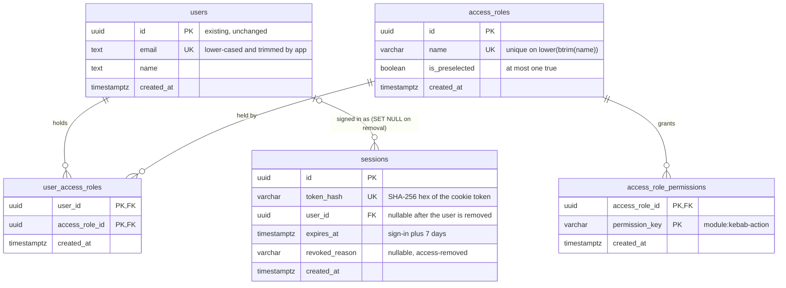

# Data model — identity

<!-- Generated by generate-data-model. Migrations are STAGED under
docs/features/identity/migrations/ (NOT the live packages/migrations/drizzle tree);
implement-tasks promotes them. -->

> **Inputs:** [PRD](./PRD.md) §4–§6.1 · [SAD](./sad.md) §5 (tactical decisions, table list in `infrastructure/schema.ts`), §6 (Critical flows 1–3, Flows 4–11 and their persist notes), §7 (scaling numbers), §8 (normalisation, ID strategy, transactions) · [ADR-0003](./adr/0003-sign-in-with-google-oidc-and-server-side-sessions.md) (server-side sessions, token hash) · [ADR-0004](./adr/0004-declare-permissions-in-module-code-and-collect-them-in-the-host.md) (grants stored by key) · [ADR-0006](./adr/0006-keep-sign-in-sessions-and-access-roles-in-one-identity-module.md) (one `identity` schema).
> **Decisions taken in this pass (2026-11-03):** primary keys are `UUID DEFAULT uuidv7()` from Postgres (repo + SAD §8, not the course's app-side default); the pre-selected mark is a flag on `access_roles` guarded by a partial unique index; a revoked session outlives its deleted user (`user_id` nullable, `ON DELETE SET NULL`) so the next request can say «you no longer have access»; `identity.users` is **not** changed.

Everything lives in the one `identity` Postgres schema (ADR-0006), so every relationship below is a real foreign key inside the module. Nothing in another schema points here with an FK; other modules keep `user_id` as a plain `UUID` (e.g. `org.employee_records.user_id`).

**Not stored (by design):**
- **The permission catalog.** Permissions are declared in module code and collected by the host (ADR-0004). The DB stores only granted **keys**; «retired» (granted but undeclared) is computed on read by comparing keys with the catalog (AC-16, AC-18).
- **The configured first admin** (`FIRST_ADMIN_EMAIL`), the company domain and the Google client: api configuration (SAD §7).
- **Sign-in history, last sign-in date, refused attempts, an audit log of grants:** excluded by PRD §3 and §6.1.

## ER diagram

## Aggregate roots

| Aggregate | Root table | Owns | Why |
|---|---|---|---|
| **User** (an access-list entry) | `users` | `user_access_roles` (the user's assignments) | AC-07: assignments are removed with the user. AC-12 / Flow 8 replaces a user's assignments as one set. |
| **Access role** | `access_roles` | `access_role_permissions` (its granted keys), the pre-selected flag | AC-09 / AC-11 / Flow 6: a role is saved together with its keys; deleting it deletes its grants and assignments and clears the mark (Flow 7). |
| **Session** | `sessions` | — | Created at sign-in, removed at sign-out, revoked on removal (ADR-0003). Refers to a user, is not part of the User aggregate: it must outlive a removed user (AC-07). |

`user_access_roles` sits between two aggregates. It is written through the User aggregate (Flows 4, 8) and cascades from both sides (user removed → AC-07; role deleted → AC-11). The cross-aggregate rule — **at least one user holds `identity:manage-access`** (AC-14) — is checked by the use case inside one `UnitOfWork` (SAD §5 «apply, verify, roll back»), not by the DB.

## Entities

Applying the repo/course defaults (`.claude/rules/backend/db.md`): `created_at TIMESTAMPTZ NOT NULL DEFAULT now()` on every table, hard delete, no `CHECK`, `TRIGGER` or business `DEFAULT`. Every enum, bound and invariant under «Rules (app)» lives in `modules/identity/src/domain/`.

**`updated_at` (surfaced, not silent): none.** Three things change in place — `users.name` (AC-21), `access_roles.name` / `is_preselected` (AC-10, AC-13) and `sessions.revoked_reason` (AC-07) — but no AC asks «last changed by / when», and no flow uses optimistic concurrency (admin changes are last-write-wins for 1–2 admins, PRD §6.1). So no `updated_at`, `version` or `last_changed_*` anywhere.

### Aggregate: User (`identity`)

#### `identity.users` — existing, unchanged

| Column | Type | Constraints | Notes |
|---|---|---|---|
| `id` | UUID | PK, `DEFAULT uuidv7()` | `UserId` in `@arv/kernel`; the actor id |
| `email` | TEXT | NOT NULL, UNIQUE (`users_email_unique`) | Stored lower-cased and trimmed by the app, so the existing plain UNIQUE already gives AC-06 (case does not make a different address). Never changes after insert (AC-21, PRD §3). App: valid address on `COMPANY_EMAIL_DOMAIN` (AC-05); max 254 chars. |
| `name` | TEXT | NOT NULL | Entered by the admin (AC-04), corrected in place (AC-21), or Google's name for the configured first admin (AC-15). App: trimmed, non-empty. <!-- TBD: max length for name — PRD gives none; propose 200 in domain validation --> |
| `created_at` | TIMESTAMPTZ | NOT NULL DEFAULT now() | |

**Kept as `TEXT`, not `VARCHAR(N)`:** the table already exists (migration `0001_identity_schema`). Retyping would be a change to an existing table; bounds are enforced in the domain instead. See the audit, «Convention divergences».

**Rules (app):** hard delete on removal (AC-07), in one `UnitOfWork` with revoking the user's sessions and the last-admin check (Critical flow 3). The FK cascade removes the user's assignments; the `SET NULL` keeps their revoked sessions.

#### `identity.user_access_roles`

| Column | Type | Constraints | Notes |
|---|---|---|---|
| `user_id` | UUID | NOT NULL, PK part 1, FK → `identity.users(id)` ON DELETE CASCADE | AC-07: «their access roles are removed with them» |
| `access_role_id` | UUID | NOT NULL, PK part 2, FK → `identity.access_roles(id)` ON DELETE CASCADE | AC-11: deleting a role ends every holder's assignment |
| `created_at` | TIMESTAMPTZ | NOT NULL DEFAULT now() | |

**PK `(user_id, access_role_id)`:** a user holds a role at most once (AC-12 «zero or more», a set). The PK's leading column serves the per-request lookup «roles of this user».

### Aggregate: Access role (`identity`)

#### `identity.access_roles`

| Column | Type | Constraints | Notes |
|---|---|---|---|
| `id` | UUID | PK, `DEFAULT uuidv7()` | |
| `name` | VARCHAR(100) | NOT NULL; UNIQUE on `lower(btrim(name))` | Displayed as entered (trimmed); unique ignoring case and surrounding spaces (AC-10). «Admin» is found by the same key when the first admin is bootstrapped (AC-15). <!-- TBD: bound 100 is an architect's choice, PRD gives none --> |
| `is_preselected` | BOOLEAN | NOT NULL; partial UNIQUE `((true)) WHERE is_preselected` | AC-13: at most one role is pre-selected for new people. No DB default — the app writes `false` on insert. Deleting the marked role clears the mark with the row (AC-11). |
| `created_at` | TIMESTAMPTZ | NOT NULL DEFAULT now() | |

**Rules (app):** setting the mark is one statement — `UPDATE identity.access_roles SET is_preselected = (id = $1)` — or `= false` to clear; changing it touches no assignment (AC-13). Removing manage access from a role or deleting a role runs the last-admin check (AC-14).

#### `identity.access_role_permissions`

| Column | Type | Constraints | Notes |
|---|---|---|---|
| `access_role_id` | UUID | NOT NULL, PK part 1, FK → `identity.access_roles(id)` ON DELETE CASCADE | Grants live and die with their role (Flow 7) |
| `permission_key` | VARCHAR(100) | NOT NULL, PK part 2 | `<module>:<kebab-action>`, e.g. `identity:manage-access`, `scheduling:edit-allocations` (SAD §8). Not an FK — the catalog is in code (ADR-0004). A key no module declares is **retired**: kept, flagged, grants nothing (AC-16); it grants again if re-declared under the same key. <!-- TBD: bound 100 — confirm against the longest declared key at api-forge --> |
| `created_at` | TIMESTAMPTZ | NOT NULL DEFAULT now() | |

**PK `(access_role_id, permission_key)`:** a role grants a key at most once. **Rules (app):** only declared keys can be added (Flow 6, AC-16); a retired key can only be removed (Flow 10).

### Aggregate: Session (`identity`, ADR-0003)

#### `identity.sessions`

| Column | Type | Constraints | Notes |
|---|---|---|---|
| `id` | UUID | PK, `DEFAULT uuidv7()` | Internal id. The cookie carries the token, never this id. |
| `token_hash` | VARCHAR(64) | NOT NULL, UNIQUE | Lower-case hex SHA-256 of the 256-bit random token (SAD §4, §8). The raw token is never stored. |
| `user_id` | UUID | NULL, FK → `identity.users(id)` ON DELETE SET NULL | NOT NULL in practice while the user exists; becomes NULL only when the user is removed, so the revoked row survives for AC-07's message. |
| `expires_at` | TIMESTAMPTZ | NOT NULL | Set by the app: sign-in time + 7 days, absolute (AC-20, PRD §6). No DB default. |
| `revoked_reason` | VARCHAR(32) | NULL | NULL = active. `access-removed` (AC-07) — an enum in the app, no CHECK. Set for all the user's sessions in the same transaction that removes the user. |
| `created_at` | TIMESTAMPTZ | NOT NULL DEFAULT now() | Sign-in time |

**Rules (app):**
- A session is valid iff `expires_at > now()` and `revoked_reason IS NULL` and `user_id IS NOT NULL`; a revoked one answers «access removed» (Critical flow 2).
- **Sign-out deletes the row** by token hash (Flow 11, AC-20): the token is useless from anywhere; other sessions are untouched.
- **Lazy purge:** sign-in completion also runs `DELETE FROM identity.sessions WHERE expires_at < now()` — removes expired rows and revoked ones once their 7 days have passed (SAD §5). At PRD scale (≤ a few hundred rows, SAD §7) this is cheap.

## Indexes

Each index serves a concrete query from SAD §6. PK indexes (including the two composite ones) are implicit; the queries they serve are listed for completeness.

| Index | Columns | Query it serves |
|---|---|---|
| `users_email_unique` (UNIQUE, existing) | `identity.users (email)` | Flow 4: «look up the user by normalised address» (AC-06; a racing duplicate hits it → Conflict). Critical flow 1: «is this verified email on the access list» and the first-admin upsert (AC-15). |
| `sessions_token_hash_unique` (UNIQUE) | `identity.sessions (token_hash)` | Critical flow 2: the per-request lookup «session by token hash» — the hot path, ≤ 25 ms p95 (PRD §6). Flow 11: «remove this session by its token hash». |
| `idx_sessions_user_id` | `identity.sessions (user_id)` | FK index (`SET NULL` on user delete). Critical flow 3: «revoke all the user's sessions as access removed» (AC-07). |
| `idx_sessions_expires_at` | `identity.sessions (expires_at)` | Lazy purge at sign-in: «delete sessions that expired before now» (SAD §5). |
| PK `user_access_roles_pkey` (implicit) | `identity.user_access_roles (user_id, access_role_id)` | Critical flow 2: «user → access roles». Flow 8: «read / replace the user's roles». |
| `idx_user_access_roles_access_role_id` | `identity.user_access_roles (access_role_id)` | FK index (CASCADE on role delete). Flow 7 / Flow 10: «holder count of the role». Last-admin check (Critical flow 3, Flows 7–8): «users still holding manage access» joins grants → assignments by role. Critical flow 1: «the admins' names and emails» (AC-03). |
| `access_roles_name_key_unique` (UNIQUE) | `identity.access_roles (lower(btrim(name)))` | Flow 6: «look up roles by name key» (AC-10; a racing duplicate → Conflict). Critical flow 1: find «Admin» when bootstrapping the first admin (AC-15). |
| `access_roles_one_preselected_unique` (UNIQUE, partial) | `identity.access_roles ((true)) WHERE is_preselected` | Enforces AC-13 «at most one role marked» under concurrency. Flow 4 / Flow 7: «read the pre-selected mark» reads the one-row partial index. |
| PK `access_role_permissions_pkey` (implicit) | `identity.access_role_permissions (access_role_id, permission_key)` | Critical flow 2: «access roles → granted keys». Flow 10: «every role with its granted keys». Flow 6: save the role's keys. |
| `idx_access_role_permissions_permission_key` | `identity.access_role_permissions (permission_key)` | Last-admin check (AC-14): «roles granting `identity:manage-access`» → assignments → count of users. First-admin rule (AC-15): «does any user hold manage access». Critical flow 1: admins to list on the «not set up yet» screen (AC-03). |

**Per-request query (Critical flow 2, one round-trip):** `sessions` by `token_hash` → `users` by PK → `user_access_roles` by PK prefix `user_id` → `access_role_permissions` by PK prefix `access_role_id`. Every hop is an index lookup; at 100 users / 50 roles (PRD §6 capacity) the whole join touches tens of rows.

## Staged migrations

Under [`./migrations/`](./migrations/). Feature-local order, re-stamped at promote time:

| File (`.up.sql` + `.down.sql`) | Creates |
|---|---|
| `20261103120000_create_sessions` | `identity.sessions` + its 3 indexes |
| `20261103120001_create_access_roles` | `identity.access_roles`, `identity.access_role_permissions` (one aggregate) + their indexes |
| `20261103120002_create_user_access_roles` | `identity.user_access_roles` + its FK index |

All three add new tables to the existing `identity` schema; `identity.users` gets no ALTER, so there is no expand → backfill → contract sequence and no `CONCURRENTLY` index.

**Promote-time note (repo tooling).** The live tree is `packages/migrations/drizzle/`, which drizzle-kit **generates** from `modules/identity/src/infrastructure/schema.ts` (`pnpm db:generate`) — sequential `NNNN_name.sql`, a journal + snapshots, no down files. At promote time `implement-tasks` adds the four tables to `schema.ts` — `identity.table(...)` with `varchar({ length })`, `boolean()`, `primaryKey({ columns: [...] })` for the two join tables, `references(() => …, { onDelete: 'cascade' | 'set null' })`, `uniqueIndex().on(sql\`lower(btrim(${t.name}))\`)` and `uniqueIndex().on(sql\`(true)\`).where(sql\`${t.isPreselected}\`)` — runs `pnpm db:generate` and diffs the generated SQL against these staged `.up.sql` files (index names and FK actions must match). `schemaFilter` already lists `identity`. drizzle has no down migrations, so the staged `.down.sql` files are **not promoted**; they document how to reverse each step by hand on a dev database. In this repo a rollback is a new forward migration (`.claude/rules/backend/db.md`).

**Seeds: none.** The «Admin» role and the first admin are created at runtime by sign-in completion, only while no user holds manage access (AC-15) — seeding them would bypass that rule. There is no lookup data: permissions are declared in code.

## Test fixtures

Not in migrations. The repo's form is `make<Entity>()` + `seed<Entities>(db, rows)` in raw SQL in `@arv/db/testing` (`packages/db/src/testing/seed.ts`), because that package cannot import module tables. `implement-tasks` adds:

- `makeUser` / `seedUsers` (existing) — switch the default email to `user-<n>@example.test` and set `COMPANY_EMAIL_DOMAIN=example.test` in test config (see audit, PII guard).
- `makeAccessRole({ name? = 'Role <n>', isPreselected? = false, permissionKeys? = [] })` / `seedAccessRoles(db, rows)` → `identity.access_roles` + `identity.access_role_permissions`.
- `seedUserAccessRoles(db, [{ userId, accessRoleId }])` → `identity.user_access_roles`.
- `makeSession({ userId, token? = random, expiresAt? = now + 7 days, revokedReason? = null })` / `seedSessions(db, rows)` → `identity.sessions`; returns the raw token so a test can call the api with it as Bearer. `expiresAt` can be back-dated (AC-20 expiry, purge).
- `seedAdmin(db)` convenience: a user + an «Admin» role granting `identity:manage-access` + the assignment — most admin-flow integration tests start from it.

**PII guard:** names `Test User <n>`, emails `user-<n>@example.test`, role names `Role <n>` / `Admin` / `Planner` / `Staff`.
