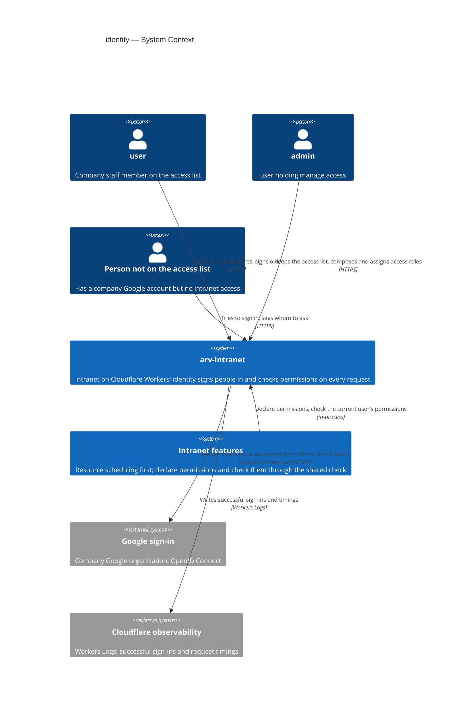
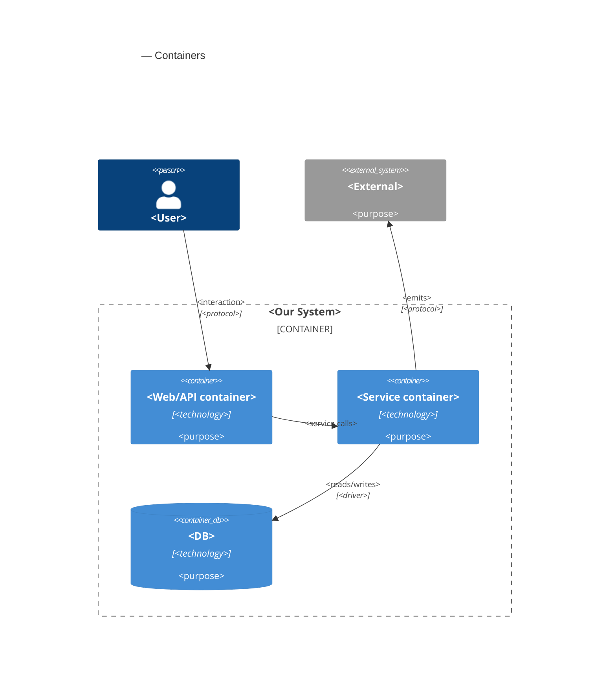
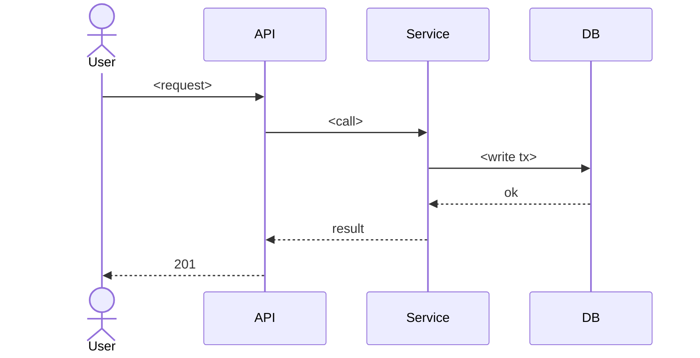

# Software Architecture Document — identity

<!-- Stages 04-05 → see sdlc/plugin/skills/architecture-design/SKILL.md -->
<!-- 12 Arc42 sections. Empty sections — <!-- N/A: <one-line reason> -->. -->
<!-- C4 Context (L1) lives inline in §3. C4 Container (L2) lives inline in §5. -->
<!-- §6 Runtime view seeds the primary flow(s) here; complete-sequence-diagrams (stage 06) then -->
<!--    fills §6 with every critical flow / §5 AC — no cap. -->
<!-- Numbers in §10 come VERBATIM from PRD §6 NFR — no inventing, no rounding. -->

## 1. Introduction and goals

<!-- 🎯 Навіщо: стабільна памʼять про «що + три головні якості + хто зацікавлений».     -->
<!--           Через рік ніхто не згадає на словах, ЯКІ ТРИ ЯКОСТІ для системи критичні. -->
<!-- 📋 Що писати: 1 абзац intent + 3 рядки топ-3 якості + таблиця stakeholders.        -->
<!-- 📌 Приклад: «QG-1: швидкість редагування блоку p95 ≤500 мс»                         -->

**Intent.** Identity gives the intranet its front door and its single access model (PRD §1, Approach A «Allowlist Sign-in, Admin-Composed Roles»). Staff on the company email domain sign in with their company-managed Google account, and only if an admin has put them on the access list. Admins build access roles from the permissions each feature declares and give each user zero or more of them. Every request re-checks access-list membership and current permissions through one shared check, and anything not granted is refused. It serves the ~30 users on every visit and the 1–2 admins a few times a month (onboarding, offboarding, role changes). It also unblocks resource scheduling's launch: scheduling's six permissions are the first feature-declared ones, alongside identity's own manage access.

**Top-3 quality goals (1-liners; full scenarios in §10):**

1. **QG-1 Revocation and fail-closed access.** A removal from the access list or a permission change takes effect on the very next request, and any request whose access cannot be determined is refused (PRD §6: Revocation, Session lifetime, Fail closed).
2. **QG-2 Access-check overhead.** At most 25 ms p95 added to every request, still holding at 100 users and 50 access roles (PRD §6: access-check latency, Capacity headroom).
3. **QG-3 Availability of sign-in and the access check.** At least 99.5% monthly, excluding Google outages (PRD §6: Availability).

When two goals conflict, the higher one wins: no cache or shortcut may let a request through after a revocation, even if it would save milliseconds.

**Stakeholders.**

| Role | Interest | Sign-off owner? |
|---|---|---|
| user | Signs in with their company Google account and acts with their current permissions (US-01, US-08, US-09) | No |
| admin | Keeps the access list, composes access roles and assigns them; never loses the last admin (US-02 – US-07) | No |
| Feature owners (resource scheduling first) | Declare their feature's permissions and check them only through the one shared check (PRD §2, §7 shared-check adoption) | No |
| PM | KPIs (PRD §7); plain-language names of the launch permissions (PRD §8 Q1) | No |
| HR / offboarding process owner | Removal from the access list on the last working day, mailbox not reassigned before that (PRD §8 Q2) | No |
| Tech Lead | SAD approval; first-admin recovery runbook (PRD §8 Q4) | Yes |
| Security Lead | Mandatory security review: new authentication boundary and new personal data (PRD §6.1) | Yes |

<!-- Decision overrides (¶4) — populated by the Step-7 critic resolution loop, empty otherwise.       -->
<!-- Each: «Decision override: <headline> — rationale: <reason>» so downstream skills see the choice.  -->

## 2. Constraints

<!-- 🎯 Навіщо: §4 (стратегія) працює тільки коли §2 зафіксувала, ЩО ВЖЕ ЗАФІКСОВАНО:    -->
<!--           стек, версії, дедлайн, регуляторні вимоги. Це вхід, не вихід.             -->
<!-- 📋 Що писати: чотири блоки — Технічні / Організаційні / Конвенції / Регуляторні.     -->
<!-- 📌 Приклад: «Postgres 18» (не «Postgres»); «дедлайн Q3 — жорсткий» (не «бажано»).    -->

**Technical.**
- TypeScript 5.9.3 (kept below 7 for React Router 7); Biome for lint and format; pnpm workspaces + Turbo.
- Cloudflare Workers — wrangler 4.148.0, `compatibility_date` 2026-10-01, `nodejs_compat`. Two deployables: the public `arv-web` Worker and the private `arv-api` Worker, reachable only through web's `API` service binding (`workers_dev: false`, no public URL).
- api: Hono 4.13.13 + Effect 3.22.2. web: React Router 7.18.4, server-rendered. Tests: Vitest 4.1.11 (Workers pool for integration), Playwright for e2e.
- Postgres 18 (Neon in production, docker locally) through the `HYPERDRIVE` binding, whose main config has **query caching disabled** (a read right after a write sees it); Drizzle ORM 0.45.4, with drizzle-kit migrations in `@arv/migrations`.
- Modular monolith with hexagonal modules (repo ADR 0001). The `identity` module scaffold exists: a `users` table, `IdentityApi.resolveActor` returning `Anonymous` for every request, and the api host's `authenticate` middleware already reading an `Authorization: Bearer` header.
- **Dependencies:** versions are pinned, and no new package or tool is added without asking. **Approved exception (2026-11-03):** one OpenID Connect / JWT library usable in Workers may be added to `modules/identity` for Google sign-in, so the code exchange and ID-token signature checks use a maintained implementation instead of hand-written crypto. `break-tasks` picks the library and pins a version old enough for pnpm's minimum release age.

**Organisational.**
- Scale: ~30 users, 1–2 admins (PRD §1).
- Deadline: none (PRD §1); resource scheduling's launch is blocked until identity ships.
- Effort budget: not set in the PRD — TBD by PM (§11).

**Conventions.**
- [`CLAUDE.md`](../../../CLAUDE.md), [`.claude/rules/`](../../../.claude/rules/), [`ARCHITECTURE.md`](../../../ARCHITECTURE.md) — the source of truth for structure.
- DB failures are defects (`Effect.orDie` → 500); domain errors are `Schema.TaggedError`s mapped to contract errors in the module's presenter.
- IDs are UUIDv7 generated by Postgres; one Postgres schema per module (`identity`), no foreign keys or joins across module schemas.
- Modules call each other only through facades; every module edge is declared in the `ARCHITECTURE.md` module graph; web imports only `@arv/contracts/*` and `import type` from `@arv/api`.
- Tests next to the code; api integration tests in `apps/api/test/integration/identity/`; feature branch + PR, Conventional Commits.

**Regulatory / external.**
- Data classification: confidential — identity decides who can see confidential data such as leave reasons (PRD §6.1).
- Personal data: each user's company email address and name, their access-role assignments and their active sessions. No passwords; no sign-in history or last-sign-in date in the intranet's data.
- Refused sign-in attempts record nothing about the person — not in the intranet's data, not in production logs (AC-02, AC-03).
- Production logs keep successful sign-ins only, for at most 30 days, for operations and the sign-in KPI; this is not an audit log (PRD §6.1, §3 non-goal).
- Mandatory security review before launch (PRD §6.1).
- Staff Google accounts are managed by the company's Google organisation, but a second factor is not enforced; the phishing risk is accepted for v1 (PRD §3).

## 3. Context and scope

<!-- 🎯 Навіщо: малює КОРДОН СИСТЕМИ — хто з нею говорить ззовні, де закінчується зона довіри. -->
<!--           Без §3 §5 і §8 (авторизація) розпливаються — неясно, що «всередині», а що «зовні». -->
<!-- 📋 Що писати: 2-3 речення бізнес-контексту + таблиця зовнішніх систем + Mermaid C4Context. -->
<!-- 📌 Приклад: «зовнішні — нема (свідома відмова від third-party у v1)» — це теж рішення.   -->
<!-- Кордон довіри (trust boundary) — лінія, за якою ти не довіряєш даним без перевірки.       -->

<!-- brownfield: no docs/architecture-map.md yet — current architecture read from the authored ARCHITECTURE.md + repo ADR 0001 + resource-scheduling's SAD/ADR-0004 + a direct scan of apps/, modules/identity, packages/kernel (2026-11-03, HEAD 795a841). Run /sdlc:map-architecture to persist a map. -->

Today the intranet has no sign-in: every request is anonymous and nobody can be granted anything. Identity makes the intranet usable only by people on the access list who arrive with a verified, company-managed Google account on the company email domain, and gives every feature one place to ask «may this user do this, right now?». The **trust boundary** is the public web Worker: everything a browser sends — the Google redirect parameters, the session cookie, admin form fields — is untrusted until the private api has checked it, and Google's answer is trusted only after its issuer, audience, expiry, verified email and organisation domain are checked. Configuration (the company email domain and the first-admin address) is set by the Tech Lead at deploy time and is trusted.

**External systems (in / out):**

| Actor or system | Type | Interaction |
|---|---|---|
| user | Person | Signs in with their company Google account, uses intranet features with their current permissions, signs out (US-01, US-08, US-09) |
| admin | Person (a user holding manage access) | Keeps the access list, composes and assigns access roles, sees retired permissions flagged (US-02 – US-07) |
| Person not on the access list | Person (company Google account, no access) | Sees the «not set up yet» screen naming the admins; nothing about them is recorded (AC-03) |
| Google sign-in (company Google organisation) | System (external) | Authenticates the person and reports their email, whether it is verified, and the organisation domain that manages the account (OpenID Connect) |
| Intranet features (resource scheduling first) | System (internal) | Declare their permissions and check the current user's permissions through the one shared check on every action |
| Cloudflare observability (Workers Logs) | System (external) | Receives successful sign-in events and request timings; source for the sign-in coverage and access-check overhead KPIs (PRD §7) |

**C4 Context (L1):**



## 4. Solution strategy

<!-- 🎯 Навіщо: 3-4 СТРАТЕГІЧНІ СТОВПИ, з яких потім ростуть усі ADR. Без §4 кожен ADR    -->
<!--           виглядає випадковим — нема зонтика. ⭐ Найгустіша секція — тут ADR-gate    -->
<!--           спрацьовує майже завжди (рішення незворотні + мульти-модульні).            -->
<!-- 📋 Що писати: спершу Target surface(s), потім 3-4 стратегічні вибори.                -->
<!--           На кожен — заголовок + 2-3 речення rationale.                              -->
<!-- 📌 ПЕРШЕ рішення §4 — Target surface(s): ЩО САМЕ будуємо. Записується у frontmatter   -->
<!--           target_surfaces: [...] і гейтить §5 (один контейнер на поверхню) + усі       -->
<!--           наступні стадії. Деривиться з PRD §1 «для кого» + §4 ролей. → _shared/surfaces.md -->
<!-- 📌 Приклад: «Зберігати урок як таблицю блоків» — стовп, з якого виросло ADR-0001.    -->

**Target surface(s) (the first decision — what's being built):** `<e.g. [backend-service, web-frontend]>`
<!-- Mirror this list into the frontmatter `target_surfaces`. For each declared UI surface          -->
<!-- (web-frontend / mobile-app / desktop-app) add a UI-architecture choice below (web → SSR/SPA/   -->
<!-- hybrid; mobile → native/cross-platform). Multi-surface is usually an ADR (multi-module +       -->
<!-- irreversible). The UI reuses the repo's existing design system / components / tokens from       -->
<!-- architecture-map.md §Frontend — it does not design greenfield. → _shared/surfaces.md           -->

**Top strategic choices (the seeds for ADRs):**

1. **<e.g. Module isolation through events>** — <2-3 sentences rationale referencing Quality Goals and constraints>.
2. **<e.g. Single-store persistence (Postgres)>** — <2-3 sentences>.
3. **<e.g. UI-architecture: SPA consuming the backend API>** — <per declared UI surface; 2-3 sentences>.

Each tactical decision in later sections should be traceable to one of these strategic seeds. Tactical decisions that *contradict* a strategic choice are red flags — surface them in §11 Risks.

## 5. Building block view

<!-- 🎯 Навіщо: ВНУТРІШНЯ ДЕКОМПОЗИЦІЯ — модулі, контейнери, БД. Статична топологія:   -->
<!--           хто з ким може говорити. Без §5 §6 (сценарії) не має словника учасників. -->
<!-- 📋 Що писати: 1 абзац про стиль (шари/гексагональна/clean/на подіях) +            -->
<!--           дерево папок + Mermaid C4Container.                                       -->
<!-- 📌 ОДИН Container на кожну оголошену target_surface (frontmatter): fullstack        -->
<!--           [backend-service, web-frontend] = backend-API container + web/SPA container; -->
<!--           [backend-service, mobile-app] = API + mobile app. Container(web, …) нижче — -->
<!--           лише приклад однієї поверхні; додай/заміни під оголошене у §4. → _shared/surfaces.md -->
<!-- 📌 Приклад: «web-app, content-api, media-worker, postgres, s3, cdn».                -->

<One paragraph: layered / hexagonal / clean / event-driven. Why.>

**Internal decomposition:**

```
<e.g. internal/modules/goals/>
├── domain/       <entities + sentinel errors>
├── app/          <use cases / services>
├── infra/        <repository + outbox impl>
├── ports/        <HTTP handlers, DTOs, error mapping>
└── module.go     <self-wiring>
```

**C4 Container (L2):**



## 6. Runtime view

<!-- 🎯 Навіщо: ПОТІК У RUNTIME для 1-2 критичних сценаріїв. Хто з ким коли і у якому     -->
<!--           порядку говорить. Без §6 §5 — лише купа коробок без життя.                  -->
<!-- 📋 Що писати: Mermaid sequenceDiagram. Учасники — імена з §5 (не вигадуй нові!).      -->
<!--           Повідомлення семантичні («складає чорновик»), БЕЗ HTTP-методів/шляхів —     -->
<!--           ендпоінт-рівневі sequence-діаграми зʼявляться у stage 06 (api-forge).        -->
<!-- ⏳ RESERVED FOR SEQUENCES: architecture-design сіє лише primary flow(s) тут.          -->
<!--           complete-sequence-diagrams (stage 06) ДОПОВНЮЄ §6 кожним критичним flow /    -->
<!--           кожним §5 AC — без обмеження. Не намагайся покрити все тут.                  -->
<!-- 📌 Приклад: «methodist → web-app: складає чорновик → web-app → content-api: зберегти». -->

**Critical flow 1: <flow name>**



<!-- For XS/S: 1 flow above is enough. For M+: add 2-4 more (e.g. failure-mode flow, async flow). -->

**Critical flow 2: <e.g. async event propagation>** — <if applicable, otherwise N/A>.

## 7. Deployment view

<!-- 🎯 Навіщо: ТОПОЛОГІЯ, яку DevOps має знати без читання Helm-чартів — скільки реплік,  -->
<!--           де живе фоновий обробник, ПРИ ЯКИХ ЧИСЛАХ масштабуємось.                     -->
<!-- 📋 Що писати: 2-3 речення про топологію + метрики + алерти + конкретні числа-пороги.   -->
<!-- 📌 Приклад: «500 IC → партиціонування за кварталом» (не «при зростанні подумаємо»).    -->
<!-- 🎯 Можна N/A для XS/S функцій, що переюзають існуюче розгортання без змін.            -->

<Topology in 2-3 sentences. Where it runs (k8s / VM / serverless), replicas, scaling thresholds.>

**Monitoring:**
- <Metrics — e.g. Prometheus `<metric_name>`>
- <Alerts — e.g. "outbox lag > 10 min → page on-call">
- <Tracing — e.g. OpenTelemetry HTTP spans>

**Scaling thresholds:**
- <e.g. 500 IC × 5 goals × 26 checkpoints/Q = 65k rows/year — comfortable in one table>
- <e.g. partitioning by quarter at >500k rows/year>

<!-- For XS/S that doesn't change deployment: <!-- N/A: feature reuses existing deployment unit -->. -->

## 8. Crosscutting concepts

<!-- 🎯 Навіщо: НАСКРІЗНІ ПАТЕРНИ, які перетинають кілька модулів: логування, помилки,    -->
<!--           авторизація, ID strategy, outbox, кеш. ⭐ Друга найгустіша секція.          -->
<!--           Якщо патерн всередині одного модуля — він НЕ сюди. Якщо це конвенція        -->
<!--           проєкту в цілому — у CLAUDE.md.                                              -->
<!-- 📋 Що писати: таблиця концепт / конвенція / де визначено. Один рядок на концепт.      -->
<!-- 📌 Приклад: «UUID v7 (час+випадковий, сортується) у app-layer» — як default з CLAUDE.md. -->

| Concept | Convention | Where defined |
|---|---|---|
| Logging | <e.g. structured slog, fields `module=<name>`> | <CLAUDE.md §X or here> |
| Authentication | <e.g. JWT via session middleware> | <CLAUDE.md §X> |
| Error handling | <e.g. domain sentinel → ports/errors.go → apperr JSON> | <CLAUDE.md §X> |
| ID strategy | <e.g. UUID v7 in app layer> | <CLAUDE.md §X> |
| Internationalisation | <e.g. N/A, English only> | — |
| Observability | <e.g. OpenTelemetry on HTTP boundaries> | — |
| Outbox / events | <module-specific patterns, if any> | <here> |

## 9. Architecture decisions

<!-- 🎯 Навіщо: ЗВОРОТНИЙ ІНДЕКС на папку adr/. `ls adr/` дає файли, §9 дає семантику —    -->
<!--           чому вони існують, до якого зрізу SAD привʼязані, у якому статусі.           -->
<!-- 📋 Що писати: таблиця з 4 колонками. Один рядок на ADR. Mixed status — це OK.         -->
<!-- 📌 Приклад: «0001 | Зберігати урок як таблицю блоків | Accepted | §4».                -->

| # | Title | Status | Section |
|---|---|---|---|
| <NNNN> | <imperative — e.g. "Use sliding window for rate limiting"> | Accepted | §<N> |
| <NNNN> | <imperative — e.g. "Co-locate outbox worker in API process"> | Accepted | §<N> |

ADR files live under `docs/features/<slug>/adr/NNNN-<title>.md`.

## 10. Quality requirements

<!-- 🎯 Навіщо: ДЕРЕВО ЯКОСТЕЙ (Quality Tree) — беремо мету з §1 і розкладаємо на          -->
<!--           конкретні листя: тести, метрики, конфіги, drill-и. ⭐ Без §10 §1 — це       -->
<!--           маніфест. З §10 кожна декларація мапиться на щось, ЩО МОЖНА ДОВЕСТИ.        -->
<!-- 📋 Що писати: на кожну якість з §1 — When / Then / How verify. Числа з PRD §6 NFR     -->
<!--           ДОСЛІВНО (не округлюй p95 ≤250мс до ≤300мс — це F6-помилка критика).        -->
<!-- 📌 Приклад: «p95 ≤500 мс на UPDATE блоку, перевіримо k6 load test 100 req/s».        -->

Each top-3 goal from §1 expanded into a full scenario:

**QG-1. <quality attribute>**
- **When:** <trigger condition>
- **Then:** <expected behavior with numbers from PRD NFR>
- **How verify:** <test / chaos drill / load test / observability>

**QG-2. <quality attribute>**
- **When:** <trigger>
- **Then:** <expected>
- **How verify:** <how>

**QG-3. <quality attribute>**
- **When:** <trigger>
- **Then:** <expected>
- **How verify:** <how>

## 11. Risks and technical debt

<!-- 🎯 Навіщо: ⭐ збирає ВСЕ, що може зламатись — і не лише технічне. Без §11 ризики   -->
<!--           обговорюються на стендапах і губляться; борг лишається у голові того,    -->
<!--           хто його прийняв.                                                          -->
<!-- 📋 Що писати: таблиця ризик/борг — серйозність — мітигація — власник. Технічний    -->
<!--           борг окремою секцією.                                                      -->
<!-- 📌 Приклад: «EM не пушить — member не оновлює дані | High | …». Перший ризик —      -->
<!--           часто продуктовий, не технічний. Це нормально.                            -->

<!-- Severity column literals: Low / Medium / High for regular risks; "Open question" for rows
     created by Step-7 `Save as Open Question` resolutions (see references/socratic-loop.md). -->

| Risk / debt | Severity | Mitigation | Owner |
|---|---|---|---|
| <e.g. Outbox lag may reach hours during downstream outage> | Medium | <Alert >10 min, on-call playbook, retry backoff> | <DevOps> |
| <e.g. No event schema versioning in v1> | Medium | <ADR-NNNN planned for v2, graceful handling of unknown fields> | <Backend> |
| Open architectural decision: <decision-headline> | Open question | Resolve before <stage trigger or YYYY-MM-DD>; <inline rationale from Step-7 Save-as-OQ> | <owner> |

**Accepted debt (acceptable in v1, plan to fix later):**
- <e.g. Goal entity is not versioned (immutable) — OK for v1, may need audit versioning in v2>

## 12. Glossary

<!-- 🎯 Навіщо: ⭐ СЛОВНИК ДОМЕНУ, який припиняє суперечки через рік («checkpoint —      -->
<!--           weekly чи biweekly? Quarter — календарний чи фіскальний?»).                -->
<!-- 📋 Що писати: таблиця термін / значення. Бізнес-терміни + технічні вперемішку.       -->
<!--           Один термін може мати дві мови у заголовку: «Goal (Обʼєктив)».              -->
<!-- 📌 Приклад: «Lesson | урок усередині курсу, що складається з блоків (text, video)». -->

| Term | Meaning |
|---|---|
| <e.g. Goal> | <quarterly intent in statement form> |
| <e.g. KR> | <Key Result — measurable target linked to a Goal> |
| <e.g. Checkpoint> | <bi-weekly progress update on a KR> |
