# Software Architecture Document — identity

<!-- Stages 04-05 → see sdlc/plugin/skills/architecture-design/SKILL.md -->
<!-- 12 Arc42 sections. Empty sections — <!-- N/A: <one-line reason> -->. -->
<!-- C4 Context (L1) lives inline in §3. C4 Container (L2) lives inline in §5. -->
<!-- §6 Runtime view seeds the primary flow(s) here; complete-sequence-diagrams (stage 06) then -->
<!--    fills §6 with every critical flow / §5 AC — no cap. -->
<!-- Numbers in §10 come VERBATIM from PRD §6 NFR — no inventing, no rounding. -->

## 1. Introduction and goals

<!-- 🎯 Навіщо: стабільна памʼять про «що + три головні якості + хто зацікавлений».     -->
<!--           Через рік ніхто не згадає на словах, ЯКІ ТРИ ЯКОСТІ для системи критичні. -->
<!-- 📋 Що писати: 1 абзац intent + 3 рядки топ-3 якості + таблиця stakeholders.        -->
<!-- 📌 Приклад: «QG-1: швидкість редагування блоку p95 ≤500 мс»                         -->

**Intent.** Identity gives the intranet its front door and its single access model (PRD §1, Approach A «Allowlist Sign-in, Admin-Composed Roles»). Staff on the company email domain sign in with their company-managed Google account, and only if an admin has put them on the access list. Admins build access roles from the permissions each feature declares and give each user zero or more of them. Every request re-checks access-list membership and current permissions through one shared check, and anything not granted is refused. It serves the ~30 users on every visit and the 1–2 admins a few times a month (onboarding, offboarding, role changes). It also unblocks resource scheduling's launch: scheduling's six permissions are the first feature-declared ones, alongside identity's own manage access.

**Top-3 quality goals (1-liners; full scenarios in §10):**

1. **QG-1 Revocation and fail-closed access.** A removal from the access list or a permission change takes effect on the very next request, and any request whose access cannot be determined is refused (PRD §6: Revocation, Session lifetime, Fail closed).
2. **QG-2 Access-check overhead.** At most 25 ms p95 added to every request, still holding at 100 users and 50 access roles (PRD §6: access-check latency, Capacity headroom).
3. **QG-3 Availability of sign-in and the access check.** At least 99.5% monthly, excluding Google outages (PRD §6: Availability).

When two goals conflict, the higher one wins: no cache or shortcut may let a request through after a revocation, even if it would save milliseconds.

**Stakeholders.**

| Role | Interest | Sign-off owner? |
|---|---|---|
| user | Signs in with their company Google account and acts with their current permissions (US-01, US-08, US-09) | No |
| admin | Keeps the access list, composes access roles and assigns them; never loses the last admin (US-02 – US-07) | No |
| Feature owners (resource scheduling first) | Declare their feature's permissions and check them only through the one shared check (PRD §2, §7 shared-check adoption) | No |
| PM | KPIs (PRD §7); plain-language names of the launch permissions (PRD §8 Q1) | No |
| HR / offboarding process owner | Removal from the access list on the last working day, mailbox not reassigned before that (PRD §8 Q2) | No |
| Tech Lead | SAD approval; first-admin recovery runbook (PRD §8 Q4) | Yes |
| Security Lead | Mandatory security review: new authentication boundary and new personal data (PRD §6.1) | Yes |

**Decision overrides.**
- Sign-in coverage KPI (PRD §7, ≥ 90% within 14 days) has no 14-day measurement path — Workers Logs retain sign-in events for 7 days and the KPI-source decision was dropped in §7 — overridden by author, rationale: the KPI does not affect any architectural decision; PRD owners may revise its measurement.

<!-- Decision overrides (¶4) — populated by the Step-7 critic resolution loop, empty otherwise.       -->
<!-- Each: «Decision override: <headline> — rationale: <reason>» so downstream skills see the choice.  -->

## 2. Constraints

<!-- 🎯 Навіщо: §4 (стратегія) працює тільки коли §2 зафіксувала, ЩО ВЖЕ ЗАФІКСОВАНО:    -->
<!--           стек, версії, дедлайн, регуляторні вимоги. Це вхід, не вихід.             -->
<!-- 📋 Що писати: чотири блоки — Технічні / Організаційні / Конвенції / Регуляторні.     -->
<!-- 📌 Приклад: «Postgres 18» (не «Postgres»); «дедлайн Q3 — жорсткий» (не «бажано»).    -->

**Technical.**
- TypeScript 5.9.3 (kept below 7 for React Router 7); Biome for lint and format; pnpm workspaces + Turbo.
- Cloudflare Workers — wrangler 4.148.0, `compatibility_date` 2026-10-01, `nodejs_compat`. Two deployables: the public `arv-web` Worker and the private `arv-api` Worker, reachable only through web's `API` service binding (`workers_dev: false`, no public URL).
- api: Hono 4.13.13 + Effect 3.22.2. web: React Router 7.18.4, server-rendered. Tests: Vitest 4.1.11 (Workers pool for integration), Playwright for e2e.
- Postgres 18 (Neon in production, docker locally) through the `HYPERDRIVE` binding, whose main config has **query caching disabled** (a read right after a write sees it); Drizzle ORM 0.45.4, with drizzle-kit migrations in `@arv/migrations`.
- Modular monolith with hexagonal modules (repo ADR 0001). The `identity` module scaffold exists: a `users` table, `IdentityApi.resolveActor` returning `Anonymous` for every request, and the api host's `authenticate` middleware already reading an `Authorization: Bearer` header.
- **Dependencies:** versions are pinned, and no new package or tool is added without asking. **Approved exception (2026-11-03):** one OpenID Connect / JWT library usable in Workers may be added to `modules/identity` for Google sign-in, so the code exchange and ID-token signature checks use a maintained implementation instead of hand-written crypto. `break-tasks` picks the library and pins a version old enough for pnpm's minimum release age.

**Organisational.**
- Scale: ~30 users, 1–2 admins (PRD §1).
- Deadline: none (PRD §1); resource scheduling's launch is blocked until identity ships.
- Effort budget: not set in the PRD — TBD by PM (§11).

**Conventions.**
- [`CLAUDE.md`](../../../CLAUDE.md), [`.claude/rules/`](../../../.claude/rules/), [`ARCHITECTURE.md`](../../../ARCHITECTURE.md) — the source of truth for structure.
- DB failures are defects (`Effect.orDie` → 500); domain errors are `Schema.TaggedError`s mapped to contract errors in the module's presenter.
- IDs are UUIDv7 generated by Postgres; one Postgres schema per module (`identity`), no foreign keys or joins across module schemas.
- Modules call each other only through facades; every module edge is declared in the `ARCHITECTURE.md` module graph; web imports only `@arv/contracts/*` and `import type` from `@arv/api`.
- Tests next to the code; api integration tests in `apps/api/test/integration/identity/`; feature branch + PR, Conventional Commits.

**Regulatory / external.**
- Data classification: confidential — identity decides who can see confidential data such as leave reasons (PRD §6.1).
- Personal data: each user's company email address and name, their access-role assignments and their active sessions. No passwords; no sign-in history or last-sign-in date in the intranet's data.
- Refused sign-in attempts record nothing about the person — not in the intranet's data, not in production logs (AC-02, AC-03).
- Production logs keep successful sign-ins only, for at most 30 days, for operations and the sign-in KPI; this is not an audit log (PRD §6.1, §3 non-goal).
- Mandatory security review before launch (PRD §6.1).
- Staff Google accounts are managed by the company's Google organisation, but a second factor is not enforced; the phishing risk is accepted for v1 (PRD §3).

## 3. Context and scope

<!-- 🎯 Навіщо: малює КОРДОН СИСТЕМИ — хто з нею говорить ззовні, де закінчується зона довіри. -->
<!--           Без §3 §5 і §8 (авторизація) розпливаються — неясно, що «всередині», а що «зовні». -->
<!-- 📋 Що писати: 2-3 речення бізнес-контексту + таблиця зовнішніх систем + Mermaid C4Context. -->
<!-- 📌 Приклад: «зовнішні — нема (свідома відмова від third-party у v1)» — це теж рішення.   -->
<!-- Кордон довіри (trust boundary) — лінія, за якою ти не довіряєш даним без перевірки.       -->

<!-- brownfield: no docs/architecture-map.md yet — current architecture read from the authored ARCHITECTURE.md + repo ADR 0001 + resource-scheduling's SAD/ADR-0004 + a direct scan of apps/, modules/identity, packages/kernel (2026-11-03, HEAD 795a841). Run /sdlc:map-architecture to persist a map. -->

Today the intranet has no sign-in: every request is anonymous and nobody can be granted anything. Identity makes the intranet usable only by people on the access list who arrive with a verified, company-managed Google account on the company email domain, and gives every feature one place to ask «may this user do this, right now?». The **trust boundary** is the public web Worker: everything a browser sends — the Google redirect parameters, the session cookie, admin form fields — is untrusted until the private api has checked it, and Google's answer is trusted only after its issuer, audience, expiry, verified email and organisation domain are checked. Configuration (the company email domain and the first-admin address) is set by the Tech Lead at deploy time and is trusted.

**External systems (in / out):**

| Actor or system | Type | Interaction |
|---|---|---|
| user | Person | Signs in with their company Google account, uses intranet features with their current permissions, signs out (US-01, US-08, US-09) |
| admin | Person (a user holding manage access) | Keeps the access list, composes and assigns access roles, sees retired permissions flagged (US-02 – US-07) |
| Person not on the access list | Person (company Google account, no access) | Sees the «not set up yet» screen naming the admins; nothing about them is recorded (AC-03) |
| Google sign-in (company Google organisation) | System (external) | Authenticates the person and reports their email, whether it is verified, and the organisation domain that manages the account (OpenID Connect) |
| Intranet features (resource scheduling first) | System (internal) | Declare their permissions and check the current user's permissions through the one shared check on every action |
| Cloudflare observability (Workers Logs) | System (external) | Receives successful sign-in events and request timings; source for the sign-in coverage and access-check overhead KPIs (PRD §7) |

**C4 Context (L1):**

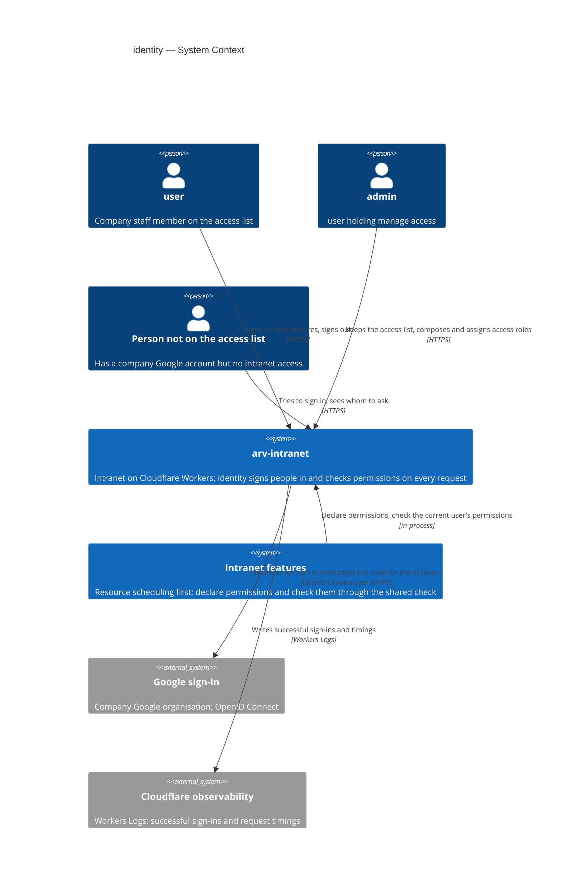

## 4. Solution strategy

<!-- 🎯 Навіщо: 3-4 СТРАТЕГІЧНІ СТОВПИ, з яких потім ростуть усі ADR. Без §4 кожен ADR    -->
<!--           виглядає випадковим — нема зонтика. ⭐ Найгустіша секція — тут ADR-gate    -->
<!--           спрацьовує майже завжди (рішення незворотні + мульти-модульні).            -->
<!-- 📋 Що писати: спершу Target surface(s), потім 3-4 стратегічні вибори.                -->
<!--           На кожен — заголовок + 2-3 речення rationale.                              -->
<!-- 📌 ПЕРШЕ рішення §4 — Target surface(s): ЩО САМЕ будуємо. Записується у frontmatter   -->
<!--           target_surfaces: [...] і гейтить §5 (один контейнер на поверхню) + усі       -->
<!--           наступні стадії. Деривиться з PRD §1 «для кого» + §4 ролей. → _shared/surfaces.md -->
<!-- 📌 Приклад: «Зберігати урок як таблицю блоків» — стовп, з якого виросло ADR-0001.    -->

**Target surface(s) (the first decision — what's being built):** `[backend-service, web-frontend]` ([ADR-0001](./adr/0001-build-backend-service-and-web-frontend-surfaces.md))

- **backend-service** — the `identity` module inside the private `arv-api` Worker owns sign-in completion, sessions, the access list, access roles, the permission catalog and the per-request permission check, and authors the HTTP contract web consumes.
- **web-frontend** — the public `arv-web` Worker gains the sign-in, sign-out and «not set up yet» screens, the session cookie, the root-level gate, and the admin screens for the access list and access roles; it *consumes* identity's contract through a typed per-feature client and authors none of its own.

**Top strategic choices (the seeds for ADRs):**

1. **UI-architecture (web-frontend): server-rendered, one sign-in gate at the web root** ([ADR-0002](./adr/0002-gate-every-web-page-at-the-root-with-a-server-only-session-cookie.md)). Screens are React Router loaders and actions that reuse the existing shadcn components in `apps/web/app/shared/ui` (Button, Input, Select, Table, Dialog, DropdownMenu) and the theme tokens in `app.css`; no new styling system. The session cookie is HttpOnly, Secure, `SameSite=Lax`, set and read only by the web server. A gate on the root route asks the api once per navigation who the user is and what they may do (for navigation such as showing «Access» only to admins); without a valid session it redirects to the sign-in page, carrying the page first asked for as a same-origin relative path (AC-01). The sign-in page only shows a «Sign in with Google» button; the Google redirect starts when the person chooses it, never on page load — otherwise, after sign-out (still signed in to Google, consent screen Internal) Google would hand the person straight back and sign them in again, and sign-out would not hold (AC-20). Only the sign-in, sign-in-return, sign-out and «not set up yet» routes sit outside the gate. The api still refuses every unauthenticated request on its own (§8) — the web gate is for UX and so that no page shell renders anonymously (AC-03, AC-20). Serves QG-1.
2. **Authentication: Google OpenID Connect with server-side sessions owned by identity** ([ADR-0003](./adr/0003-sign-in-with-google-oidc-and-server-side-sessions.md); resolves PRD §8 Q3 and the open «authentication source» question in repo ADR 0001). Sign-in uses the authorization-code flow with PKCE; the ID token is accepted only when its issuer, audience and expiry are valid, `email_verified` is true, the `hd` (hosted-domain) claim equals the configured company domain, and the email is on that domain (AC-02). A session is a random 256-bit token in the cookie; Postgres keeps only its SHA-256 hash, the user, and an absolute expiry of sign-in + 7 days. Sign-out ends that one session (AC-20); removal from the access list ends all of the user's sessions (AC-07). Because sessions are rows, the session lookup joins the same query as the access-list and permission lookup — no extra round-trip (QG-2).
3. **Permissions are declared in code by the module that checks them; the api host collects them into one catalog** ([ADR-0004](./adr/0004-declare-permissions-in-module-code-and-collect-them-in-the-host.md)). Each module exports its declarations — key (e.g. `scheduling:edit-allocations`, `identity:manage-access`), plain-language name, one-sentence description, feature — from its root; `apps/api/src/composition.ts`, the only place that knows every module, builds identity's `PermissionCatalog` port from them. Identity stores grants by key and never imports a feature module. A key an access role still grants but no module declares is a **retired permission**: it grants nothing, is flagged to admins, and cannot be added to a role; if a module declares it again under the same key, roles that still list it grant it again (AC-16).
4. **One shared check over a per-request, uncached actor** ([ADR-0005](./adr/0005-check-permissions-with-one-kernel-require-permission-over-a-per-request-actor.md); implements resource-scheduling's [ADR-0004](../resource-scheduling/adr/0004-resolve-permissions-into-actor-per-request.md)). On every authenticated request `IdentityApi.resolveActor` runs one query — session → user on the access list → access roles → granted keys — intersects the keys with the catalog, and the host puts the result on `Actor.User { id, permissions }` in `@arv/kernel`. Features call one `requirePermission(permission)` from `@arv/kernel`, which fails with a shared `PermissionDenied` (an anonymous actor fails with `Unauthenticated`); `@arv/platform` maps them once to new shared contract errors `Forbidden` (403) and `Unauthorized` (401). Nothing is cached anywhere — not in the isolate, not in Hyperdrive — so a revocation applies from the next request (QG-1, PRD §6 Revocation). Manage access grants nothing beyond itself (AC-19); a permission no module declares is never in the set (AC-18).

Each tactical decision in later sections should be traceable to one of these strategic seeds. Tactical decisions that *contradict* a strategic choice are red flags — surface them in §11 Risks.

## 5. Building block view

<!-- 🎯 Навіщо: ВНУТРІШНЯ ДЕКОМПОЗИЦІЯ — модулі, контейнери, БД. Статична топологія:   -->
<!--           хто з ким може говорити. Без §5 §6 (сценарії) не має словника учасників. -->
<!-- 📋 Що писати: 1 абзац про стиль (шари/гексагональна/clean/на подіях) +            -->
<!--           дерево папок + Mermaid C4Container.                                       -->
<!-- 📌 ОДИН Container на кожну оголошену target_surface (frontmatter): fullstack        -->
<!--           [backend-service, web-frontend] = backend-API container + web/SPA container; -->
<!--           [backend-service, mobile-app] = API + mobile app. Container(web, …) нижче — -->
<!--           лише приклад однієї поверхні; додай/заміни під оголошене у §4. → _shared/surfaces.md -->
<!-- 📌 Приклад: «web-app, content-api, media-worker, postgres, s3, cdn».                -->

The feature follows the repo's **modular monolith with hexagonal modules** (repo ADR 0001) with no divergence. It extends the existing `identity` module rather than adding one: users and the access list, sessions, access roles, grants, the permission catalog port and actor resolution all live in `modules/identity` and its `identity` Postgres schema ([ADR-0006](./adr/0006-keep-sign-in-sessions-and-access-roles-in-one-identity-module.md)), because the per-request check is one query joining sessions, users and grants (QG-2) and the last-admin guard spans users, roles and grants in one transaction (AC-14) — neither is possible across module schemas. The module graph does not change (`identity → (none)`); identity imports no feature module, and features reach identity only through `@arv/kernel`'s actor and their own permission declarations (ADR-0004, ADR-0005).

Sign-in is split along the trust boundary ([ADR-0007](./adr/0007-split-sign-in-into-a-web-browser-leg-and-an-identity-server-leg.md)): the **web** owns the browser leg — it asks identity for Google's sign-in address, keeps the anti-forgery `state`, the PKCE verifier and `returnTo` in a short-lived (10-minute) HttpOnly cookie, checks `state` on return, sets and clears the session cookie, and forwards the session token as `Authorization: Bearer` on every api call; **identity** owns the server leg — it builds the Google address from its own configuration, exchanges the code with the Google client secret, checks the claims, applies the access list and the first-admin rule, and creates the session. The Google client secret, the company domain and the first-admin address exist only in the api.

**Tactical decisions inside the module (inline, no ADR):**
- **Last-admin guard (AC-14): apply, verify, roll back.** Each of the four actions that can remove manage access — remove a user, take an access role from a user, remove manage access from a role, delete a role — runs in one `UnitOfWork.transactional`: apply the change, count users still holding `identity:manage-access` through a declared grant, and if none remain fail with `LastAdminRequired`, which rolls everything back. One rule covers every action and multi-target changes alike. Two admins removing each other at the same instant can both pass under Postgres' default isolation — accepted by PRD §6.1, recovered through the configured first admin (AC-15) or the runbook (PRD §8 Q4). Needs `UnitOfWorkLive` in `@arv/db`, planned by resource-scheduling ADR-0006; whichever feature is built first implements it.
- **First-admin bootstrap (AC-15)** runs inside sign-in completion: only when no user holds manage access and the verified email equals the configured first-admin address, identity upserts that user under the name Google reports and gives them the ordinary access role «Admin» (created holding only manage access, or reused with manage access added). Once any admin exists, the address is ordinary.
- **Removal revokes, it does not silently delete:** removing a user revokes all their sessions with the reason «access removed», so their next request gets «you no longer have access» (AC-07) rather than a generic sign-in prompt; revoked and expired rows are purged lazily.
- **Uniqueness by normalised key:** emails are stored lower-cased and trimmed (AC-06); access-role names keep their display form but are unique on lower-cased, trimmed text (AC-10).

**Internal decomposition:**

```
modules/identity/                        @arv/identity — schema `identity`; calls no module
└── src/
    ├── domain/            user.ts (normalised email), session.ts, access-role.ts (name key, granted keys),
    │                      sign-in-eligibility.ts (claims → eligible | refused), last-admin.ts, errors.ts
    ├── application/       ports.ts (UserRepository, SessionRepository, AccessRoleRepository, GoogleSignIn,
    │                      PermissionCatalog, IdentityConfig); begin-sign-in, complete-sign-in (+ first admin),
    │                      resolve-actor, sign-out, access-list and access-role use cases, identity-api.ts (facade)
    ├── infrastructure/    schema.ts (users, sessions, access_roles, access_role_permissions, user_access_roles),
    │                      drizzle-*-repository.ts, google-sign-in.ts (adapter over the approved OIDC library)
    ├── http/              routes.ts (public: sign-in begin/complete; authenticated: me, sign-out,
    │                      access list, access roles, catalog), presenter.ts
    ├── permissions.ts     identity's declarations: identity:manage-access
    ├── layer.ts · index.ts
packages/kernel/src/       actor.ts (Actor.User { id, permissions }), permission.ts (Permission,
                           PermissionDeclaration, requirePermission, PermissionDenied, Unauthenticated)
packages/contracts/src/    shared: Forbidden, Unauthorized · identity: sign-in, me, access-list, access-role DTOs
packages/platform/src/http PermissionDenied → Forbidden 403, Unauthenticated → Unauthorized 401
packages/db/src/           UnitOfWorkLive (if not already built by resource-scheduling)
apps/api/src/
├── middleware/            authenticate: Bearer → IdentityApi.resolveActor; refuses everything without
│                          a valid session except the public sign-in routes and /health
├── composition.ts         PermissionCatalog from every module's declarations; IdentityConfig from env
└── env.ts                 GOOGLE_CLIENT_ID, GOOGLE_CLIENT_SECRET (secrets); COMPANY_EMAIL_DOMAIN,
                           FIRST_ADMIN_EMAIL, SIGN_IN_RETURN_URL (vars)
apps/web/app/
├── root.tsx               root gate (ADR-0002): session → me → redirect to the sign-in page with returnTo
├── shared/lib/            session.server.ts (session + sign-in-state cookies); api.server.ts forwards Bearer
└── features/identity/     routes: sign-in, sign-in-return, sign-out, not-set-up, access/users, access/roles;
                           components from shared/ui; identity.server.ts (hc<IdentityRoutes>)
```

**C4 Container (L2):**

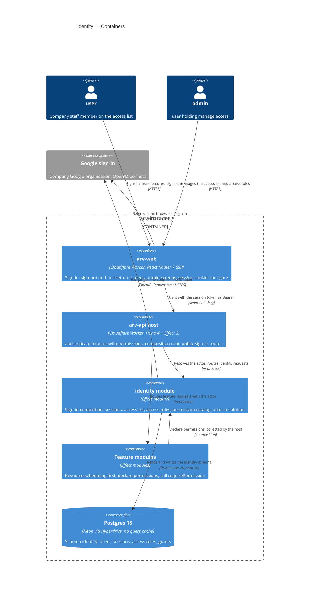

## 6. Runtime view

<!-- 🎯 Навіщо: ПОТІК У RUNTIME для 1-2 критичних сценаріїв. Хто з ким коли і у якому     -->
<!--           порядку говорить. Без §6 §5 — лише купа коробок без життя.                  -->
<!-- 📋 Що писати: Mermaid sequenceDiagram. Учасники — імена з §5 (не вигадуй нові!).      -->
<!--           Повідомлення семантичні («складає чорновик»), БЕЗ HTTP-методів/шляхів —     -->
<!--           ендпоінт-рівневі sequence-діаграми зʼявляться у stage 06 (api-forge).        -->
<!-- ⏳ RESERVED FOR SEQUENCES: architecture-design сіє лише primary flow(s) тут.          -->
<!--           complete-sequence-diagrams (stage 06) ДОПОВНЮЄ §6 кожним критичним flow /    -->
<!--           кожним §5 AC — без обмеження. Не намагайся покрити все тут.                  -->
<!-- 📌 Приклад: «methodist → web-app: складає чорновик → web-app → content-api: зберегти». -->

Participants are the §5 containers. Messages are semantic; endpoint-level detail arrives with `api-forge`. These three flows are the seeds — `complete-sequence-diagrams` covers every remaining AC.

**Critical flow 1: Sign in with company Google (AC-01, AC-02, AC-03, AC-15)**

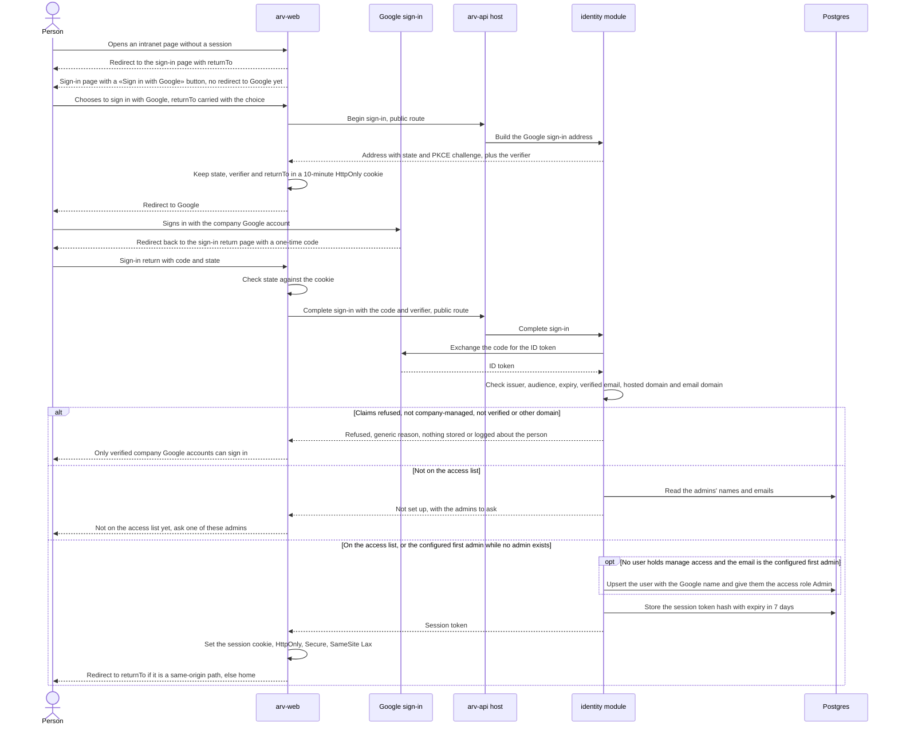

**Critical flow 2: Access check on every request (AC-07, AC-17, AC-18, AC-19, AC-20; Fail closed)**

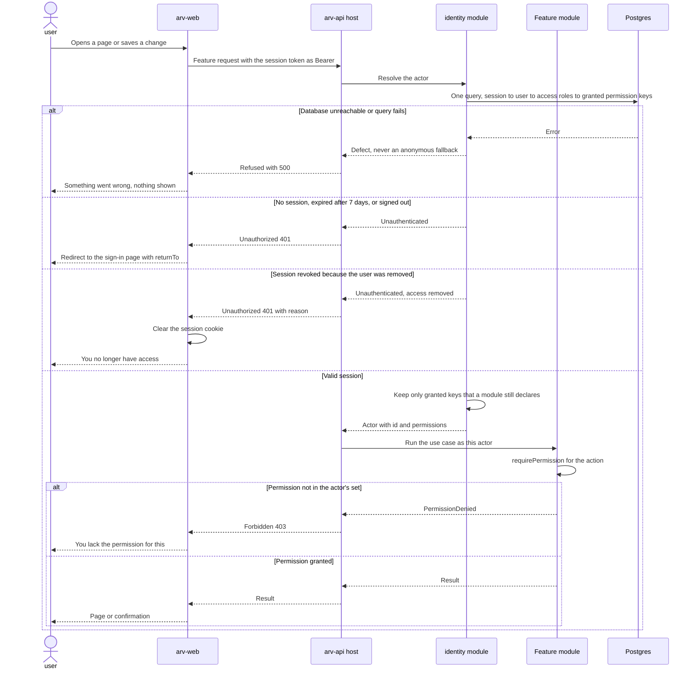

**Critical flow 3: Admin change guarded against losing the last admin (AC-07, AC-11, AC-14)**

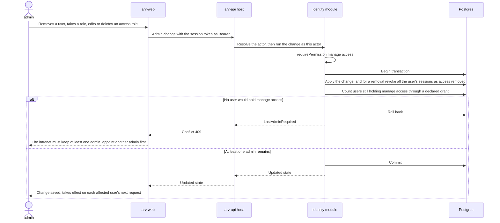

### Flow 4: Add a user to the access list

Realizes US-03 (AC-04, AC-05, AC-06, AC-08) and the pre-selected role in the add form (AC-13).

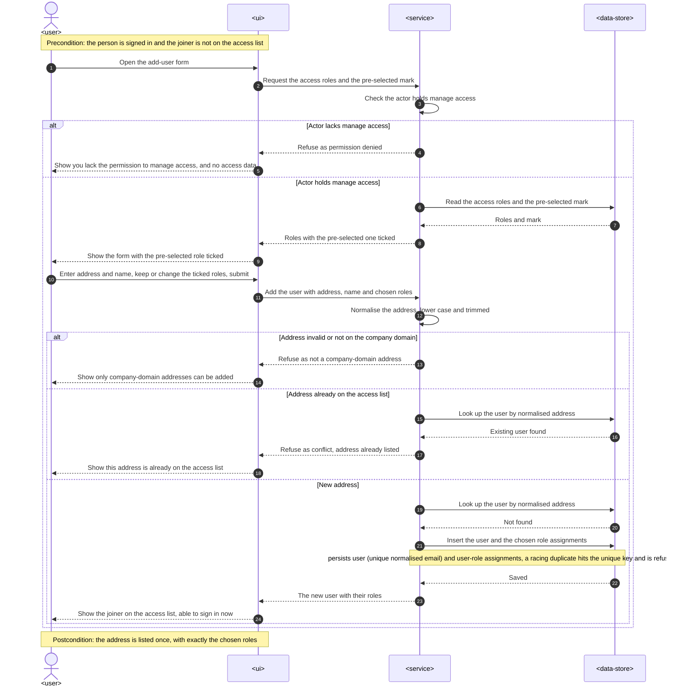

### Flow 5: Correct a user's name

Realizes US-03 (AC-21).

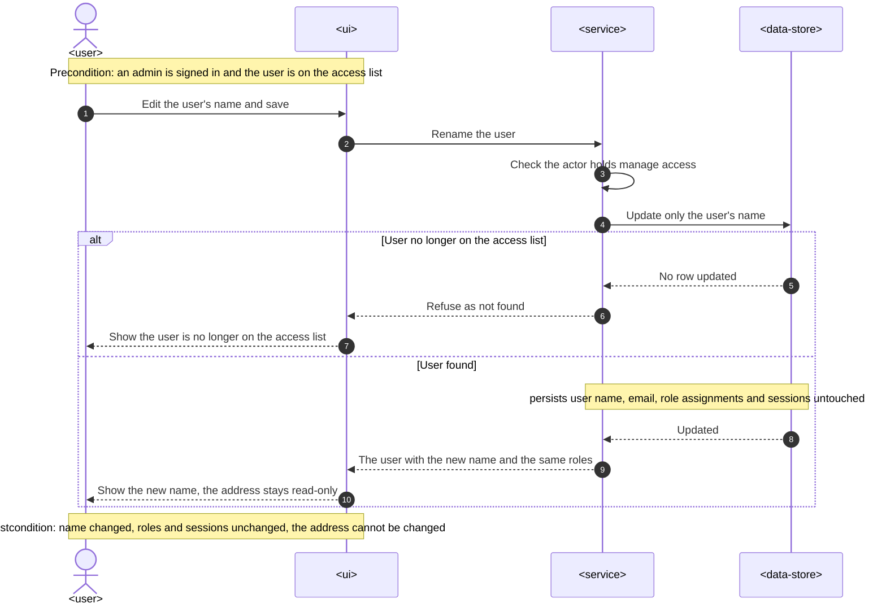

### Flow 6: Create or rename an access role

Realizes US-04 (AC-09, AC-10, and AC-16 «a retired permission cannot be added»). Removing manage access from a role runs the last-admin guard of Critical flow 3.

```mermaid
sequenceDiagram
    autonumber
    actor U as <user>
    participant UI as <ui>
    participant S as <service>
    participant D as <data-store>

    Note over U,UI: Precondition: an admin is signed in
    U->>UI: Open the access-role form
    UI->>S: Request the permission catalog
    S->>S: Check the actor holds manage access
    S->>S: List declared permissions with plain-language name, description and owning feature
    S-->>UI: The catalog
    UI-->>U: Show each permission in plain words, grouped by feature
    U->>UI: Enter the name, pick permissions, save
    UI->>S: Create the role, or rename and change it
    S->>S: Normalise the name key, lower case and trimmed
    alt A picked permission is not declared by any module
        S-->>UI: Refuse as a retired permission
        UI-->>U: Show the retired permission cannot be added
    else Another role already has the same name key
        S->>D: Look up roles by name key
        D-->>S: Another role found
        S-->>UI: Refuse as conflict, name taken
        UI-->>U: Show an access role with that name already exists
    else Name free and every picked permission declared
        S->>D: Look up roles by name key
        D-->>S: No other role
        S->>D: Save the role and its permission keys
        Note over S,D: persists access role (unique name key) and its granted permission keys
        D-->>S: Saved
        S-->>UI: The role with its permissions in plain words
        UI-->>U: Show the role listed, held by nobody yet
    end
    Note over U,UI: Postcondition: role names are unique by key and no user holds a new role until assigned
```

### Flow 7: Delete an access role after a warning

Realizes US-04 (AC-11 delete with warning and pre-selected mark) and US-06 (AC-14 for deleting a role).

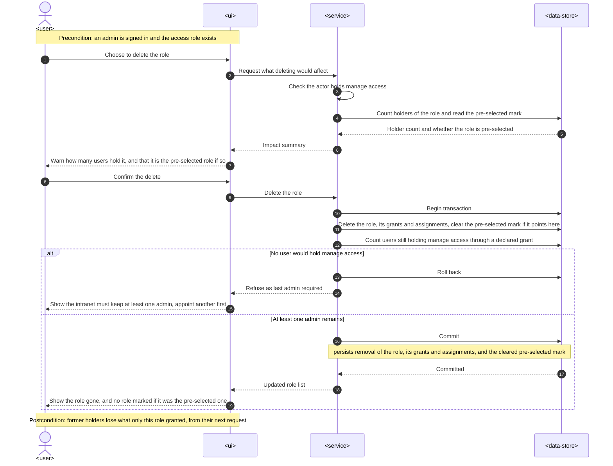

### Flow 8: Assign or take away access roles

Realizes US-05 (AC-12) and US-06 (AC-14 for taking a role from a user).

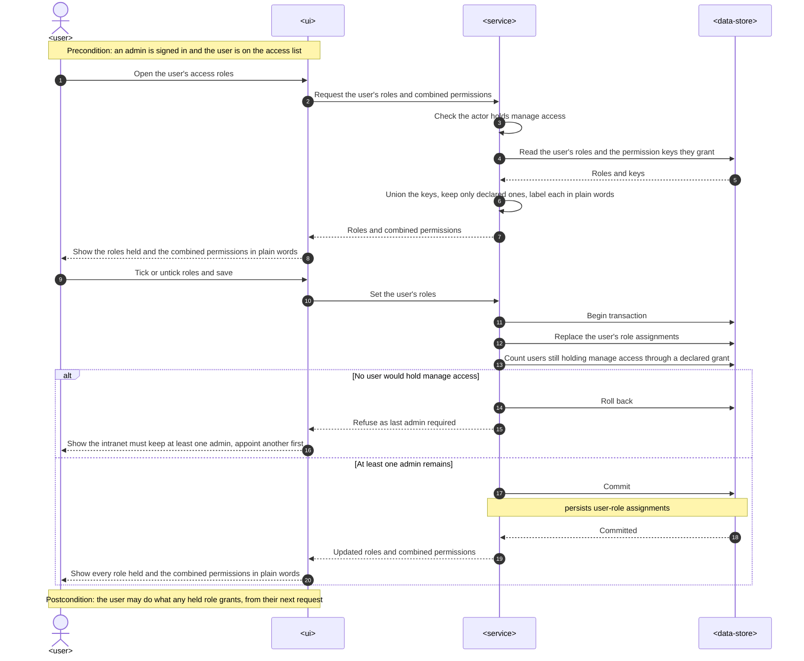

### Flow 9: Mark or clear the pre-selected access role

Realizes US-05 (AC-13).

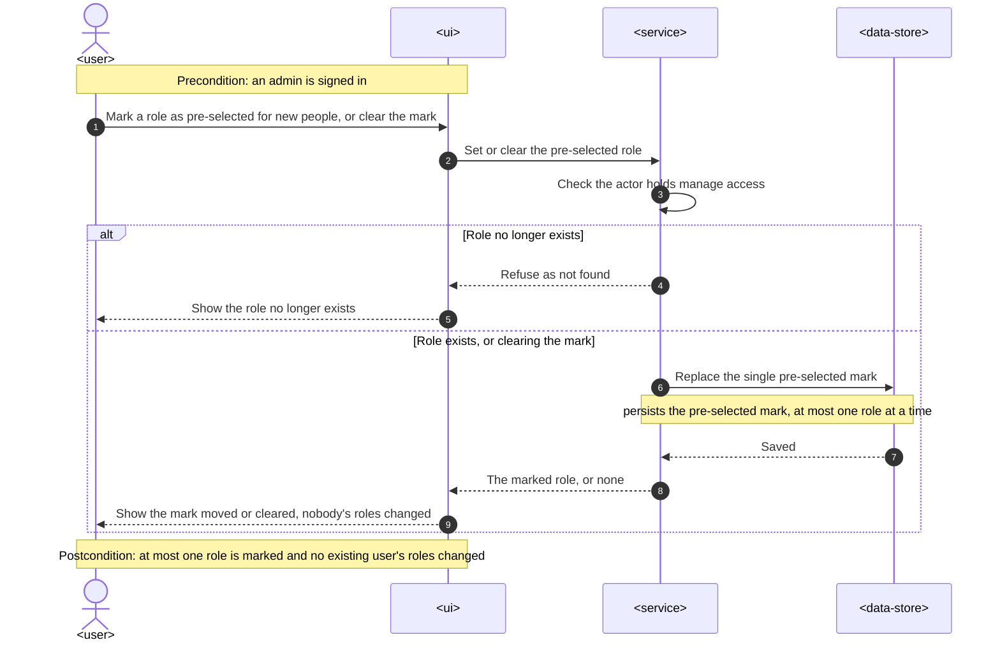

### Flow 10: Review access roles with retired permissions flagged

Realizes US-07 (AC-16 admin side). The holder side, refused because retired keys grant nothing, is Critical flow 2.

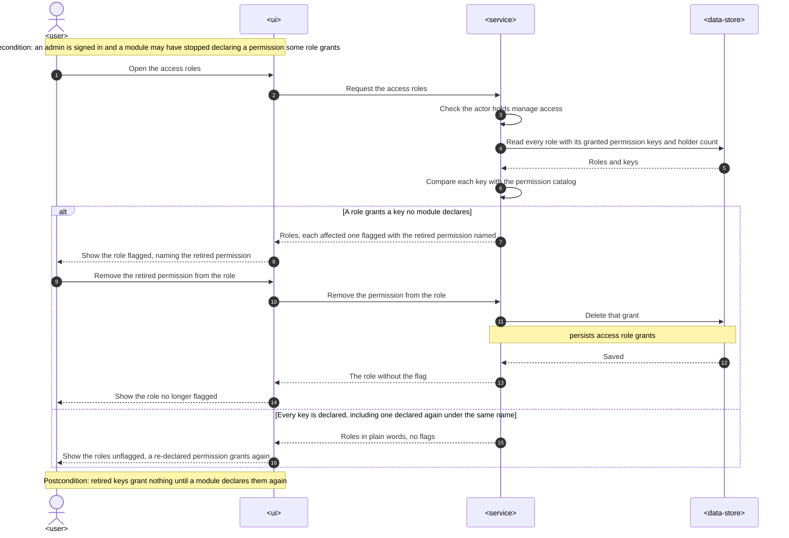

### Flow 11: Sign out

Realizes US-09 (AC-20 sign-out). Expiry after 7 days is the expired-session branch of Critical flow 2.

```mermaid
sequenceDiagram
    autonumber
    actor U as <user>
    participant UI as <ui>
    participant S as <service>
    participant D as <data-store>

    Note over U,UI: Precondition: the user is signed in in this browser
    U->>UI: Choose to sign out
    UI->>S: Sign out this session with its session token
    S->>D: Remove this session by its token hash
    alt Session already expired, revoked or unknown
        D-->>S: No session removed
        S-->>UI: Treat as already signed out
    else Session found
        Note over S,D: persists removal of this session only, other sessions kept
        D-->>S: Removed
        S-->>UI: Signed out
    end
    UI->>UI: Clear the session cookie
    UI-->>U: Show the sign-in page, still signed in to Google; nothing starts sign-in until the user chooses it
    Note over U,UI: Postcondition: the token is unusable from anywhere and other devices stay signed in
```

### Coverage: US/AC → flows

| ID | Realized by (§6 heading) | How | Note |
|---|---|---|---|
| US-01 | Critical flow 1: Sign in with company Google | flow | |
| US-02 | Critical flow 1: Sign in with company Google | flow | `else Not on the access list` |
| US-03 | Flow 4: Add a user to the access list, Flow 5: Correct a user's name, Critical flow 3: Admin change guarded against losing the last admin | flow | removal is Critical flow 3 |
| US-04 | Flow 6: Create or rename an access role, Flow 7: Delete an access role after a warning, Critical flow 3: Admin change guarded against losing the last admin | flow | changing a role's permissions is Critical flow 3 |
| US-05 | Flow 8: Assign or take away access roles, Flow 9: Mark or clear the pre-selected access role | flow | |
| US-06 | Critical flow 3: Admin change guarded against losing the last admin, Flow 7: Delete an access role after a warning, Flow 8: Assign or take away access roles, Critical flow 1: Sign in with company Google | flow | first admin is the `opt` in Critical flow 1 |
| US-07 | Flow 10: Review access roles with retired permissions flagged, Critical flow 2: Access check on every request | flow | |
| US-08 | Critical flow 2: Access check on every request | flow | |
| US-09 | Flow 11: Sign out, Critical flow 2: Access check on every request | flow | expiry is a Critical flow 2 branch |
| AC-01 | Critical flow 1: Sign in with company Google | flow | |
| AC-02 | Critical flow 1: Sign in with company Google | branch | `alt Claims refused, not company-managed, not verified or other domain` |
| AC-03 | Critical flow 1: Sign in with company Google, Critical flow 2: Access check on every request | branch | `else Not on the access list` (empty admin list means «ask your manager»); opening a page without a session is `else No session, expired after 7 days, or signed out` |
| AC-04 | Flow 4: Add a user to the access list | flow | |
| AC-05 | Flow 4: Add a user to the access list | branch | `alt Address invalid or not on the company domain` |
| AC-06 | Flow 4: Add a user to the access list | branch | `else Address already on the access list` |
| AC-07 | Critical flow 3: Admin change guarded against losing the last admin, Critical flow 2: Access check on every request | flow | next request is `else Session revoked because the user was removed` |
| AC-08 | Flow 4: Add a user to the access list, Critical flow 2: Access check on every request | branch | `alt Actor lacks manage access` · `alt Permission not in the actor's set` |
| AC-09 | Flow 6: Create or rename an access role | flow | |
| AC-10 | Flow 6: Create or rename an access role | branch | `else Another role already has the same name key` |
| AC-11 | Flow 7: Delete an access role after a warning, Critical flow 3: Admin change guarded against losing the last admin | flow | |
| AC-12 | Flow 8: Assign or take away access roles | flow | |
| AC-13 | Flow 9: Mark or clear the pre-selected access role, Flow 4: Add a user to the access list | flow | |
| AC-14 | Critical flow 3: Admin change guarded against losing the last admin, Flow 7: Delete an access role after a warning, Flow 8: Assign or take away access roles | branch | `alt No user would hold manage access` |
| AC-15 | Critical flow 1: Sign in with company Google | branch | `opt No user holds manage access and the email is the configured first admin` |
| AC-16 | Flow 10: Review access roles with retired permissions flagged, Flow 6: Create or rename an access role, Critical flow 2: Access check on every request | flow | `alt A picked permission is not declared by any module` in Flow 6 · «Keep only granted keys that a module still declares» in Critical flow 2 |
| AC-17 | Critical flow 2: Access check on every request | branch | `alt Permission not in the actor's set` |
| AC-18 | Critical flow 2: Access check on every request | branch | `alt Permission not in the actor's set` (undeclared keys are dropped first) |
| AC-19 | Critical flow 2: Access check on every request | branch | `alt Permission not in the actor's set` |
| AC-20 | Flow 11: Sign out, Critical flow 2: Access check on every request | flow | expiry is `else No session, expired after 7 days, or signed out` |
| AC-21 | Flow 5: Correct a user's name | flow | |

Coverage: 9/9 user stories · 21/21 ACs — 0 non-runtime N/A.

**Flags:**
- No new participants: every generic participant in Flows 4–11 maps to a §5 container (`<ui>` arv-web, `<service>` arv-api host + identity module, `<data-store>` Postgres).
- The three seeded Critical flows keep their concrete §5 names (they predate this stage and were left untouched).
- The pre-selected mark (Flows 4, 7, 9) needs a home holding at most one role — for `generate-data-model`.
- Lookups by normalised email, by role name key, by session token hash and by role holder count are the index hints from the persist notes — for `generate-data-model`.
- No ADR-worthy decision surfaced.

## 7. Deployment view

<!-- 🎯 Навіщо: ТОПОЛОГІЯ, яку DevOps має знати без читання Helm-чартів — скільки реплік,  -->
<!--           де живе фоновий обробник, ПРИ ЯКИХ ЧИСЛАХ масштабуємось.                     -->
<!-- 📋 Що писати: 2-3 речення про топологію + метрики + алерти + конкретні числа-пороги.   -->
<!-- 📌 Приклад: «500 IC → партиціонування за кварталом» (не «при зростанні подумаємо»).    -->
<!-- 🎯 Можна N/A для XS/S функцій, що переюзають існуюче розгортання без змін.            -->

No new deployable. Identity ships inside the existing `arv-web` and `arv-api` Workers (Cloudflare runs and scales them; there are no replicas to size) and the existing Neon Postgres 18 behind the `HYPERDRIVE` binding, whose main config keeps query caching disabled. Deploy order for the release: apply the `identity` schema migrations to Neon → deploy `arv-api` → deploy `arv-web` (web calls api endpoints that must already exist).

**New configuration (api only — web holds no Google or identity settings, ADR-0007):**
- Secrets (`wrangler secret put`): `GOOGLE_CLIENT_ID`, `GOOGLE_CLIENT_SECRET`.
- Vars: `COMPANY_EMAIL_DOMAIN` (the single company domain, PRD §1), `FIRST_ADMIN_EMAIL` (AC-15), `SIGN_IN_RETURN_URL` (web's sign-in return page registered with Google).
- Local development uses `.dev.vars` and a separate Google OAuth client whose redirect is the local web origin; production and local clients never share a secret.
- **Custom domain for `arv-web`** (critic F6, 2026-11-03): today `apps/web/wrangler.jsonc` has no `routes`, so web is served on `workers.dev`. Identity adds a custom-domain route for `arv-web` on a company-controlled Cloudflare zone — needed for a stable Google redirect URI and for zone-level rules — plus a **Rate Limiting rule** on that zone for the sign-in and sign-in-return paths (§8). Without the zone the rule cannot apply (§11).
- Google Cloud: one OAuth client of type «Web application» in the company's Google Cloud project, with the consent screen's user type set to **Internal**, so Google itself only admits accounts of the company's Google organisation — a second line of defence behind identity's `hd` / `email_verified` / domain checks (AC-02).

**Monitoring:**
- Workers Logs (observability is already enabled on both Workers): identity writes one structured event `identity.sign_in.succeeded` carrying the `userId` only — no email, no name, no Google claims. Refused sign-ins write nothing (AC-02, AC-03). Workers Logs keep events for 7 days.
- Sign-in completion timing: web's sign-in return handler logs `signInCompleteMs` (from receiving Google's return to issuing the redirect to the first page); p95 read against 800 ms (PRD §6).
- Google availability: identity logs `identity.google.unavailable` (timestamp only, no personal data) when Google's token endpoint fails or times out; these minutes are excluded from the availability figure (PRD §6 «excluding Google outages»).
- Access-check overhead: the api's `authenticate` middleware logs `accessCheckMs` per request; p95 is read with a Workers Logs query against the 25 ms target (PRD §6, §7).
- Availability of sign-in and the access check: share of non-5xx responses on the api's sign-in and authenticated routes in Workers Analytics, read monthly against 99.5% (PRD §6).
- Tracing: Hono `requestId` already tags each api request; no further tracing in v1.
- Alerts: none in v1 (the repo has no alerting yet); the Tech Lead reviews the three numbers above weekly during the first month.

**Neon compute:** production keeps Neon's default scale-to-zero (the compute suspends after a few idle minutes and the next query waits for it to wake). The cold-start effect on the 25 ms and 800 ms p95 targets is measured after launch from `accessCheckMs` and the sign-in timing, and scale-to-zero is turned off if either p95 is missed (§11).

**Scaling thresholds:**
- Capacity target (PRD §6): 100 users and 50 access roles — at most a few hundred session rows (≤ 7 days each) and a few hundred role-permission rows; the hot path is one indexed lookup on the session token hash plus small joins. Comfortable in one schema with no partitioning.
- Revisit only if users exceed ~1,000 or the access check's p95 approaches 25 ms with Neon awake.

## 8. Crosscutting concepts

<!-- 🎯 Навіщо: НАСКРІЗНІ ПАТЕРНИ, які перетинають кілька модулів: логування, помилки,    -->
<!--           авторизація, ID strategy, outbox, кеш. ⭐ Друга найгустіша секція.          -->
<!--           Якщо патерн всередині одного модуля — він НЕ сюди. Якщо це конвенція        -->
<!--           проєкту в цілому — у CLAUDE.md.                                              -->
<!-- 📋 Що писати: таблиця концепт / конвенція / де визначено. Один рядок на концепт.      -->
<!-- 📌 Приклад: «UUID v7 (час+випадковий, сортується) у app-layer» — як default з CLAUDE.md. -->

Repo conventions apply unchanged unless a row says otherwise; identity adds the rows marked *new*.

| Concept | Convention | Where defined |
|---|---|---|
| Logging | Repo default (Hono `logger`, `console`; Workers Logs). Identity never logs an email, name, session token, code or Google claim; refused sign-ins log nothing. Allowed identity events: `identity.sign_in.succeeded` (`userId` only), `identity.google.unavailable` (no personal data), and the timing fields `accessCheckMs` and `signInCompleteMs` | ARCHITECTURE.md · here · PRD §6.1 |
| Authentication *(new)* | Session cookie `__Host-arv_session` — HttpOnly, Secure, `SameSite=Lax`, `Path=/`, lifetime no longer than the session's expiry — set and cleared only by the web server, which forwards the token to the api as `Authorization: Bearer`. The api's `authenticate` middleware refuses every route without a valid session except an explicit public list (sign-in begin/complete, `/health`) | [ADR-0002](./adr/0002-gate-every-web-page-at-the-root-with-a-server-only-session-cookie.md), [ADR-0003](./adr/0003-sign-in-with-google-oidc-and-server-side-sessions.md), [ADR-0007](./adr/0007-split-sign-in-into-a-web-browser-leg-and-an-identity-server-leg.md) |
| Authorization *(new)* | Deny by default. Use cases call `requirePermission(permission)` from `@arv/kernel` over `CurrentActor`; the actor's set is granted keys ∩ catalog, resolved per request with no cache. No feature builds its own access check (PRD §7 shared-check adoption, checked at review) | [ADR-0005](./adr/0005-check-permissions-with-one-kernel-require-permission-over-a-per-request-actor.md) |
| Permission declaration *(new)* | Each module declares its permissions in `src/permissions.ts`, exported from its root: key `<module>:<kebab-action>` (e.g. `identity:manage-access`, `scheduling:edit-allocations`), plain-language name, one-sentence description, feature; the host composition collects them; keys are never renamed once granted (rename = retire) | [ADR-0004](./adr/0004-declare-permissions-in-module-code-and-collect-them-in-the-host.md) |
| CSRF *(new)* | `SameSite=Lax` session cookie; state changes only through POST actions; the web server rejects non-GET requests whose `Origin` is not its own; the sign-in round-trip is bound by OAuth `state` and PKCE | here |
| Open redirect *(new)* | `returnTo` is accepted only as a same-origin path that starts with `/` and not `//`; anything else returns the user to the home page (AC-01) | [ADR-0002](./adr/0002-gate-every-web-page-at-the-root-with-a-server-only-session-cookie.md) |
| Rate limiting *(new)* | A Cloudflare Rate Limiting rule on the web zone's sign-in and sign-in-return paths (a zone rule, no code), with a per-IP threshold tuned so a whole office behind one address can still sign in at the start of the day; the exact threshold is set at deploy time. Other routes are not rate-limited in v1 | here, §7 |
| Error handling | Repo default: domain `Schema.TaggedError`s → presenter → shared contract errors; DB failures are defects → 500, which is how identity fails closed. New shared contract errors `Unauthorized` (401) and `Forbidden` (403), mapped once in `@arv/platform`; identity's `LastAdminRequired` → `Conflict` (409); duplicate email or role name → `Conflict` (409); non-company address → validation error (400) | CLAUDE.md · ARCHITECTURE.md §Errors · [ADR-0005](./adr/0005-check-permissions-with-one-kernel-require-permission-over-a-per-request-actor.md) |
| ID strategy | Repo default: UUIDv7 from Postgres. The session token is not an id: 256 random bits from Web Crypto, stored only as its SHA-256 hash | ARCHITECTURE.md §Data · [ADR-0003](./adr/0003-sign-in-with-google-oidc-and-server-side-sessions.md) |
| Normalisation *(new)* | Emails stored lower-cased and trimmed, unique (AC-06); access-role names unique on lower-cased, trimmed text, displayed as entered (AC-10) | §5 |
| Transactions | Repo default `UnitOfWork`; admin changes that can affect manage access run in one transaction (last-admin guard). Transactions stay short and never contain the Google call (Hyperdrive holds one connection per transaction) | ARCHITECTURE.md §Cloudflare constraints · §5 |
| Caching | None for identity data — no in-isolate cache, no KV, and only Hyperdrive's uncached main config may serve identity queries (QG-1) | [ADR-0005](./adr/0005-check-permissions-with-one-kernel-require-permission-over-a-per-request-actor.md) |
| Configuration and secrets | Google client id and secret as api Worker secrets; company domain, first-admin address and sign-in return URL as api vars; web holds none | §7 |
| Internationalisation | N/A — English UI, matching the existing web | — |
| Observability | `accessCheckMs` per api request; availability from Workers Analytics | §7 |
| Outbox / events | N/A — identity publishes no events in v1; features consume the per-request actor, not events | — |

## 9. Architecture decisions

<!-- 🎯 Навіщо: ЗВОРОТНИЙ ІНДЕКС на папку adr/. `ls adr/` дає файли, §9 дає семантику —    -->
<!--           чому вони існують, до якого зрізу SAD привʼязані, у якому статусі.           -->
<!-- 📋 Що писати: таблиця з 4 колонками. Один рядок на ADR. Mixed status — це OK.         -->
<!-- 📌 Приклад: «0001 | Зберігати урок як таблицю блоків | Accepted | §4».                -->

| # | Title | Status | Section |
|---|---|---|---|
| [0001](./adr/0001-build-backend-service-and-web-frontend-surfaces.md) | Build identity as a backend service and a web frontend | Accepted | §4 |
| [0002](./adr/0002-gate-every-web-page-at-the-root-with-a-server-only-session-cookie.md) | Gate every web page at the root with a server-only session cookie | Accepted | §4 |
| [0003](./adr/0003-sign-in-with-google-oidc-and-server-side-sessions.md) | Sign in with Google OpenID Connect and keep server-side sessions in identity | Accepted | §4 |
| [0004](./adr/0004-declare-permissions-in-module-code-and-collect-them-in-the-host.md) | Declare permissions in each module's code and collect them in the api host | Accepted | §4 |
| [0005](./adr/0005-check-permissions-with-one-kernel-require-permission-over-a-per-request-actor.md) | Check permissions with one kernel `requirePermission` over a per-request, uncached actor | Accepted | §4 |
| [0006](./adr/0006-keep-sign-in-sessions-and-access-roles-in-one-identity-module.md) | Keep sign-in, sessions and access roles in one `identity` module | Accepted | §5 |
| [0007](./adr/0007-split-sign-in-into-a-web-browser-leg-and-an-identity-server-leg.md) | Split sign-in into a web browser leg and an identity server leg | Accepted | §5 |

ADR files live under `docs/features/identity/adr/NNNN-<title>.md`.

Related decisions outside this folder:
- ADR-0003 resolves the «Authentication source» open question in repo [ADR 0001](../../adr/0001-modular-monolith.md) and PRD §8 Q3; `ARCHITECTURE.md` (module catalog, Open questions) is updated in the implementation PR.
- ADR-0005 implements resource-scheduling [ADR-0004](../resource-scheduling/adr/0004-resolve-permissions-into-actor-per-request.md) (permissions on `Actor`, resolved per request); the `UnitOfWorkLive` used by the last-admin guard is the one planned in resource-scheduling [ADR-0006](../resource-scheduling/adr/0006-implement-unit-of-work-without-outbox.md).

## 10. Quality requirements

<!-- 🎯 Навіщо: ДЕРЕВО ЯКОСТЕЙ (Quality Tree) — беремо мету з §1 і розкладаємо на          -->
<!--           конкретні листя: тести, метрики, конфіги, drill-и. ⭐ Без §10 §1 — це       -->
<!--           маніфест. З §10 кожна декларація мапиться на щось, ЩО МОЖНА ДОВЕСТИ.        -->
<!-- 📋 Що писати: на кожну якість з §1 — When / Then / How verify. Числа з PRD §6 NFR     -->
<!--           ДОСЛІВНО (не округлюй p95 ≤250мс до ≤300мс — це F6-помилка критика).        -->
<!-- 📌 Приклад: «p95 ≤500 мс на UPDATE блоку, перевіримо k6 load test 100 req/s».        -->

Each top-3 goal from §1 expanded into full scenarios. Every number is quoted from PRD §6; nothing is rounded or added. Integration tests run in workerd against the real `arv_test` database (`pnpm test:integration`); production numbers come from the sources in §7.

**QG-1. Revocation and fail-closed access**

*Scenario 1a — Revocation (PRD §6 Revocation; AC-07, AC-11, AC-17)*
- **When:** an admin's removal of a user from the access list, or a permission change (removing a permission from an access role, taking an access role from a user, deleting an access role), is confirmed, and the affected user's next request arrives with their existing session.
- **Then:** 0 requests accepted after a removal from the access list or a permission change is confirmed — the removed user gets «no longer have access» (401), the user who lost a permission gets 403 on the action it guarded.
- **How verify:** integration test in CI `apps/api/test/integration/identity/revocation.test.ts` — sign in two seeded users, confirm each change type through the admin routes, then assert the very next request of the affected user is refused (401 or 403) and the unaffected user is still served.

*Scenario 1b — Session lifetime (PRD §6 Session lifetime; AC-07, AC-20)*
- **When:** a session reaches 7 days since sign-in, or the user signs out (also replaying a copy of the signed-out cookie from another client), or the user is removed from the access list.
- **Then:** ≤ 7 days from sign-in (absolute); 0 requests accepted on a session after its sign-out or after the user's removal from the access list; the user's other sessions survive their own sign-out on one device.
- **How verify:** integration test in CI `apps/api/test/integration/identity/sessions.test.ts` — sessions seeded with an expiry in the past are refused; after sign-out a replayed token is refused while a second session of the same user is accepted; after removal every session of the user is refused.

*Scenario 1c — Fail closed (PRD §6 Fail closed)*
- **When:** the user's access-list membership or permissions cannot be determined — the database is unreachable or the resolution query fails.
- **Then:** 100% of intranet requests refused when the user's access-list membership or permissions cannot be determined (500, never served as anonymous or with stale permissions).
- **How verify:** fault-injection test in CI `apps/api/test/integration/identity/fail-closed.test.ts` — run every authenticated route with a database Layer that fails (and once with an unreachable connection string) and assert no 2xx; unit test in `modules/identity` that `resolveActor` turns repository failure into a defect, never `Anonymous`.

**QG-2. Access-check overhead (and the other latency targets under load)**

*Scenario 2a — Access check (PRD §6 Latency p95 — access check)*
- **When:** any authenticated request is handled, at 100 users and 50 access roles.
- **Then:** the access check added to every request (access list + permissions) is ≤ 25 ms p95.
- **How verify:** production request timing, access-check step vs total — the `accessCheckMs` field logged by `authenticate` (§7), p95 read weekly in the first month; before launch, the k6 load test below.

*Scenario 2b — Sign-in completion and admin actions (PRD §6 Latency p95 rows)*
- **When:** a person returns from Google to the sign-in return page; an admin adds or removes a user, saves an access role or assigns an access role.
- **Then:** sign-in completion (from Google's return to the first intranet page) ≤ 800 ms p95; admin access actions ≤ 500 ms p95.
- **How verify:** production server timing of the sign-in completion step (logged by web's sign-in return handler) and production request timing of the admin routes in Workers Logs.

*Scenario 2c — Capacity headroom (PRD §6 Capacity headroom)*
- **When:** the database holds 100 users and 50 access roles.
- **Then:** the three latency targets above hold at 100 users and 50 access roles.
- **How verify:** seeded load test in CI with **k6** (approved 2026-11-03 as a new CI tool — see §11): a CI job seeds `arv_test` with 100 users, 50 access roles and their sessions, starts the web and api Workers locally (`wrangler dev`) with Google replaced by a test double, and runs `e2e/load/identity.k6.js` with thresholds taken verbatim from PRD §6: **access check ≤ 25 ms p95** read from the `accessCheck` entry of the api's `Server-Timing` response header (the access-check step, not the whole request) as a k6 custom Trend, `p(95)<=25`; **sign-in completion ≤ 800 ms p95** on `http_req_duration` of the sign-in return request, `p(95)<=800`; **admin access actions ≤ 500 ms p95** on `http_req_duration` of the admin routes, `p(95)<=500`. Local Postgres is faster than Neon through Hyperdrive, so CI is a lower bound; production `accessCheckMs` remains the source of truth.

**QG-3. Availability of sign-in and the access check**

*Scenario 3 — Availability (PRD §6 Availability)*
- **When:** a calendar month of production traffic on the sign-in routes and on authenticated api requests.
- **Then:** ≥ 99.5% monthly, excluding Google outages.
- **How verify:** monthly uptime from production monitoring — the share of non-5xx responses in Workers Analytics for the api's sign-in and authenticated routes, with minutes in which Google's token endpoint failed (counted by identity without personal data) excluded.

## 11. Risks and technical debt

<!-- 🎯 Навіщо: ⭐ збирає ВСЕ, що може зламатись — і не лише технічне. Без §11 ризики   -->
<!--           обговорюються на стендапах і губляться; борг лишається у голові того,    -->
<!--           хто його прийняв.                                                          -->
<!-- 📋 Що писати: таблиця ризик/борг — серйозність — мітигація — власник. Технічний    -->
<!--           борг окремою секцією.                                                      -->
<!-- 📌 Приклад: «EM не пушить — member не оновлює дані | High | …». Перший ризик —      -->
<!--           часто продуктовий, не технічний. Це нормально.                            -->

<!-- Severity column literals: Low / Medium / High for regular risks; "Open question" for rows
     created by Step-7 `Save as Open Question` resolutions (see references/socratic-loop.md). -->

| Risk / debt | Severity | Mitigation | Owner |
|---|---|---|---|
| **Brownfield:** the identity scaffold's `/users` routes (list, get, create) accept anonymous requests today, and `identity.users.email` is unique case-sensitively, so «Anna@» and «anna@» could both exist (AC-06) | High | The first identity task puts every existing route behind the new `authenticate` refusal and `identity:manage-access`; a migration normalises stored emails (lower-case, trimmed) before the unique constraint is rebuilt on the normalised value; an integration test asserts that no api route except the public sign-in routes and `/health` answers an anonymous request. Must land before any production deploy of identity | Backend |
| A mistake in the Google claim checks (issuer, audience, expiry, `email_verified`, `hd`, email domain) lets a personal, unverified or other-domain account sign in (AC-02) | High | Approved OIDC library instead of hand-written crypto (§2); one test per claim with forged/missing values; Google consent screen set to Internal (§7); mandatory security review before launch | Security Lead |
| Neon scale-to-zero (kept in §7) adds wake-up time to the first queries after idle, pushing the access check above 25 ms p95 or sign-in above 800 ms p95 | Medium | `accessCheckMs` and sign-in timing reviewed weekly in the first month after launch; turn off scale-to-zero on the production compute if either p95 is missed | Tech Lead |
| `@arv/kernel`'s `Actor` and new shared errors change while resource scheduling is planned against them (its ADR-0004) | Medium | Identity's kernel/contracts/platform changes land first as one task; scheduling's tasks consume them; both features' tests build actors through the same kernel constructor | Tech Lead |
| `UnitOfWorkLive` is needed by identity (last-admin guard) and planned by resource-scheduling ADR-0006; two implementations could diverge | Medium | Whichever feature is built first implements it in `@arv/db` exactly as scheduling ADR-0006 describes; the other reuses it — a dependency edge in both features' tasks | Tech Lead |
| A cached Hyperdrive config, or any future cache, serves identity's session/permission query and breaks revocation (QG-1) | Medium | ADR-0005 forbids it; the revocation integration test fails on any cache; `ARCHITECTURE.md` notes that identity queries use only the uncached main config | Backend |
| No admin is left and the configured first admin cannot sign in (left the company, address invalid) — PRD §8 Q4 | Medium | Runbook before launch: the Tech Lead changes `FIRST_ADMIN_EMAIL` to a current admin-to-be who then signs in (AC-15); a direct data fix only as last resort. Resolve before identity launch | Tech Lead |
| A leaver's mailbox is reassigned before they are removed, so the new holder signs in as them — PRD §8 Q2 | Medium | Offboarding checklist: remove from the access list on the last working day, never reassign the mailbox before that; agreed with HR before identity launch | dmitro.b |
| Two admins remove each other at the same instant and both changes pass, leaving no admin (accepted by PRD §6.1) | Low | Recovered by the configured first admin signing in (AC-15) or the runbook above | Tech Lead |
| Plain-language names and descriptions of the seven launch permissions are not agreed — PRD §8 Q1 | Low | Default to the glossary wording in each module's `permissions.ts`; agree before `/sdlc:break-tasks identity` | PM + scheduling owner |
| k6 is a new CI tool, approved in §10 on 2026-11-03 after §2 was written, so §2's dependency list does not name it | Low | Pin the k6 version in the CI job; `break-tasks` plans the CI step and the seed script; treat this row as the §2 amendment | Tech Lead |
| `arv-web` has no custom domain yet (`workers.dev`), so the zone-level sign-in rate limit (§8) and a stable Google redirect URI depend on adding one (§7) | Low | Custom-domain route and Rate Limiting rule are a deploy task planned by `break-tasks`; verify the rule matches the sign-in paths before launch | Tech Lead |
| The sign-in rate limit (§8) blocks legitimate sign-ins when the whole office shares one public IP at the start of the day | Low | Set the per-IP threshold for ~30 people signing in within minutes; watch 429s on the sign-in paths during the first week | Tech Lead |
| Google sign-in outage: nobody can start a new session | Low | Existing sessions keep working up to their 7-day expiry; excluded from the availability target (PRD §6) | Tech Lead |
| Effort budget not set in the PRD (§2) | Low | PM sets it before `/sdlc:break-tasks identity` | PM |
| `ARCHITECTURE.md` (module catalog, «Authentication source» open question), repo ADR 0001 and CONTEXT.md («the roles/permissions feature») describe the pre-identity state | Low | Update `ARCHITECTURE.md` and mark repo ADR 0001's open question resolved by ADR-0003 in the implementation PR; `/sdlc:fix-term` for «roles/permissions feature» (§12) | dmitro.b |

**Accepted debt (acceptable in v1, plan to fix later):**
- No audit log of who granted or removed access — current state only (PRD §3); revisit if an access incident needs investigating.
- No enforced second factor on staff Google accounts (PRD §3).
- The simultaneous two-admin removal race is not guarded (PRD §6.1).
- No alerting in v1; the Tech Lead reviews the §7 numbers weekly in the first month.
- Expired and revoked session rows are purged lazily, not by a scheduled job.

## 12. Glossary

<!-- 🎯 Навіщо: ⭐ СЛОВНИК ДОМЕНУ, який припиняє суперечки через рік («checkpoint —      -->
<!--           weekly чи biweekly? Quarter — календарний чи фіскальний?»).                -->
<!-- 📋 Що писати: таблиця термін / значення. Бізнес-терміни + технічні вперемішку.       -->
<!--           Один термін може мати дві мови у заголовку: «Goal (Обʼєктив)».              -->
<!-- 📌 Приклад: «Lesson | урок усередині курсу, що складається з блоків (text, video)». -->

Domain terms are canonical in [`CONTEXT.md`](../../../CONTEXT.md); this table repeats the ones this SAD relies on and adds the technical terms it introduces. Terms marked † are not in CONTEXT.md yet — run `/sdlc:fix-term` for them after this pass.

| Term | Meaning |
|---|---|
| access list | The admin-kept list of company-domain email addresses allowed to sign in; removal denies the user's next request. NOT the company email domain and NOT an access role (CONTEXT). |
| access role | A named bundle of permissions assigned to users by admins; a user may hold several and gets the union (CONTEXT). CONTEXT says «assigned by the roles/permissions feature» — that feature is this `identity` module (ADR-0006); wording to update via `fix-term`. |
| admin | A user who holds the manage-access permission through an access role; 1–2 exist; the first is seeded from configuration only while no admin exists; the last cannot lose admin rights (CONTEXT). |
| permission | A named right to perform one action, declared by the feature that checks it and granted only through access roles (CONTEXT). In code: a key `<module>:<kebab-action>`. |
| retired permission | A permission an access role still grants but no module declares any more; flagged to admins, grants nothing (CONTEXT). In code: a granted key absent from the permission catalog. |
| user | A person on the access list who signs in with their company Google account and holds zero or more access roles (CONTEXT). |
| manage access | Identity's own permission (`identity:manage-access`): add and remove users on the access list, compose and assign access roles; grants nothing else (AC-19). |
| pre-selected access role † | The at most one access role an admin marks to be ticked by default when adding someone; afterwards an ordinary assignment (AC-13). |
| configured first admin † | The company-domain address in `FIRST_ADMIN_EMAIL`; it becomes admin on sign-in only while no user holds manage access (AC-15). |
| session † | One signed-in browser: a random token in the `__Host-arv_session` cookie, stored by identity only as its hash, valid at most 7 days from sign-in; ended by sign-out (that session) or removal (all of the user's sessions). |
| actor | Who is making the current request (`Actor` in `@arv/kernel`): anonymous, or a user with the set of permissions granted to them right now. |
| permission catalog | Every permission currently declared by any module, collected by the api host at composition and read by identity (ADR-0004). |
| permission declaration | One module-exported entry: key, plain-language name, one-sentence description, feature (ADR-0004). |
| `requirePermission` | The one shared check in `@arv/kernel`; refuses with «permission denied» (403) or «not signed in» (401) (ADR-0005). |
| hosted domain (`hd`) | The Google ID-token claim naming the Google organisation that manages the account; present only for company-managed accounts, and must equal the company domain (AC-02). |
| «not set up yet» screen | What a verified company-domain person not on the access list sees: they are not on the list yet, and the admins' names and emails to ask (AC-03). |
| PKCE / `state` | Proof Key for Code Exchange and the anti-forgery value that bind Google's return to the sign-in this browser started (ADR-0007). |
| fail closed | When access cannot be determined, the request is refused, never allowed (PRD §6). |
