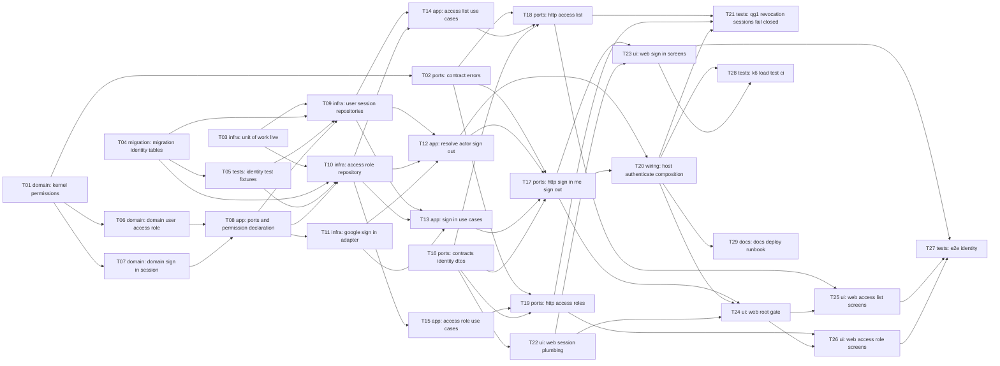

# Epic — identity

> **PRD:** [PRD.md](../PRD.md) · **Design:** [sad.md](../sad.md) · **Data model:** [data-model.md](../data-model.md) · **API:** [openapi.yaml](../contracts/openapi.yaml) · **ADRs:** [adr/](../adr/)

## Goal

Ship sign-in with company Google, the access list and admin-composed access roles, plus the one shared `requirePermission` check, so that only listed staff use the intranet and every feature checks access the same way ([PRD §2](../PRD.md)). This unblocks resource scheduling's launch, whose six permissions are the first feature-declared entries in the catalog.

## Scope

- **In:** `@arv/kernel` (actor permissions, `requirePermission`), `@arv/contracts` (shared 401/403 errors and identity DTOs), `@arv/platform` (error mapping), `@arv/db` (`UnitOfWorkLive` and fixtures), `modules/identity` (domain → application → infrastructure → http), the `apps/api` host (authenticate, composition, config), `apps/web` (session cookie, root gate, sign-in screens, admin screens), integration, e2e and load tests, and docs/deploy. Surfaces: `[backend-service, web-frontend]` (sad frontmatter, [ADR-0001](../adr/0001-build-backend-service-and-web-frontend-surfaces.md)).
- **Out (PRD §3):** non-company accounts, email changes, passwords or a second sign-in method, an audit log, team-scoped permissions, self-service requests, «view as» and «why can't I», and enforced 2FA. Scheduling's own `permissions.ts` ships with scheduling's tasks.

## Task map

**Parallel start (phase 1):** T01, T03, T04, T16. Domain (T06, T07) starts as soon as T01 lands, and web plumbing (T22) once T16 does.

| Phase | Tasks (deps satisfied) |
|---|---|
| 1 | T01, T03, T04, T16 |
| 2 | T02, T05, T06, T07, T22 |
| 3 | T08 |
| 4 | T09, T10, T11 |
| 5 | T12, T13, T14, T15 |
| 6 | T17, T18, T19 |
| 7 | T20, T23 |
| 8 | T21, T24, T28, T29 |
| 9 | T25, T26 |
| 10 | T27 |

Serialization lanes (applied by `implement-tasks` on top of the phases): `migration` T04; `modules/identity/src/http/routes.ts` + `presenter.ts` T17 → T18 → T19; `apps/web/.../identity.server.ts` + `routes.ts` T22 / T23 / T25 / T26; `ARCHITECTURE.md` T03 / T29.

## Tasks

See [tracker.md](./tracker.md) for status. Machine contract: [tasks.json](./tasks.json).

| # | Task | Layer | Blocked by | DoD (short) |
|---|---|---|---|---|
| T01 | [Add Permission, requirePermission and the permission set on Actor.User in the kernel](./t01-kernel-permissions.md) | domain | — | Unit tests: anonymous actor → `Unauthenticated`; user without the key → `PermissionDenied` naming it; user with it → success. |
| T02 | [Add Unauthorized and Forbidden contract errors and map the kernel permission errors once in platform](./t02-contract-errors.md) | ports | T01 | Unit tests: each new error maps to its status and to a body that decodes against the OpenAPI `ApiError` example. |
| T03 | [Implement UnitOfWorkLive with a CurrentTx FiberRef read by query()](./t03-unit-of-work-live.md) | infra | — | Integration test (real `arv_test`): two writes then a failure inside `transactional` leave no rows; without the failure both rows exist. |
| T04 | [Promote the staged identity migrations: sessions, access roles, grants and assignments](./t04-migration-identity-tables.md) | migration | — | Staged migrations promoted: the generated SQL matches the staged `.up.sql` (names, FK actions, partial and expression indexes); `pnpm db:migrate` applies on a clean DB and `pnpm db:status` is clean. |
| T05 | [Add identity test fixtures to @arv/db/testing](./t05-identity-test-fixtures.md) | tests | T04 | Integration test: `seedAdmin` + `seedSessions` produce rows the T09 resolve query can read (smoke-tested with raw SQL here). |
| T06 | [Model company email, user name, access-role name key and retired permissions in the identity domain](./t06-domain-user-access-role.md) | domain | T01 | Unit tests: «Anna@» and « anna@ » normalise to the same email (AC-06); an other-domain or invalid address → `NotCompanyAddress` (AC-05). |
| T07 | [Model sign-in eligibility, sessions, the first-admin rule and the last-admin rule](./t07-domain-sign-in-session.md) | domain | T01 | Unit tests, one per refused claim (AC-02): unverified, missing `hd`, other `hd`, other email domain, missing email. |
| T08 | [Declare identity:manage-access and define identity's application ports with in-memory fakes](./t08-ports-and-permission-declaration.md) | app | T06, T07 | Unit test: every declaration's key matches `<module>:<kebab-action>`, and `identity:manage-access` is exported from `@arv/identity`. |
| T09 | [Implement the Drizzle user and session repositories with the one-query actor lookup](./t09-user-session-repositories.md) | infra | T03, T04, T05, T08 | Integration tests: `resolve` returns the union of keys across several roles (AC-12); expired → `expired`; revoked → `revoked`; unknown hash → `unknown`. |
| T10 | [Implement the Drizzle access-role repository with the manage-access holder queries](./t10-access-role-repository.md) | infra | T03, T04, T05, T08 | Integration tests: «planner » after «Planner» → `AccessRoleNameTaken` (AC-10); setting a second pre-selected role clears the first (AC-13). |
| T11 | [Implement the GoogleSignIn adapter on a pinned OIDC library](./t11-google-sign-in-adapter.md) | infra | T08 | Unit tests with a stubbed `fetch` and a locally signed JWT: wrong issuer, wrong audience, expired token and bad signature each → refused; a valid token → claims. |
| T12 | [Implement resolveActor and sign-out, and wire identity's adapters in the module layer](./t12-resolve-actor-sign-out.md) | app | T09, T10, T11 | Unit tests (fakes): a retired key held by a role is not in the actor's set (AC-16/AC-18); after a fake role change the next resolve reflects it (AC-17); manage access alone yields exactly `{identity:manage-access}` (AC-19). |
| T13 | [Implement begin and complete sign-in, with the first-admin bootstrap and the not-set-up answer](./t13-sign-in-use-cases.md) | app | T09, T10, T11 | Unit tests (fakes): a listed user gets a session expiring in 7 days (AC-01); each refused claim stores and logs nothing (AC-02); an unlisted person gets `NotSetUp` with the admins' names and emails, or an empty list (AC-03). |
| T14 | [Implement the access-list use cases: list, add, rename, remove and assign access roles under the last-admin guard](./t14-access-list-use-cases.md) | app | T09, T10 | Unit tests (fakes) for each AC listed, including: removing the only admin, or taking «Admin» from them, → `LastAdminRequired` with nothing changed (AC-14). |
| T15 | [Implement the access-role use cases: compose, rename, delete with warning, pre-select and list permissions](./t15-access-role-use-cases.md) | app | T10 | Unit tests (fakes) for each AC listed, including: deleting the pre-selected role clears the mark (AC-11), and a re-declared key is granted again and loses its flag (AC-16). |
| T16 | [Add the identity contract schemas for sign-in, me, the access list, access roles and permissions](./t16-contracts-identity-dtos.md) | ports | — | Unit tests: each schema decodes its openapi.yaml example and rejects one malformed variant. |
| T17 | [Expose sign-in begin and complete, me and sign-out routes](./t17-http-sign-in-me-sign-out.md) | ports | T02, T12, T13, T16 | Integration tests (Google replaced by a fake `GoogleSignIn` Layer): a listed user gets a token (AC-01); a refused claim answers the refused body (AC-02); an unlisted person gets not-set-up with admins (AC-03); the first-admin path (AC-15). |
| T18 | [Expose the access-list endpoints behind manage access](./t18-http-access-list.md) | ports | T02, T14, T16 | Integration tests, one per AC listed. AC-08: a non-admin gets 403 and no list data. AC-14: removing the last admin → 409 and the DB is unchanged. |
| T19 | [Expose the access-role, pre-selected-role and permission-catalog endpoints](./t19-http-access-roles.md) | ports | T02, T15, T16 | Integration tests, one per AC listed. AC-16: with a test-only catalog that stops declaring a key, the role is flagged, the key can't be added, and re-declaring it clears the flag. |
| T20 | [Wire authenticate, the permission catalog and identity config in the api host](./t20-host-authenticate-composition.md) | wiring | T12, T17 | Integration test: every non-public route answers 401 to an anonymous request (route list taken from the app, not hand-written). |
| T21 | [Add the QG-1 revocation, session-lifetime and fail-closed integration suites](./t21-qg1-revocation-sessions-fail-closed.md) | tests | T18, T19, T20 | All three suites green in `pnpm test:integration`, and each fails if a cache is introduced (sad §11). |
| T22 | [Add the web session and sign-in-state cookies, Bearer forwarding, the returnTo check and the Origin check](./t22-web-session-plumbing.md) | ui | T16 | Unit tests: cookie attributes; `safeReturnTo` for `/board`, `//evil`, `https://evil`, `javascript:` and empty; Origin check rejects a foreign origin on POST. |
| T23 | [Build the sign-in, sign-in-return, sign-out, not-set-up and refused screens](./t23-web-sign-in-screens.md) | ui | T17, T22 | Route tests with `app/test/fake-api.ts`: state mismatch refuses; each completion outcome renders its screen; a successful return sets the cookie and redirects to the given path (AC-01). |
| T24 | [Gate every page at the root and show navigation by permission](./t24-web-root-gate.md) | ui | T17, T20, T22 | Route tests: anonymous visit to `/board` redirects to sign-in with `returnTo=/board`; access-removed clears the cookie and shows the message; a non-admin sees no «Access» link. |
| T25 | [Build the access-list screens: list, add with pre-selected role, rename, remove and assign roles](./t25-web-access-list-screens.md) | ui | T18, T24 | Component and route tests: the pre-selected role is ticked by default and can be unticked (AC-13); the last-admin 409 shows «appoint another admin first» (AC-14); rename keeps roles (AC-21). |
| T26 | [Build the access-role screens: compose, rename, delete with warning, pre-select and retired flags](./t26-web-access-role-screens.md) | ui | T19, T24 | Component tests: a retired key renders flagged and isn't offered in the picker (AC-16); the delete warning shows the count and the pre-selected note (AC-11); the duplicate-name 409 shows inline (AC-10). |
| T27 | [Add the identity end-to-end tests over seeded sessions](./t27-e2e-identity.md) | tests | T23, T25, T26 | `pnpm test:e2e` green locally and in CI. |
| T28 | [Add the seeded k6 load test and its CI job for the three latency targets](./t28-k6-load-test-ci.md) | tests | T20, T23 | The CI job runs the scenario and fails when a threshold is breached (shown once in the PR by a temporarily lowered threshold). |
| T29 | [Update ARCHITECTURE.md and repo ADR 0001, and add the deploy checklist and the first-admin recovery runbook](./t29-docs-deploy-runbook.md) | docs | T20 | `pnpm lint` (module graph unchanged: `identity → (none)`) clean. |

## Risks / Hard rules

- **Deny by default, never cached** ([ADR-0005](../adr/0005-check-permissions-with-one-kernel-require-permission-over-a-per-request-actor.md); PRD §6 Revocation and Fail closed): no task may add a cache, in the isolate, in KV or in Hyperdrive, for identity queries. A DB failure is a defect (500), never `Anonymous`. Proven by T21.
- **Brownfield (sad §11, High):** the scaffold's `/users` routes answer anonymous callers today. T18 and T20 must merge before any production deploy of identity.
- **Claim checks (sad §11, High):** T07 and T11 need one test per claim, and the Security Lead reviews them. A security review is mandatory before launch (PRD §6.1).
- **No personal data in logs** (sad §8 Logging): only `identity.sign_in.succeeded {userId}`, `identity.google.unavailable`, `accessCheckMs` and `signInCompleteMs`.
- **Module boundaries:** identity imports no feature module; the module graph stays `identity → (none)`. Web imports only `@arv/contracts/*` and `import type` from `@arv/api`.
- **Shared with resource-scheduling:** T01, T02 and T03 overlap scheduling's [T01/T02/T03](../../resource-scheduling/tasks/tracker.md). Whichever feature runs first implements them, and the other reduces to the delta.
- **Open inputs:** PRD §8 Q1 (permission labels, default glossary wording, T08); the Google test double for the k6 sign-in leg (T28, Security Lead); the `arv-web` custom-domain zone (T29); the effort budget (sad §11, PM).
