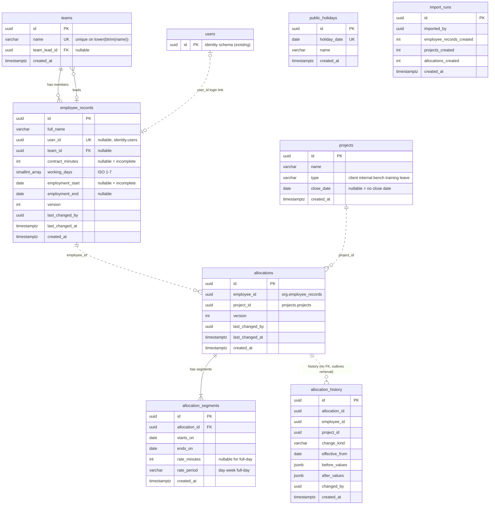

# Data model — resource-scheduling

<!-- Generated by generate-data-model. Migrations are STAGED under
docs/features/resource-scheduling/migrations/ (NOT the live packages/migrations/drizzle tree);
implement-tasks promotes them. -->

> **Inputs:** [PRD](./PRD.md) §4–§6.1 · [SAD](./sad.md) §5 (table list per module), §6 (13 flows + purge), §8 · [ADR-0008](./adr/0008-model-allocation-as-effective-dated-segments.md) (segments) · [ADR-0009](./adr/0009-store-minutes-and-compute-in-1-420-minute-ticks.md) (integer minutes) · [ADR-0006](./adr/0006-implement-unit-of-work-without-outbox.md) (one transaction).
> **Decisions taken in this pass (2026-10-30):** contract hours and working days are **not** effective-dated (a change applies to all weeks; PRD §8 default, closes the SAD §11 open question). Primary keys are `UUID DEFAULT uuidv7()`, generated by Postgres, following the repo and SAD §8 rather than the app-side course default.

Three Postgres schemas, one per module (ADR-0003). There are **no foreign keys across schemas** (repo ADR 0001). `employee_id`, `project_id`, `user_id`, `*_by` columns that point into another module are plain `UUID`s, validated through that module's facade on write.

## ER diagram

Solid lines are foreign keys inside one schema. Dotted lines are ID references across schemas, with no FK.

`public_holidays` and `import_runs` stand alone. Capacity reads join holidays to resources in domain code, not in SQL.

## Entities

Applying the course defaults: `created_at TIMESTAMPTZ NOT NULL DEFAULT now()` on every table, hard delete, and no `CHECK`, `TRIGGER` or business `DEFAULT`. Every enum, range and invariant listed under "Rules (app)" is enforced in the module's `domain/`. Hours are integer **minutes** (ADR-0009).

**Columns that act like `updated_at` (surfaced, not silent).** Only `employee_records` and `allocations` carry `last_changed_by` + `last_changed_at` + `version`:
- `allocations`: AC-07 «shows the user as last changed by, with the time»; AC-07b optimistic concurrency.
- `employee_records`: SAD §8 puts an optimistic version on it, and the flow 9 conflict shows «who changed them».

`teams`, `projects` and `public_holidays` are last-write-wins (SAD §8), so they get no such column.

### Aggregate: Team (`org`)

#### `org.teams`

| Column | Type | Constraints | Notes |
|---|---|---|---|
| `id` | UUID | PK, `DEFAULT uuidv7()` | |
| `name` | VARCHAR(100) | NOT NULL; UNIQUE on `lower(btrim(name))` | AC-19d: duplicate ignoring case and surrounding spaces is refused. Stored as typed (trimmed by app). <!-- TBD: max length 100 is an architect's bound, PRD gives none --> |
| `team_lead_id` | UUID | NULL, FK → `org.employee_records(id)` ON DELETE RESTRICT | AC-19d «with a resource as its team lead». Nullable in the DB, and the app requires it on manual create. <!-- TBD: whether the import creates teams without a lead depends on the spreadsheet format (PRD §8) --> |
| `created_at` | TIMESTAMPTZ | NOT NULL DEFAULT now() | |

**Aggregate root:** root. **Rules (app):** name required. Removing a team that still has resources is refused with the member count (AC-19d), and the `employee_records.team_id` FK RESTRICT is the backstop.

### Aggregate: Employee record (`org`)

#### `org.employee_records`

| Column | Type | Constraints | Notes |
|---|---|---|---|
| `id` | UUID | PK, `DEFAULT uuidv7()` | `EmployeeId` in `@arv/kernel` (crosses into `scheduling`) |
| `full_name` | VARCHAR(200) | NOT NULL | <!-- TBD: bound 200 is an architect's choice --> |
| `user_id` | UUID | NULL, UNIQUE | Login link to `identity.users(id)`, with no cross-schema FK. AC-19b: one login → one record (the unique index refuses a second link). Unlinked → AC-18. |
| `team_id` | UUID | NULL, FK → `org.teams(id)` ON DELETE RESTRICT | AC-06: optional, «no team» group |
| `contract_minutes` | INTEGER | NULL | Weekly contract hours × 60 (ADR-0009). NULL = incomplete record (AC-06). App: 0 < x ≤ 3600 (AC-20). |
| `working_days` | SMALLINT[] | NOT NULL | ISO weekdays 1 (Mon) … 7 (Sun). Mon–Fri default applied **in app** (AC-06), and at least one day is required (AC-20). An array is used, not 7 booleans, because the domain treats it as a set. |
| `employment_start` | DATE | NULL | NULL = incomplete record (AC-06) |
| `employment_end` | DATE | NULL | App: not before start (AC-20). Redacted for viewers without manage-employee-records / edit-allocations (AC-22), in the presenter, not the DB. |
| `version` | INTEGER | NOT NULL | Optimistic concurrency (SAD §8). Set to 1 by the app on insert, with no DB default. |
| `last_changed_by` | UUID | NOT NULL | `identity.users(id)`, no FK |
| `last_changed_at` | TIMESTAMPTZ | NOT NULL DEFAULT now() | Set by app on every update |
| `created_at` | TIMESTAMPTZ | NOT NULL DEFAULT now() | |

**Aggregate root:** root. **Not stored:** capacity, daily share and incompleteness. These are computed on read (ADR-0005). Per the 2026-10-30 decision the terms are **not** effective-dated: a change rewrites capacity for all weeks, past included. Adding effective dates later means a new `employment_terms` table plus a data migration (3-step).

### Aggregate: Public holiday (`org`)

#### `org.public_holidays`

| Column | Type | Constraints | Notes |
|---|---|---|---|
| `id` | UUID | PK, `DEFAULT uuidv7()` | |
| `holiday_date` | DATE | NOT NULL, UNIQUE | One company-wide list (US-09) |
| `name` | VARCHAR(100) | NOT NULL | Display label. <!-- TBD: PRD names no holiday label; drop if the UI does not show one --> |
| `created_at` | TIMESTAMPTZ | NOT NULL DEFAULT now() | |

**Aggregate root:** root. Removal is a hard delete.

### Aggregate: Project (`projects`)

#### `projects.projects`

| Column | Type | Constraints | Notes |
|---|---|---|---|
| `id` | UUID | PK, `DEFAULT uuidv7()` | `ProjectId` in `@arv/kernel` |
| `name` | VARCHAR(200) | NOT NULL | Plain text, never interpreted (PRD §6.1). The leave project's name *is* the leave type («Annual leave», «Sick leave»), so it gets redacted to «away» (AC-29). |
| `type` | VARCHAR(16) | NOT NULL | `client` \| `internal` \| `bench` \| `training` \| `leave`, an enum in the app with no CHECK |
| `close_date` | DATE | NULL | NULL = no close date. Open until the end of `close_date`, closed after (AC-25). Never earlier than today when set, and never cleared (no reopening). |
| `created_at` | TIMESTAMPTZ | NOT NULL DEFAULT now() | |

**Aggregate root:** root. **Rules (app):** no two **open** projects share `lower(btrim(name))` (AC-24). A UNIQUE index can't express this because "open" depends on today's date (`close_date >= today`). Concurrent creates of the same name are last-write-wins (SAD §8 accepted debt).

### Aggregate: Allocation (`scheduling`, ADR-0008)

#### `scheduling.allocations`

| Column | Type | Constraints | Notes |
|---|---|---|---|
| `id` | UUID | PK, `DEFAULT uuidv7()` | One identity for history, version and UI |
| `employee_id` | UUID | NOT NULL | `org.employee_records(id)`, no FK, checked via the `org` facade. Never changes. |
| `project_id` | UUID | NOT NULL | `projects.projects(id)`, no FK, checked via the `projects` facade (open, type). A leave allocation points at a `leave`-type project. Never changes. |
| `version` | INTEGER | NOT NULL | AC-07b: `UPDATE … WHERE id = $1 AND version = $2` and 0 rows → `Conflict` |
| `last_changed_by` | UUID | NOT NULL | AC-07. For a project-close trim it is the closer (AC-16). |
| `last_changed_at` | TIMESTAMPTZ | NOT NULL DEFAULT now() | AC-07 |
| `created_at` | TIMESTAMPTZ | NOT NULL DEFAULT now() | |

#### `scheduling.allocation_segments`

| Column | Type | Constraints | Notes |
|---|---|---|---|
| `id` | UUID | PK, `DEFAULT uuidv7()` | |
| `allocation_id` | UUID | NOT NULL, FK → `scheduling.allocations(id)` ON DELETE CASCADE | Segment lives and dies with its allocation |
| `starts_on` | DATE | NOT NULL | Inclusive |
| `ends_on` | DATE | NOT NULL | Inclusive. App: ≥ `starts_on` (AC-09). It is within the employment period (AC-13) and on or before the project's close date. |
| `rate_minutes` | INTEGER | NULL | Multiple of 15 (AC-09), > 0, ≤ 1440/day or ≤ 1440 × working days/week. NULL only when `rate_period = 'full-day'`. |
| `rate_period` | VARCHAR(8) | NOT NULL | `day` \| `week` (work, AC-07) \| `full-day` (leave: each working day takes the full daily capacity, AC-15, and follows later contract changes) |
| `created_at` | TIMESTAMPTZ | NOT NULL DEFAULT now() | |

**Aggregate root:** `allocations` owns `allocation_segments`. **Invariant (domain):** segments that end before today never change (AC-09b). A change from today sets the current segment's `ends_on` to yesterday and inserts a new one. A removal does the same, or deletes the allocation when it starts today or later. The allocation row, its segments and its history entry are written in one `UnitOfWork` (ADR-0006).

**Needing attention (AC-21) and overbooking** are computed on read and never stored.

#### `scheduling.allocation_history`

| Column | Type | Constraints | Notes |
|---|---|---|---|
| `id` | UUID | PK, `DEFAULT uuidv7()` | |
| `allocation_id` | UUID | NOT NULL | **No FK on purpose.** A removed allocation is deleted, but its «removed» entry must stay (AC-07a, AC-25). |
| `employee_id` | UUID | NOT NULL | Snapshot, so redaction rules still apply after the allocation is deleted (own leave, AC-29) |
| `project_id` | UUID | NOT NULL | Snapshot, so leave type → «away» still works after deletion (AC-29) |
| `change_kind` | VARCHAR(16) | NOT NULL | `created` \| `imported` \| `changed` \| `trimmed` \| `removed` (AC-16), an enum in the app |
| `effective_from` | DATE | NULL | «Change taking effect today» (AC-09b). NULL for `created` / `imported`. |
| `before_values` | JSONB | NULL | **JSONB justified:** an opaque display snapshot of the segment list `[{startsOn, endsOn, rateMinutes, ratePeriod}]`, never queried by field. NULL for `created` / `imported`. |
| `after_values` | JSONB | NULL | Same shape. NULL for `removed`. |
| `changed_by` | UUID | NOT NULL | Who made it. On a trim, the closer. On an import entry, the importer (AC-16). |
| `created_at` | TIMESTAMPTZ | NOT NULL DEFAULT now() | **When** the change happened. The 12-month window and the purge key. |

**Aggregate root:** append-only log owned by the Allocation aggregate. Rows are hard-deleted by the monthly purge (PRD §6, SAD §7).

### Aggregate: Import run (`scheduling`)

#### `scheduling.import_runs`

| Column | Type | Constraints | Notes |
|---|---|---|---|
| `id` | UUID | PK, `DEFAULT uuidv7()` | |
| `imported_by` | UUID | NOT NULL | `identity.users(id)`, no FK |
| `employee_records_created` | INTEGER | NOT NULL | Counts shown in the preview (AC-30), kept as the run's report |
| `projects_created` | INTEGER | NOT NULL | |
| `allocations_created` | INTEGER | NOT NULL | |
| `created_at` | TIMESTAMPTZ | NOT NULL DEFAULT now() | |

**Aggregate root:** root. Only completed runs are written, inside the import's unit of work. The preview stores nothing, and neither does the file (SAD §8). **AC-32 one-time** is checked by the use case (flow 13: «completed import run — present or none»). A UNIQUE index on the constant `(true)` makes a second row impossible even when two imports race, and the loser's transaction rolls back. This is a uniqueness constraint, not business logic in the DB.

## Indexes

Each index serves a concrete query from SAD §6. PK indexes are implicit and not listed.

| Index | Columns | Query it serves |
|---|---|---|
| `teams_name_key_unique` (UNIQUE) | `org.teams (lower(btrim(name)))` | Flow 10: «team with the same name ignoring case and surrounding spaces» (AC-19d) |
| `idx_teams_team_lead_id` | `org.teams (team_lead_id)` | FK index (RESTRICT check when an employee record is deleted). Also lists the teams a resource leads. |
| `employee_records_user_id_unique` (UNIQUE) | `org.employee_records (user_id)` | Flow 8: «employee record linked to this login». Flow 9: «record already linked to this login» (AC-19b). |
| `idx_employee_records_team_id` | `org.employee_records (team_id)` | FK index. Flow 10: member count before removing a team. Flow 3: board narrowed to a team (AC-02). |
| `public_holidays_holiday_date_unique` (UNIQUE) | `org.public_holidays (holiday_date)` | Flows 1, 3, 4, 6, 8: «holidays for the period» (range scan). Flow 12: add / remove by date. |
| `idx_projects_name_key` | `projects.projects (lower(btrim(name)))` | Flow 11: «open project with the same name ignoring case and surrounding spaces» (AC-24) |
| `idx_allocations_employee_id` | `scheduling.allocations (employee_id)` | Flow 1 / 5 / 6: «the resource's allocation segments in the period». Flow 8: own schedule. Flow 9 / 12: `CapacityImpactCheck` for a resource. |
| `idx_allocations_project_id` | `scheduling.allocations (project_id)` | Flow 2: «allocations of the project running past the close date» (AC-25). Flow 3: board narrowed to a project (AC-02). |
| `idx_allocation_segments_allocation_id` | `scheduling.allocation_segments (allocation_id)` | FK index. Flow 5 / 7: «load the allocation and its segments». |
| `idx_allocation_segments_ends_on_starts_on` | `scheduling.allocation_segments (ends_on, starts_on)` | Flows 3, 4: «allocation segments overlapping the window» (`ends_on >= :from AND starts_on <= :to`). Flow 2: segments past the close date. `ends_on` leads because past segments pile up and the window is mostly in the future. |
| `idx_allocation_history_allocation_id_created_at` | `scheduling.allocation_history (allocation_id, created_at)` | Flow 7: «history entries of the allocation from the last 12 months in order» |
| `idx_allocation_history_created_at` | `scheduling.allocation_history (created_at)` | Purge: «delete history entries recorded before the cut-off» |
| `import_runs_one_time_unique` (UNIQUE) | `scheduling.import_runs ((true))` | Flow 13: «completed import run, present or none». Enforces AC-32 under concurrency. |

At PRD scale (100 resources, 300 projects, low thousands of segments per year, SAD §7) several of these are near-free scans today. They are kept because each matches a named query and the write volume is tiny.

## Staged migrations

Under [`./migrations/`](./migrations/). Feature-local order, re-stamped at promote time:

| File (`.up.sql` + `.down.sql`) | Creates |
|---|---|
| `20261030120000_create_teams_and_employee_records` | schema `org`, `teams`, `employee_records` (one file, because the two reference each other) |
| `20261030120001_create_public_holidays` | `org.public_holidays` |
| `20261030120002_create_projects` | schema `projects`, `projects.projects` |
| `20261030120003_create_allocations` | schema `scheduling`, `allocations`, `allocation_segments` (one aggregate) |
| `20261030120004_create_allocation_history` | `scheduling.allocation_history` |
| `20261030120005_create_import_runs` | `scheduling.import_runs` |

**Promote-time note (repo tooling).** The live tree is `packages/migrations/drizzle/`, which drizzle-kit **generates** from each module's `infrastructure/schema.ts` (`pnpm db:generate`), with sequential `NNNN_name.sql` files and no down files. At promote time, `implement-tasks` writes the three `schema.ts` files to match these staged `.up.sql` files. That covers `pgSchema('org' | 'projects' | 'scheduling')`, `smallint().array()`, `jsonb()`, `uniqueIndex().on(sql\`lower(btrim(${t.name}))\`)`, `uniqueIndex().on(sql\`(true)\`)` and the `teams` ↔ `employee_records` FK pair. It then runs `pnpm db:generate` and diffs the generated SQL against the staged `.up.sql`, and adds `org`, `projects`, `scheduling` to `schemaFilter`. drizzle has no down migrations, so the staged `.down.sql` files are **not promoted**. They only document how to reverse each step by hand (e.g. on a dev database). In this repo a rollback is a new forward migration (`.claude/rules/backend/db.md`).

**Seeds:** none. No bootstrap row is needed (auth is still open, SAD §2). Leave-type projects («Annual leave», «Sick leave») are created by a manage-projects holder (US-08) or by the import, not seeded.

## Test fixtures

Not in migrations. The repo's form is `make<Entity>()` + `seed<Entities>(db, rows)` in raw SQL in `@arv/db/testing` (`packages/db/src/testing/seed.ts`), because that package cannot import module tables. `implement-tasks` adds these alongside the module that owns each table:

- `makeTeam({ name? = 'Team <n>', teamLeadId? })` / `seedTeams(db, rows)` → `org.teams`.
- `makeEmployeeRecord({ fullName? = 'Test User <n>', userId?, teamId?, contractMinutes? = 2400, workingDays? = [1,2,3,4,5], employmentStart?, employmentEnd?, version? = 1, lastChangedBy })` / `seedEmployeeRecords`. Pass `contractMinutes: null` or `employmentStart: null` for an incomplete record.
- `makePublicHoliday({ holidayDate, name? = 'Test holiday' })` / `seedPublicHolidays`.
- `makeProject({ name? = 'Project <n>', type? = 'client', closeDate? })` / `seedProjects`. `type: 'leave', name: 'Annual leave' | 'Sick leave'` for leave.
- `makeAllocation({ employeeId, projectId, segments: [{ startsOn, endsOn, rateMinutes, ratePeriod }], version? = 1, lastChangedBy })` / `seedAllocations`. This writes `allocations` + `allocation_segments`.
- `makeHistoryEntry({ allocationId, employeeId, projectId, changeKind, changedBy, createdAt? })` / `seedAllocationHistory`. `createdAt` can be back-dated to test the 12-month purge.

**PII guard:** names `Test User <n>`, emails `user-<n>@example.test`. The existing `makeUser` uses `user<n>@arvest.digital`, which is a real company domain. See the audit.
