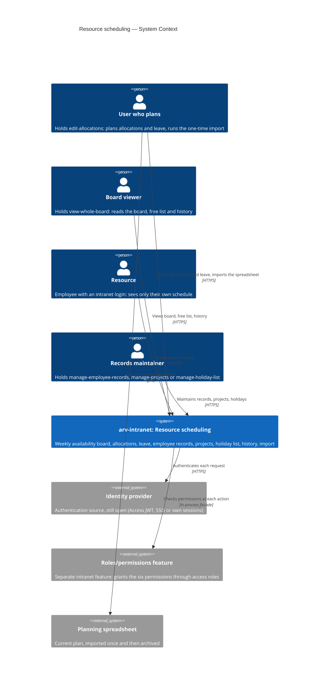
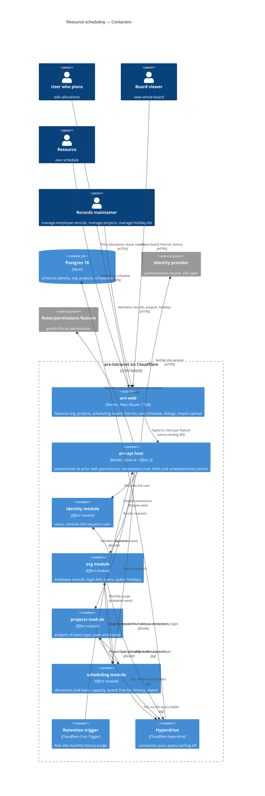
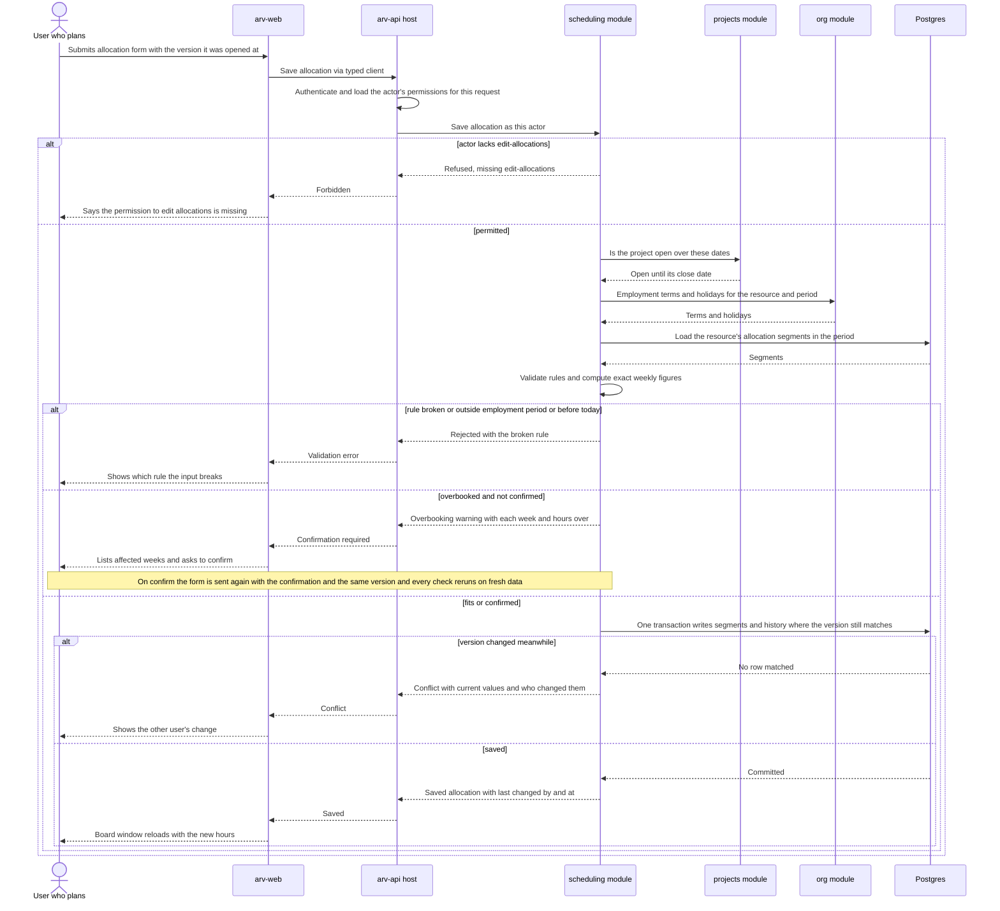
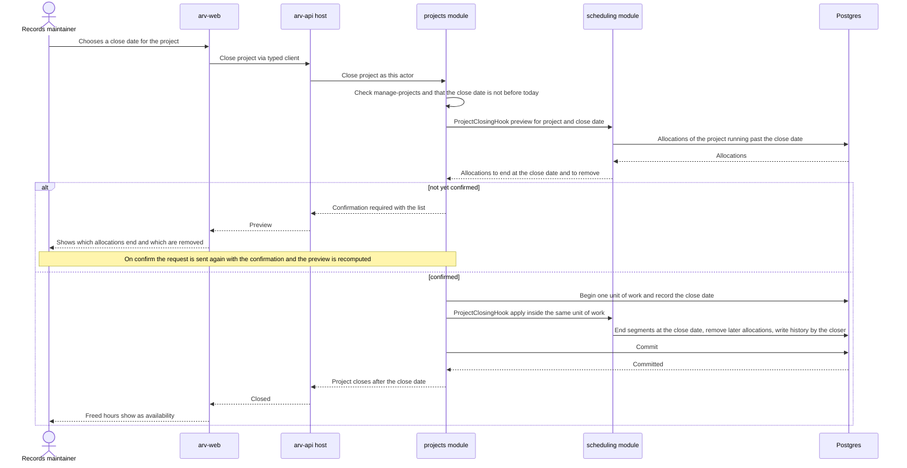
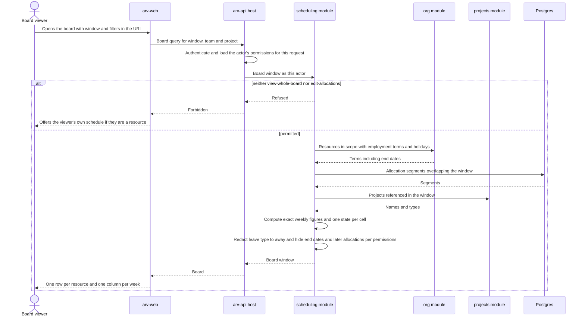

# Software Architecture Document — resource-scheduling

<!-- Stages 04-05 → see sdlc/plugin/skills/architecture-design/SKILL.md -->
<!-- 12 Arc42 sections. Empty sections — <!-- N/A: <one-line reason> -->. -->
<!-- C4 Context (L1) lives inline in §3. C4 Container (L2) lives inline in §5. -->
<!-- §6 Runtime view seeds the primary flow(s) here; complete-sequence-diagrams (stage 06) then -->
<!--    fills §6 with every critical flow / §5 AC — no cap. -->
<!-- Numbers in §10 come VERBATIM from PRD §6 NFR — no inventing, no rounding. -->

## 1. Introduction and goals

**Intent.** We build the **Team Availability Board** (PRD §1, Approach C): a weekly board of resources by week showing allocated hours against capacity, a «free hours over the next N weeks» filter, leave booked as allocations to leave-type projects, one company-wide public-holiday list, employee records kept separate from scheduling so later intranet features reuse them, a one-time import of the planning spreadsheet, and a change history on allocations covering the last 12 months. It serves the ~5 users who plan (holders of the edit-allocations permission) and the ~30 resources whose weeks the plan decides. Who may do what is decided by six named permissions granted through the separate roles/permissions feature, not by job title. It is the first business feature on the intranet and the first to need shared employee and project records.

**Top-3 quality goals (1-liners; full scenarios in §10):**

1. **QG-1 Calculation correctness** — 100% of weekly figures match the proration rules (partial weeks, holidays, part-timers, employment period), computed without intermediate rounding, with overbooking judged on the exact figures (PRD §6).
2. **QG-2 Confidentiality of personal data** — leave type and employment end date never reach a viewer without the matching permission, in any view (board, free list, history, project filter, import preview) (PRD §6.1).
3. **QG-3 Board responsiveness at target scale** — board p95 ≤ 1500 ms, «who's free» p95 ≤ 1000 ms, allocation save p95 ≤ 500 ms, holding at 100 resources, 300 projects, 52 weeks ahead (PRD §6).

**Stakeholders.**

| Role | Interest | Sign-off owner? |
|---|---|---|
| Users who plan — holders of the edit-allocations permission (PMs, delivery managers, team leads) | One always-current board they trust enough to retire the planning spreadsheet | No |
| Resources (~30 scheduled employees) | See their own allocations and leave week by week | No |
| Holders of the manage-employee-records permission | Accurate employee records, so capacity is correct | No |
| PM (PRD owner — dmitro.b) | Goals and KPIs hold; consulted on §10 quality goals and §11 severities | Yes (§10) |
| Tech Lead | SAD approval, module graph, ADRs | Yes |
| Security Lead | Security review: six new permissions, health-related leave data (PRD §6.1) | Yes |
| Owner of the roles/permissions feature | Supplies the access roles that grant the six permissions | No |

<!-- Decision overrides (¶4) — populated by the Step-7 critic resolution loop, empty otherwise.       -->
<!-- Each: «Decision override: <headline> — rationale: <reason>» so downstream skills see the choice.  -->

## 2. Constraints

**Technical** (pinned in the repo — see `ARCHITECTURE.md`, `package.json`, `apps/*/wrangler.jsonc`).
- Runtime: Cloudflare Workers (`compatibility_date` 2026-10-01, `nodejs_compat`, Workers Paid plan limits on CPU time, subrequests and bundle size). Two deployables: `arv-web` (public) and `arv-api` (private — no public URL, reachable only through the web Worker's `API` service binding).
- API: Hono 4.13.13 + Effect 3.22.2 (Effect is the dependency-injection mechanism: ports are `Context.Tag`s, adapters are `Layer`s).
- Web: React Router 7.18.4 (SSR, loaders/actions), React 19.2, Tailwind CSS 4.3.3, shadcn 4.22.1 over Base UI 1.9.0 primitives in `apps/web/app/shared/ui`.
- Language and tooling: TypeScript 5.9.3 (pinned below 7 for React Router 7), Vitest 4.1.11 (pinned for the Workers Vitest plugin), Playwright 1.64.0, Biome 2.5.15, pnpm 11.2.2, Turbo 2.11.7.
- Data: Postgres 18 (Neon in production, docker locally) through the `HYPERDRIVE` binding, with query caching **disabled** on the main config so a read after a write sees it; Drizzle ORM 0.45.4, drizzle-kit 0.31.11, `pg` 8.23.1; IDs are UUIDv7 generated by Postgres.
- Architecture: modular monolith with hexagonal modules (repo [ADR 0001](../../adr/0001-modular-monolith.md)) — one Postgres schema per module; no foreign keys, joins or queries across schemas; modules call each other only through facades; the module graph is checked by `pnpm check:modules`; transactions on Hyperdrive stay short and never await network calls.
- Whether a new package may be added to parse the planning spreadsheet is open — see §11.

**Organisational.**
- Deadline, effort budget and team composition: **TBD by PM** — the PRD cuts scope «to fit the deadline» but names no date (risk in §11).
- **Hard launch prerequisites** (scheduling launch waits for both, per PRD §8 default):
  - **Authentication source** — still open in repo ADR 0001; today `IdentityApi.resolveActor` returns `Anonymous` for every request, so no permission can be granted to anyone.
  - **The roles/permissions feature** — the separate feature that grants the six permissions through access roles; not built yet.
- A sample of the real planning spreadsheet is owed by the PM (PRD §8); the import mapping is derived from it.

**Conventions.**
- [`CLAUDE.md`](../../../CLAUDE.md), [`ARCHITECTURE.md`](../../../ARCHITECTURE.md) and `.claude/rules/*` (backend, frontend, infra) — layer imports enforced by Biome `noRestrictedImports`; every module edge declared in the module graph.
- Errors: domain errors are `Schema.TaggedError`s mapped by the module's presenter to shared contract errors (`NotFound`, `Conflict`, …); database failures are defects (`Effect.orDie` → 500); every error body is `{ error: { _tag, message } }`.
- Tests next to the code (`*.test.ts`); api integration tests in `apps/api/test/integration/<module>/` against workerd + the real `arv_test` database.
- New module: `pnpm new:module <name>`, registered in `composition.ts`, `index.ts`, the module graph and `schemaFilter`. Conventional Commits scoped by module.

**Regulatory / external.**
- Data classification **confidential** (PRD §6.1): named employees' workload, employment dates and absences.
- Sick leave is health-related, high-sensitivity data. Controls carried from PRD §6.1: leave type visible only to holders of the see-leave-reasons permission and to the resource themselves; employment end date visible only to holders of manage-employee-records or edit-allocations; allocation history deleted after 12 months; mandatory security review before launch.

## 3. Context and scope

<!-- brownfield: no docs/architecture-map.md yet — current architecture read from the authored ARCHITECTURE.md + repo ADR 0001 + a direct scan of apps/, modules/, packages/ (2026-10-29, HEAD d4b5993). Run /sdlc:map-architecture to persist a map. -->

Planning today lives in a spreadsheet and tracker tickets. The ~5 users who plan cannot see a resource's allocations against their capacity, so «who is free in the next 2 weeks?» costs about an hour of chat. Resource scheduling puts that plan on the intranet. Users who plan maintain allocations and leave on a weekly board. Resources see their own weeks. The employee records, teams, projects and public-holiday list behind it become the intranet's first shared records. The trust boundary is the public web Worker: everything a browser sends (form fields, the uploaded spreadsheet) is untrusted until the private api validates it, and every action is authorised against the six permissions at the moment it happens.

**External systems (in / out):**

| Actor or system | Type | Interaction |
|---|---|---|
| User who plans (holds edit-allocations, which includes view-whole-board) | Person | Views the board and free list; creates, changes and removes allocations; books leave; runs the one-time import (with manage-employee-records + manage-projects) |
| Board viewer (holds view-whole-board only) | Person | Views the board, the free list and allocation history; cannot edit |
| Resource (with an intranet login linked to their employee record) | Person | Views their own schedule only, including their own leave type |
| Records maintainer (holds manage-employee-records, manage-projects and/or manage-holiday-list) | Person | Maintains employee records and teams, projects, and the public-holiday list |
| Identity provider (source still open — repo ADR 0001: Cloudflare Access JWT, SSO or own sessions) | System (external) | Authenticates the browser session; the api turns it into the request's actor |
| Roles/permissions feature | System (internal, separate feature — not built yet) | Answers which of the six permissions an intranet user holds, checked at every action |
| Planning spreadsheet | Data source (external file) | Uploaded once for preview and all-or-nothing import, then archived read-only |

**C4 Context (L1):**



## 4. Solution strategy

**Target surface(s) (the first decision — what's being built):** `[backend-service, web-frontend]` — [ADR-0001](./adr/0001-build-backend-service-and-web-frontend-surfaces.md).

- **backend-service** — the private `arv-api` Worker gains three business modules (`org`, `projects`, `scheduling`) that own the typed HTTP contract (Hono routes + `@arv/contracts/<module>` schemas). The monthly history-retention job runs as a `scheduled` (Cron Trigger) entry point on this same Worker — part of the backend surface, not a separate `worker` surface.
- **web-frontend** — the public `arv-web` Worker gains feature folders that *consume* that contract through typed per-feature clients; it authors no contract of its own.

**Top strategic choices (the seeds for ADRs):**

1. **UI-architecture: server-rendered board with the week window in the URL** ([ADR-0002](./adr/0002-render-board-ssr-with-week-window-in-url.md)) — stay on React Router 7 SSR. The board's window and filters (`from`, `weeks`, `team`, `project`) are URL search params, so each view is one loader call that asks the api for exactly one bounded window (≤ 12 visible weeks), and every view is a shareable link. Scrolling back (≤ 12 months, view only) or forward (≤ 52 weeks) is a navigation to the next window. Edits are route actions; client JavaScript is used only for dialogs and the overbooking / project-close confirmations. Screens are composed from the existing `app/shared/ui` primitives (table, dialog, select, dropdown-menu, input, button) and the theme tokens — no new design system. Serves QG-3 (bounded payload per request) and keeps the api private (the browser never calls it).

2. **Three modules: `org`, `projects`, `scheduling`** ([ADR-0003](./adr/0003-split-into-org-projects-scheduling-modules.md); resolves PRD §8 «is the employee record its own module» — yes). `org` owns employee records, the login link, teams and the public-holiday list (company facts other intranet features reuse) and calls `identity`. `projects` owns projects of every type (client, internal, bench, training, leave), open/closed state, close dates and name uniqueness. `scheduling` owns allocations (including leave), capacity/availability/overbooking, the board and free list, allocation history, the history-retention job and the one-time import, and calls `org` and `projects`. Two operations need the *called* module to ask the *caller* for data — capacity-changing edits in `org` must preview overbooking (AC-19c, AC-27) and closing a project in `projects` must preview and trim allocations (AC-25) — without creating a cycle in the module graph; §5 decides the mechanism.

3. **Permissions resolved into the actor on every request** ([ADR-0004](./adr/0004-resolve-permissions-into-actor-per-request.md)) — the api host's authentication middleware builds the `Actor` from the identity provider *and* the permission set the roles/permissions feature grants that user, on every request; `Actor.User` in `@arv/kernel` gains that set. Each module's use cases check the named permissions they own; the rule «edit-allocations includes everything view-whole-board allows» lives in one `scheduling` policy. Visibility rules (leave type, employment end date) are enforced by redacting before any DTO leaves the api — the web never receives data the viewer may not see. Until the roles/permissions feature ships, a stub permission source serves development and tests; launch waits for the real one (§2). Serves QG-2 and AC-14 (checked at each action, not at sign-in).

4. **Capacity, availability and overbooking computed on read in pure domain functions** ([ADR-0005](./adr/0005-compute-capacity-and-availability-on-read.md)) — no stored weekly aggregates. For a board window or free-list period, `scheduling` loads the allocations overlapping it, asks `org` for the employment terms of the resources in scope and for the holidays in the period, and computes every figure with side-effect-free functions in its `domain/`. One rule set serves the board, the free list, the overbooking warnings and the import preview. Serves QG-1 (figures can never drift from their inputs) and is cheap at the PRD scale (QG-3).

5. **Synchronous and transactional; implement `UnitOfWork` now, no outbox in the MVP** ([ADR-0006](./adr/0006-implement-unit-of-work-without-outbox.md)) — implement the kernel's `UnitOfWork` port as `ARCHITECTURE.md` describes (one `db.transaction`, the transaction carried in a `CurrentTx` FiberRef that `query()` reads). Every allocation change and its history entry commit together; cross-module writes (closing a project and trimming its allocations, the all-or-nothing import) are facade commands that join the caller's unit of work. No domain events, outbox, Cron relay or Queue in this feature — no use case needs eventual delivery. Serves the «0 lost updates» and atomic-import requirements (PRD §6, AC-31).

Each tactical decision in later sections should be traceable to one of these strategic seeds. Tactical decisions that *contradict* a strategic choice are red flags — surface them in §11 Risks.

## 5. Building block view

The feature follows the repo's **modular monolith with hexagonal modules** (repo ADR 0001), with no divergence: three new modules generated from `modules/_template`, each with `domain/` (pure entities, policies, calculations) → `application/` (ports, use cases, facade) → `infrastructure/` (Drizzle adapters, its own `pgSchema`) → `http/` (Hono routes, presenter). Modules reach each other only through facades. The two operations that run against the module graph — an `org` edit that changes capacity must preview overbooking (AC-19c, AC-27), and closing a project in `projects` must preview and trim allocations (AC-25) — use **ports owned by the called module and implemented by `scheduling`**, wired in the api host's composition root ([ADR-0007](./adr/0007-invert-capacity-and-close-checks-through-host-wired-ports.md)): `org` defines `CapacityImpactCheck`, `projects` defines `ProjectClosingHook`, both exported from their facades; `scheduling` (which already depends on both) provides the Layers that implement them. The package graph stays `org → identity`, `scheduling → org`, `scheduling → projects`, with no cycle. An allocation is one aggregate holding **effective-dated segments**, so a change «from today» ends the current segment and starts a new one without rewriting the past ([ADR-0008](./adr/0008-model-allocation-as-effective-dated-segments.md)).

**Internal decomposition:**

```
packages/kernel/src/
├── actor.ts              Actor.User gains the permission set (ADR-0004); Permission identifier type
└── …                     UnitOfWork / DomainEvents ports (unchanged)
packages/db/src/
└── unit-of-work.ts       UnitOfWorkLive: db.transaction + CurrentTx FiberRef read by query() (ADR-0006)

modules/org/                         @arv/org — schema `org`; calls identity
├── domain/               EmployeeRecord (contract hours, working days, employment period, team, login link),
│                         Team (name + team lead), PublicHoliday, name-normalisation, validation rules (AC-20)
├── application/          ports.ts (repositories + CapacityImpactCheck — implemented by scheduling),
│                         use cases (create/edit record, link login, teams, holidays), org-api.ts (facade:
│                         employment terms + holidays for a window, employee by login, import commands)
├── infrastructure/       schema.ts (employee_records, teams, public_holidays), drizzle-*-repository.ts
└── http/                 routes.ts, presenter.ts (redacts end date for viewers without the permission)

modules/projects/                    @arv/projects — schema `projects`; calls no module
├── domain/               Project (type: client | internal | bench | training | leave; open / close date),
│                         name comparison ignoring case and surrounding spaces (AC-24)
├── application/          ports.ts (repository + ProjectClosingHook — implemented by scheduling),
│                         use cases (create, close with preview), projects-api.ts (facade: get / list
│                         projects, is-open-on(date), import commands)
├── infrastructure/       schema.ts (projects), drizzle-project-repository.ts
└── http/                 routes.ts, presenter.ts

modules/scheduling/                  @arv/scheduling — schema `scheduling`; calls org, projects
├── domain/               Allocation (aggregate of effective-dated segments, version), capacity calendar
│                         and proration (pure, ADR-0005), overbooking, free-list ranking,
│                         visibility policy (leave type, end date, view-whole-board ⊆ edit-allocations)
├── application/          ports.ts, board / free-list / my-schedule queries, allocation and leave commands,
│                         history query, capacity-impact-check.ts and project-closing-hook.ts (implement
│                         the org / projects ports), import preview + commit, purge-history,
│                         scheduling-api.ts (facade)
├── infrastructure/       schema.ts (allocations, allocation_segments, allocation_history, import_runs),
│                         drizzle-*-repository.ts
├── http/                 routes.ts, presenter.ts (leave type → «away» unless see-leave-reasons or own)
└── layer.ts              SchedulingModuleLive + the Layers that satisfy org's and projects' ports

apps/api/src/
├── middleware/           authenticate → Actor with permissions (identity + permission source, ADR-0004)
├── composition.ts        Identity, Org, Projects, Scheduling Layers + port wiring (ADR-0007)
└── index.ts              mounts /org, /projects, /scheduling routes; adds the `scheduled` handler
                          (monthly history purge, ADR-0001)

apps/web/app/features/
├── org/                  employee records, teams, holiday list (routes, components, org.server.ts)
├── projects/             project list, create, close-with-preview (projects.server.ts)
└── scheduling/           board, free list, my schedule, allocation / leave dialogs, history, import
                          (scheduling.server.ts)
```

**C4 Container (L2):**



## 6. Runtime view

architecture-design seeds the three riskiest flows here; `/sdlc:complete-sequence-diagrams` then covers every PRD §5 acceptance criterion. Participants are the §5 containers; messages are semantic (endpoint paths and status codes arrive with `api-forge`).

**Critical flow 1: Plan an allocation that overbooks** (AC-07, AC-09, AC-10, AC-13, AC-07b, AC-12, AC-14)



**Critical flow 2: Close a project and trim its allocations** (AC-25, AC-11, AC-16, AC-26; ADR-0007)



**Critical flow 3: Open the board with per-viewer redaction** (AC-01, AC-03, AC-06, AC-22, AC-29; ADR-0002, ADR-0004, ADR-0005)



## 7. Deployment view

<!-- 🎯 Навіщо: ТОПОЛОГІЯ, яку DevOps має знати без читання Helm-чартів — скільки реплік,  -->
<!--           де живе фоновий обробник, ПРИ ЯКИХ ЧИСЛАХ масштабуємось.                     -->
<!-- 📋 Що писати: 2-3 речення про топологію + метрики + алерти + конкретні числа-пороги.   -->
<!-- 📌 Приклад: «500 IC → партиціонування за кварталом» (не «при зростанні подумаємо»).    -->
<!-- 🎯 Можна N/A для XS/S функцій, що переюзають існуюче розгортання без змін.            -->

<Topology in 2-3 sentences. Where it runs (k8s / VM / serverless), replicas, scaling thresholds.>

**Monitoring:**
- <Metrics — e.g. Prometheus `<metric_name>`>
- <Alerts — e.g. "outbox lag > 10 min → page on-call">
- <Tracing — e.g. OpenTelemetry HTTP spans>

**Scaling thresholds:**
- <e.g. 500 IC × 5 goals × 26 checkpoints/Q = 65k rows/year — comfortable in one table>
- <e.g. partitioning by quarter at >500k rows/year>

<!-- For XS/S that doesn't change deployment: <!-- N/A: feature reuses existing deployment unit -->. -->

## 8. Crosscutting concepts

<!-- 🎯 Навіщо: НАСКРІЗНІ ПАТЕРНИ, які перетинають кілька модулів: логування, помилки,    -->
<!--           авторизація, ID strategy, outbox, кеш. ⭐ Друга найгустіша секція.          -->
<!--           Якщо патерн всередині одного модуля — він НЕ сюди. Якщо це конвенція        -->
<!--           проєкту в цілому — у CLAUDE.md.                                              -->
<!-- 📋 Що писати: таблиця концепт / конвенція / де визначено. Один рядок на концепт.      -->
<!-- 📌 Приклад: «UUID v7 (час+випадковий, сортується) у app-layer» — як default з CLAUDE.md. -->

| Concept | Convention | Where defined |
|---|---|---|
| Logging | <e.g. structured slog, fields `module=<name>`> | <CLAUDE.md §X or here> |
| Authentication | <e.g. JWT via session middleware> | <CLAUDE.md §X> |
| Error handling | <e.g. domain sentinel → ports/errors.go → apperr JSON> | <CLAUDE.md §X> |
| ID strategy | <e.g. UUID v7 in app layer> | <CLAUDE.md §X> |
| Internationalisation | <e.g. N/A, English only> | — |
| Observability | <e.g. OpenTelemetry on HTTP boundaries> | — |
| Outbox / events | <module-specific patterns, if any> | <here> |

## 9. Architecture decisions

<!-- 🎯 Навіщо: ЗВОРОТНИЙ ІНДЕКС на папку adr/. `ls adr/` дає файли, §9 дає семантику —    -->
<!--           чому вони існують, до якого зрізу SAD привʼязані, у якому статусі.           -->
<!-- 📋 Що писати: таблиця з 4 колонками. Один рядок на ADR. Mixed status — це OK.         -->
<!-- 📌 Приклад: «0001 | Зберігати урок як таблицю блоків | Accepted | §4».                -->

| # | Title | Status | Section |
|---|---|---|---|
| <NNNN> | <imperative — e.g. "Use sliding window for rate limiting"> | Accepted | §<N> |
| <NNNN> | <imperative — e.g. "Co-locate outbox worker in API process"> | Accepted | §<N> |

ADR files live under `docs/features/<slug>/adr/NNNN-<title>.md`.

## 10. Quality requirements

<!-- 🎯 Навіщо: ДЕРЕВО ЯКОСТЕЙ (Quality Tree) — беремо мету з §1 і розкладаємо на          -->
<!--           конкретні листя: тести, метрики, конфіги, drill-и. ⭐ Без §10 §1 — це       -->
<!--           маніфест. З §10 кожна декларація мапиться на щось, ЩО МОЖНА ДОВЕСТИ.        -->
<!-- 📋 Що писати: на кожну якість з §1 — When / Then / How verify. Числа з PRD §6 NFR     -->
<!--           ДОСЛІВНО (не округлюй p95 ≤250мс до ≤300мс — це F6-помилка критика).        -->
<!-- 📌 Приклад: «p95 ≤500 мс на UPDATE блоку, перевіримо k6 load test 100 req/s».        -->

Each top-3 goal from §1 expanded into a full scenario:

**QG-1. <quality attribute>**
- **When:** <trigger condition>
- **Then:** <expected behavior with numbers from PRD NFR>
- **How verify:** <test / chaos drill / load test / observability>

**QG-2. <quality attribute>**
- **When:** <trigger>
- **Then:** <expected>
- **How verify:** <how>

**QG-3. <quality attribute>**
- **When:** <trigger>
- **Then:** <expected>
- **How verify:** <how>

## 11. Risks and technical debt

<!-- 🎯 Навіщо: ⭐ збирає ВСЕ, що може зламатись — і не лише технічне. Без §11 ризики   -->
<!--           обговорюються на стендапах і губляться; борг лишається у голові того,    -->
<!--           хто його прийняв.                                                          -->
<!-- 📋 Що писати: таблиця ризик/борг — серйозність — мітигація — власник. Технічний    -->
<!--           борг окремою секцією.                                                      -->
<!-- 📌 Приклад: «EM не пушить — member не оновлює дані | High | …». Перший ризик —      -->
<!--           часто продуктовий, не технічний. Це нормально.                            -->

<!-- Severity column literals: Low / Medium / High for regular risks; "Open question" for rows
     created by Step-7 `Save as Open Question` resolutions (see references/socratic-loop.md). -->

| Risk / debt | Severity | Mitigation | Owner |
|---|---|---|---|
| <e.g. Outbox lag may reach hours during downstream outage> | Medium | <Alert >10 min, on-call playbook, retry backoff> | <DevOps> |
| <e.g. No event schema versioning in v1> | Medium | <ADR-NNNN planned for v2, graceful handling of unknown fields> | <Backend> |
| Open architectural decision: <decision-headline> | Open question | Resolve before <stage trigger or YYYY-MM-DD>; <inline rationale from Step-7 Save-as-OQ> | <owner> |

**Accepted debt (acceptable in v1, plan to fix later):**
- <e.g. Goal entity is not versioned (immutable) — OK for v1, may need audit versioning in v2>

## 12. Glossary

<!-- 🎯 Навіщо: ⭐ СЛОВНИК ДОМЕНУ, який припиняє суперечки через рік («checkpoint —      -->
<!--           weekly чи biweekly? Quarter — календарний чи фіскальний?»).                -->
<!-- 📋 Що писати: таблиця термін / значення. Бізнес-терміни + технічні вперемішку.       -->
<!--           Один термін може мати дві мови у заголовку: «Goal (Обʼєктив)».              -->
<!-- 📌 Приклад: «Lesson | урок усередині курсу, що складається з блоків (text, video)». -->

| Term | Meaning |
|---|---|
| <e.g. Goal> | <quarterly intent in statement form> |
| <e.g. KR> | <Key Result — measurable target linked to a Goal> |
| <e.g. Checkpoint> | <bi-weekly progress update on a KR> |
