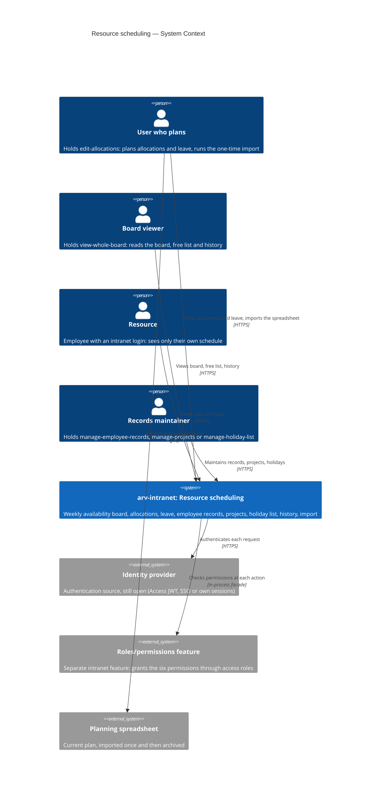
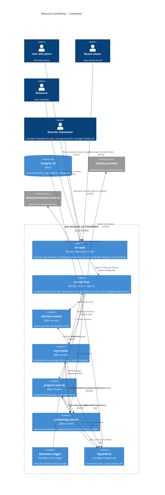
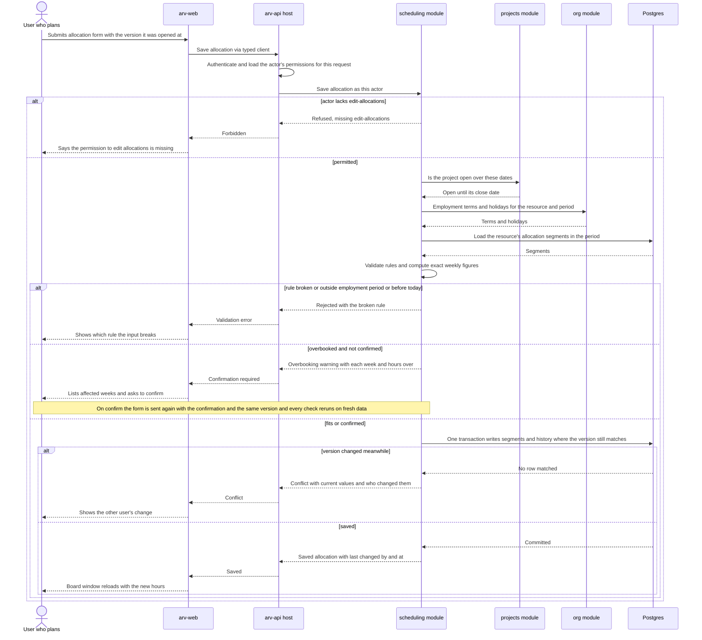
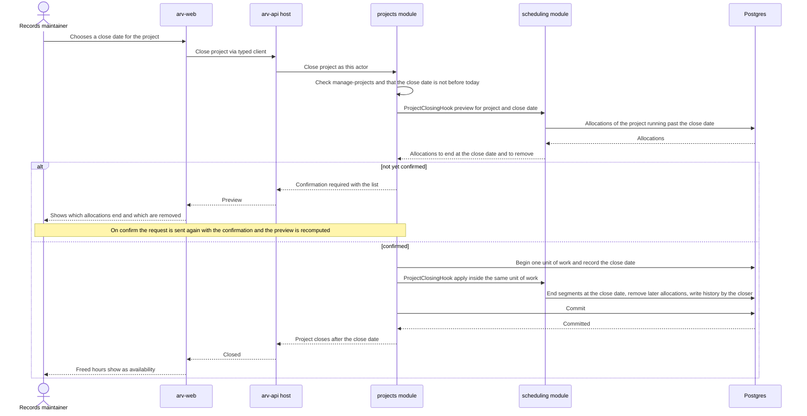
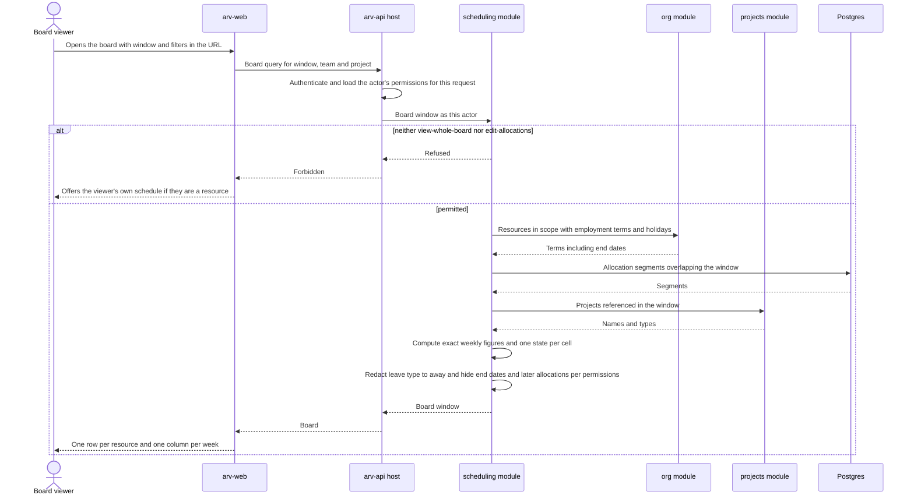
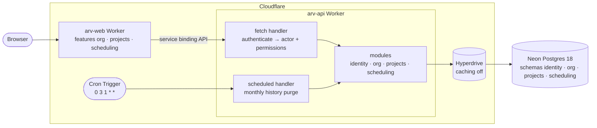

# Software Architecture Document — resource-scheduling

<!-- Stages 04-05 → see sdlc/plugin/skills/architecture-design/SKILL.md -->
<!-- 12 Arc42 sections. Empty sections — <!-- N/A: <one-line reason> -->. -->
<!-- C4 Context (L1) lives inline in §3. C4 Container (L2) lives inline in §5. -->
<!-- §6 Runtime view seeds the primary flow(s) here; complete-sequence-diagrams (stage 06) then -->
<!--    fills §6 with every critical flow / §5 AC — no cap. -->
<!-- Numbers in §10 come VERBATIM from PRD §6 NFR — no inventing, no rounding. -->

## 1. Introduction and goals

**Intent.** We build the **Team Availability Board** (PRD §1, Approach C): a weekly board of resources by week showing allocated hours against capacity, a «free hours over the next N weeks» filter, leave booked as allocations to leave-type projects, one company-wide public-holiday list, employee records kept separate from scheduling so later intranet features reuse them, a one-time import of the planning spreadsheet, and a change history on allocations covering the last 12 months. It serves the ~5 users who plan (holders of the edit-allocations permission) and the ~30 resources whose weeks the plan decides. Who may do what is decided by six named permissions granted through the separate roles/permissions feature, not by job title. It is the first business feature on the intranet and the first to need shared employee and project records.

**Top-3 quality goals (1-liners; full scenarios in §10):**

1. **QG-1 Calculation correctness** — 100% of weekly figures match the proration rules (partial weeks, holidays, part-timers, employment period), computed without intermediate rounding, with overbooking judged on the exact figures (PRD §6).
2. **QG-2 Confidentiality of personal data** — leave type and employment end date never reach a viewer without the matching permission, in any view (board, free list, history, project filter, import preview) (PRD §6.1).
3. **QG-3 Board responsiveness at target scale** — board p95 ≤ 1500 ms, «who's free» p95 ≤ 1000 ms, allocation save p95 ≤ 500 ms, holding at 100 resources, 300 projects, 52 weeks ahead (PRD §6).

**Stakeholders.**

| Role | Interest | Sign-off owner? |
|---|---|---|
| Users who plan — holders of the edit-allocations permission (PMs, delivery managers, team leads) | One always-current board they trust enough to retire the planning spreadsheet | No |
| Resources (~30 scheduled employees) | See their own allocations and leave week by week | No |
| Holders of the manage-employee-records permission | Accurate employee records, so capacity is correct | No |
| PM (PRD owner — dmitro.b) | Goals and KPIs hold; consulted on §10 quality goals and §11 severities | Yes (§10) |
| Tech Lead | SAD approval, module graph, ADRs | Yes |
| Security Lead | Security review: six new permissions, health-related leave data (PRD §6.1) | Yes |
| Owner of the roles/permissions feature | Supplies the access roles that grant the six permissions | No |

<!-- Decision overrides (¶4) — populated by the Step-7 critic resolution loop, empty otherwise.       -->
<!-- Each: «Decision override: <headline> — rationale: <reason>» so downstream skills see the choice.  -->

## 2. Constraints

**Technical** (pinned in the repo — see `ARCHITECTURE.md`, `package.json`, `apps/*/wrangler.jsonc`).
- Runtime: Cloudflare Workers (`compatibility_date` 2026-10-01, `nodejs_compat`, Workers Paid plan limits on CPU time, subrequests and bundle size). Two deployables: `arv-web` (public) and `arv-api` (private — no public URL, reachable only through the web Worker's `API` service binding).
- API: Hono 4.13.13 + Effect 3.22.2 (Effect is the dependency-injection mechanism: ports are `Context.Tag`s, adapters are `Layer`s).
- Web: React Router 7.18.4 (SSR, loaders/actions), React 19.2, Tailwind CSS 4.3.3, shadcn 4.22.1 over Base UI 1.9.0 primitives in `apps/web/app/shared/ui`.
- Language and tooling: TypeScript 5.9.3 (pinned below 7 for React Router 7), Vitest 4.1.11 (pinned for the Workers Vitest plugin), Playwright 1.64.0, Biome 2.5.15, pnpm 11.2.2, Turbo 2.11.7.
- Data: Postgres 18 (Neon in production, docker locally) through the `HYPERDRIVE` binding, with query caching **disabled** on the main config so a read after a write sees it; Drizzle ORM 0.45.4, drizzle-kit 0.31.11, `pg` 8.23.1; IDs are UUIDv7 generated by Postgres.
- Architecture: modular monolith with hexagonal modules (repo [ADR 0001](../../adr/0001-modular-monolith.md)) — one Postgres schema per module; no foreign keys, joins or queries across schemas; modules call each other only through facades; the module graph is checked by `pnpm check:modules`; transactions on Hyperdrive stay short and never await network calls.
- Whether a new package may be added to parse the planning spreadsheet is open — see §11.

**Organisational.**
- Deadline, effort budget and team composition: **TBD by PM** — the PRD cuts scope «to fit the deadline» but names no date (risk in §11).
- **Hard launch prerequisites** (scheduling launch waits for both, per PRD §8 default):
  - **Authentication source** — still open in repo ADR 0001; today `IdentityApi.resolveActor` returns `Anonymous` for every request, so no permission can be granted to anyone.
  - **The roles/permissions feature** — the separate feature that grants the six permissions through access roles; not built yet.
- A sample of the real planning spreadsheet is owed by the PM (PRD §8); the import mapping is derived from it.

**Conventions.**
- [`CLAUDE.md`](../../../CLAUDE.md), [`ARCHITECTURE.md`](../../../ARCHITECTURE.md) and `.claude/rules/*` (backend, frontend, infra) — layer imports enforced by Biome `noRestrictedImports`; every module edge declared in the module graph.
- Errors: domain errors are `Schema.TaggedError`s mapped by the module's presenter to shared contract errors (`NotFound`, `Conflict`, …); database failures are defects (`Effect.orDie` → 500); every error body is `{ error: { _tag, message } }`.
- Tests next to the code (`*.test.ts`); api integration tests in `apps/api/test/integration/<module>/` against workerd + the real `arv_test` database.
- New module: `pnpm new:module <name>`, registered in `composition.ts`, `index.ts`, the module graph and `schemaFilter`. Conventional Commits scoped by module.

**Regulatory / external.**
- Data classification **confidential** (PRD §6.1): named employees' workload, employment dates and absences.
- Sick leave is health-related, high-sensitivity data. Controls carried from PRD §6.1: leave type visible only to holders of the see-leave-reasons permission and to the resource themselves; employment end date visible only to holders of manage-employee-records or edit-allocations; allocation history deleted after 12 months; mandatory security review before launch.

## 3. Context and scope

<!-- brownfield: no docs/architecture-map.md yet — current architecture read from the authored ARCHITECTURE.md + repo ADR 0001 + a direct scan of apps/, modules/, packages/ (2026-10-29, HEAD d4b5993). Run /sdlc:map-architecture to persist a map. -->

Planning today lives in a spreadsheet and tracker tickets. The ~5 users who plan cannot see a resource's allocations against their capacity, so «who is free in the next 2 weeks?» costs about an hour of chat. Resource scheduling puts that plan on the intranet. Users who plan maintain allocations and leave on a weekly board. Resources see their own weeks. The employee records, teams, projects and public-holiday list behind it become the intranet's first shared records. The trust boundary is the public web Worker: everything a browser sends (form fields, the uploaded spreadsheet) is untrusted until the private api validates it, and every action is authorised against the six permissions at the moment it happens.

**External systems (in / out):**

| Actor or system | Type | Interaction |
|---|---|---|
| User who plans (holds edit-allocations, which includes view-whole-board) | Person | Views the board and free list; creates, changes and removes allocations; books leave; runs the one-time import (with manage-employee-records + manage-projects) |
| Board viewer (holds view-whole-board only) | Person | Views the board, the free list and allocation history; cannot edit |
| Resource (with an intranet login linked to their employee record) | Person | Views their own schedule only, including their own leave type |
| Records maintainer (holds manage-employee-records, manage-projects and/or manage-holiday-list) | Person | Maintains employee records and teams, projects, and the public-holiday list |
| Identity provider (source still open — repo ADR 0001: Cloudflare Access JWT, SSO or own sessions) | System (external) | Authenticates the browser session; the api turns it into the request's actor |
| Roles/permissions feature | System (internal, separate feature — not built yet) | Answers which of the six permissions an intranet user holds, checked at every action |
| Planning spreadsheet | Data source (external file) | Uploaded once for preview and all-or-nothing import, then archived read-only |

**C4 Context (L1):**



## 4. Solution strategy

**Target surface(s) (the first decision — what's being built):** `[backend-service, web-frontend]` — [ADR-0001](./adr/0001-build-backend-service-and-web-frontend-surfaces.md).

- **backend-service** — the private `arv-api` Worker gains three business modules (`org`, `projects`, `scheduling`) that own the typed HTTP contract (Hono routes + `@arv/contracts/<module>` schemas). The monthly history-retention job runs as a `scheduled` (Cron Trigger) entry point on this same Worker — part of the backend surface, not a separate `worker` surface.
- **web-frontend** — the public `arv-web` Worker gains feature folders that *consume* that contract through typed per-feature clients; it authors no contract of its own.

**Top strategic choices (the seeds for ADRs):**

1. **UI-architecture: server-rendered board with the week window in the URL** ([ADR-0002](./adr/0002-render-board-ssr-with-week-window-in-url.md)) — stay on React Router 7 SSR. The board's window and filters (`from`, `weeks`, `team`, `project`) are URL search params, so each view is one loader call that asks the api for exactly one bounded window (≤ 12 visible weeks), and every view is a shareable link. Scrolling back (≤ 12 months, view only) or forward (≤ 52 weeks) is a navigation to the next window. Edits are route actions; client JavaScript is used only for dialogs and the overbooking / project-close confirmations. Screens are composed from the existing `app/shared/ui` primitives (table, dialog, select, dropdown-menu, input, button) and the theme tokens — no new design system. Serves QG-3 (bounded payload per request) and keeps the api private (the browser never calls it).

2. **Three modules: `org`, `projects`, `scheduling`** ([ADR-0003](./adr/0003-split-into-org-projects-scheduling-modules.md); resolves PRD §8 «is the employee record its own module» — yes). `org` owns employee records, the login link, teams and the public-holiday list (company facts other intranet features reuse) and calls `identity`. `projects` owns projects of every type (client, internal, bench, training, leave), open/closed state, close dates and name uniqueness. `scheduling` owns allocations (including leave), capacity/availability/overbooking, the board and free list, allocation history, the history-retention job and the one-time import, and calls `org` and `projects`. Two operations need the *called* module to ask the *caller* for data — capacity-changing edits in `org` must preview overbooking (AC-19c, AC-27) and closing a project in `projects` must preview and trim allocations (AC-25) — without creating a cycle in the module graph; §5 decides the mechanism.

3. **Permissions resolved into the actor on every request** ([ADR-0004](./adr/0004-resolve-permissions-into-actor-per-request.md)) — the api host's authentication middleware builds the `Actor` from the identity provider *and* the permission set the roles/permissions feature grants that user, on every request; `Actor.User` in `@arv/kernel` gains that set. Each module's use cases check the named permissions they own; the rule «edit-allocations includes everything view-whole-board allows» lives in one `scheduling` policy. Visibility rules (leave type, employment end date) are enforced by redacting before any DTO leaves the api — the web never receives data the viewer may not see. Until the roles/permissions feature ships, a stub permission source serves development and tests; launch waits for the real one (§2). Serves QG-2 and AC-14 (checked at each action, not at sign-in).

4. **Capacity, availability and overbooking computed on read in pure domain functions** ([ADR-0005](./adr/0005-compute-capacity-and-availability-on-read.md)) — no stored weekly aggregates. For a board window or free-list period, `scheduling` loads the allocations overlapping it, asks `org` for the employment terms of the resources in scope and for the holidays in the period, and computes every figure with side-effect-free functions in its `domain/`. One rule set serves the board, the free list, the overbooking warnings and the import preview. Serves QG-1 (figures can never drift from their inputs) and is cheap at the PRD scale (QG-3).

5. **Synchronous and transactional; implement `UnitOfWork` now, no outbox in the MVP** ([ADR-0006](./adr/0006-implement-unit-of-work-without-outbox.md)) — implement the kernel's `UnitOfWork` port as `ARCHITECTURE.md` describes (one `db.transaction`, the transaction carried in a `CurrentTx` FiberRef that `query()` reads). Every allocation change and its history entry commit together; cross-module writes (closing a project and trimming its allocations, the all-or-nothing import) are facade commands that join the caller's unit of work. No domain events, outbox, Cron relay or Queue in this feature — no use case needs eventual delivery. Serves the «0 lost updates» and atomic-import requirements (PRD §6, AC-31).

Each tactical decision in later sections should be traceable to one of these strategic seeds. Tactical decisions that *contradict* a strategic choice are red flags — surface them in §11 Risks.

## 5. Building block view

The feature follows the repo's **modular monolith with hexagonal modules** (repo ADR 0001), with no divergence: three new modules generated from `modules/_template`, each with `domain/` (pure entities, policies, calculations) → `application/` (ports, use cases, facade) → `infrastructure/` (Drizzle adapters, its own `pgSchema`) → `http/` (Hono routes, presenter). Modules reach each other only through facades. The two operations that run against the module graph — an `org` edit that changes capacity must preview overbooking (AC-19c, AC-27), and closing a project in `projects` must preview and trim allocations (AC-25) — use **ports owned by the called module and implemented by `scheduling`**, wired in the api host's composition root ([ADR-0007](./adr/0007-invert-capacity-and-close-checks-through-host-wired-ports.md)): `org` defines `CapacityImpactCheck`, `projects` defines `ProjectClosingHook`, both exported from their facades; `scheduling` (which already depends on both) provides the Layers that implement them. The package graph stays `org → identity`, `scheduling → org`, `scheduling → projects`, with no cycle. An allocation is one aggregate holding **effective-dated segments**, so a change «from today» ends the current segment and starts a new one without rewriting the past ([ADR-0008](./adr/0008-model-allocation-as-effective-dated-segments.md)).

**Internal decomposition:**

```
packages/kernel/src/
├── actor.ts              Actor.User gains the permission set (ADR-0004); Permission identifier type
└── …                     UnitOfWork / DomainEvents ports (unchanged)
packages/db/src/
└── unit-of-work.ts       UnitOfWorkLive: db.transaction + CurrentTx FiberRef read by query() (ADR-0006)

modules/org/                         @arv/org — schema `org`; calls identity
├── domain/               EmployeeRecord (contract hours, working days, employment period, team, login link),
│                         Team (name + team lead), PublicHoliday, name-normalisation, validation rules (AC-20)
├── application/          ports.ts (repositories + CapacityImpactCheck — implemented by scheduling),
│                         use cases (create/edit record, link login, teams, holidays), org-api.ts (facade:
│                         employment terms + holidays for a window, employee by login, import commands)
├── infrastructure/       schema.ts (employee_records, teams, public_holidays), drizzle-*-repository.ts
└── http/                 routes.ts, presenter.ts (redacts end date for viewers without the permission)

modules/projects/                    @arv/projects — schema `projects`; calls no module
├── domain/               Project (type: client | internal | bench | training | leave; open / close date),
│                         name comparison ignoring case and surrounding spaces (AC-24)
├── application/          ports.ts (repository + ProjectClosingHook — implemented by scheduling),
│                         use cases (create, close with preview), projects-api.ts (facade: get / list
│                         projects, is-open-on(date), import commands)
├── infrastructure/       schema.ts (projects), drizzle-project-repository.ts
└── http/                 routes.ts, presenter.ts

modules/scheduling/                  @arv/scheduling — schema `scheduling`; calls org, projects
├── domain/               Allocation (aggregate of effective-dated segments, version), capacity calendar
│                         and proration (pure, ADR-0005), overbooking, free-list ranking,
│                         visibility policy (leave type, end date, view-whole-board ⊆ edit-allocations)
├── application/          ports.ts, board / free-list / my-schedule queries, allocation and leave commands,
│                         history query, capacity-impact-check.ts and project-closing-hook.ts (implement
│                         the org / projects ports), import preview + commit, purge-history,
│                         scheduling-api.ts (facade)
├── infrastructure/       schema.ts (allocations, allocation_segments, allocation_history, import_runs),
│                         drizzle-*-repository.ts
├── http/                 routes.ts, presenter.ts (leave type → «away» unless see-leave-reasons or own)
└── layer.ts              SchedulingModuleLive + the Layers that satisfy org's and projects' ports

apps/api/src/
├── middleware/           authenticate → Actor with permissions (identity + permission source, ADR-0004)
├── composition.ts        Identity, Org, Projects, Scheduling Layers + port wiring (ADR-0007)
└── index.ts              mounts /org, /projects, /scheduling routes; adds the `scheduled` handler
                          (monthly history purge, ADR-0001)

apps/web/app/features/
├── org/                  employee records, teams, holiday list (routes, components, org.server.ts)
├── projects/             project list, create, close-with-preview (projects.server.ts)
└── scheduling/           board, free list, my schedule, allocation / leave dialogs, history, import
                          (scheduling.server.ts)
```

**C4 Container (L2):**



## 6. Runtime view

architecture-design seeds the three riskiest flows here; `/sdlc:complete-sequence-diagrams` then covers every PRD §5 acceptance criterion. Participants are the §5 containers; messages are semantic (endpoint paths and status codes arrive with `api-forge`).

**Critical flow 1: Plan an allocation that overbooks** (AC-07, AC-09, AC-10, AC-13, AC-07b, AC-12, AC-14)



**Critical flow 2: Close a project and trim its allocations** (AC-25, AC-11, AC-16, AC-26; ADR-0007)



**Critical flow 3: Open the board with per-viewer redaction** (AC-01, AC-03, AC-06, AC-22, AC-29; ADR-0002, ADR-0004, ADR-0005)



## 7. Deployment view

The feature ships inside the two existing Cloudflare Workers — serverless, scaled by Cloudflare per request, so there are no replicas or instance counts to manage. `arv-web` gains three feature folders and no new bindings. `arv-api` gains three modules, three Postgres schemas (`org`, `projects`, `scheduling`) and its **first Cron Trigger**: `triggers.crons = ["0 3 1 * *"]` (03:00 UTC on the 1st of each month) fires the `scheduled` handler, which calls `scheduling`'s purge of allocation history entries older than 12 months (ADR-0001). Hyperdrive (query caching off) and the `API` service binding are unchanged. Migrations for the three schemas are applied through `@arv/migrations` **before** the api deploy and are additive only (new schemas and tables), so a rollback of the Worker never needs a schema rollback.



**Monitoring:**
- **Request metrics** — the api host middleware writes one structured log line per request: route id, status, duration in ms, and no personal data (no names, dates or leave types). Workers Observability (already enabled in both `wrangler.jsonc`) computes p95 per route against the PRD §6 targets: open the schedule board ≤ 1500 ms, «who's free» ≤ 1000 ms, save an allocation ≤ 500 ms.
- **Alerts** (thresholds are architect's estimates, not PRD numbers): p95 above its PRD target for 1 hour on any of the three routes; 5xx share above 1% over 15 minutes; the history purge fails, or deletes 0 entries on 2 consecutive runs once history is older than 12 months.
- **Retention report** — each purge run logs the number of entries deleted and the oldest remaining entry's age; the monthly report PRD §6 asks for is that log line.
- **Availability** — 99.5% monthly, measured by the intranet uptime monitor (PRD §6).

**Scaling thresholds:**
- PRD scale (100 resources, 300 projects, 52 weeks ahead): a 12-week board window is ~100 × 84 ≈ 8,400 resource-days computed per request (ADR-0005); allocations, segments and history stay in the low thousands of rows per year — comfortable in single tables with ordinary indexes.
- **Revisit compute-on-read** (ADR-0005 TODO) when resources exceed ~1,000 or when board CPU time per request approaches 50% of the Workers CPU limit; CPU time per board request is measured in the pre-launch load test seeded at 100 resources / 300 projects / 52 weeks (PRD §6).
- The one-time import runs in one transaction bounded by the 2,000-row target (PRD §6, ADR-0006); a spreadsheet larger than that is rejected at preview rather than risking a long-held Hyperdrive connection.

## 8. Crosscutting concepts

| Concept | Convention | Where defined |
|---|---|---|
| Logging | One structured log line per api request (route id, status, duration ms) written by the host middleware; **no personal data** in logs (no names, dates, leave types, spreadsheet cells). Defects are logged with their `Cause` by `runEffect`. | §7; `packages/platform/src/http/run-effect.ts` |
| Authentication | Still open (repo ADR 0001: Access JWT, SSO or own sessions); hard launch prerequisite. Until decided, every request is `Anonymous` and every permission check denies. | §2; repo [ADR 0001](../../adr/0001-modular-monolith.md) |
| Authorization | Permission set carried on `Actor.User`, resolved per request (ADR-0004). Identifiers `<module>:<name>` — `org:manage-employee-records`, `org:manage-holiday-list`, `projects:manage-projects`, `scheduling:view-whole-board`, `scheduling:edit-allocations`, `scheduling:see-leave-reasons`. Checked in **application** use cases (never only in `http/`); deny by default; «edit-allocations includes view-whole-board» lives in one `scheduling` domain policy. A missing permission fails with the `Forbidden` contract error naming it (ADR-0010). | [ADR-0004](./adr/0004-resolve-permissions-into-actor-per-request.md) |
| Visibility / redaction | A domain visibility policy decides, per viewer, what leaves the api: in `scheduling`, a leave allocation's project (its type) becomes «away» unless the viewer holds `scheduling:see-leave-reasons` or is the resource themselves — in the board, free list, history, project filter and import preview; in `org` / `scheduling`, a resource's employment end date, the allocations after it and the needing-attention marks are visible only to holders of `org:manage-employee-records` or `scheduling:edit-allocations`, and for everyone else weeks after it are computed without those allocations. Applied before the DTO is built; the web never receives hidden fields. | PRD §6.1, AC-22, AC-29; §6 flow 3 |
| Error handling | Repo default (domain `Schema.TaggedError` → presenter → contract error; DB failures are defects → 500), plus three additions in `@arv/contracts/shared` and `@arv/platform/http`: `Forbidden` (403, names the missing permission), `ConfirmationRequired` (409, carries the impact list), and details on `Conflict` (current values, who changed them, when). Error bodies gain an optional `details` field. | [ADR-0010](./adr/0010-confirm-by-resubmitting-with-typed-confirmation-errors.md) |
| Warn-then-confirm | Allocation and leave saves (AC-10, AC-15), contract-hours / working-days changes (AC-19c), adding a holiday (AC-27), closing a project (AC-25) and the import (AC-30) answer an unconfirmed request with `ConfirmationRequired` + the impact; the client re-sends the **same** request with `confirm: true` and the server recomputes everything on fresh data. For the import, confirming re-uploads the file — the spreadsheet is never stored. | [ADR-0010](./adr/0010-confirm-by-resubmitting-with-typed-confirmation-errors.md), [ADR-0007](./adr/0007-invert-capacity-and-close-checks-through-host-wired-ports.md) |
| Concurrency | Optimistic `version` on **allocations** (AC-07b, ADR-0008) and on **employee records** (a lost contract-hours change would silently corrupt capacity); a stale version fails with `Conflict` + current values. Projects, teams and holidays: last write wins. | ADR-0008 |
| Hour arithmetic | Hours are stored as integer **minutes** (contract hours; allocation hours, which are multiples of 15 minutes per AC-09). Domain calculations use integer **ticks of 1/420 minute** (420 is divisible by every working-day count 1–7), so daily shares, partial weeks, holidays and overbooking comparisons are exact; figures are rounded to the nearest half hour only when shown. | [ADR-0009](./adr/0009-store-minutes-and-compute-in-1-420-minute-ticks.md) |
| Dates and time zone | Business dates (allocation segments, holidays, employment period, close dates) are `date` values with no time. «Today» is the date in `COMPANY_TIME_ZONE = Europe/Kyiv` (api Worker variable), read through a `Clock` port so tests can fix it. Weeks are ISO weeks, Monday to Sunday. | AC-04, AC-09b |
| ID strategy | UUIDv7 generated by Postgres. IDs that cross modules — `EmployeeId` (org → scheduling) and `ProjectId` (projects → scheduling) — live in `@arv/kernel` beside `UserId`; module-local IDs stay in their domain. | `ARCHITECTURE.md` → Module anatomy |
| Rate limiting | **Not implemented in the MVP.** The PRD §6.1 limit (120 allocation changes per minute per user) is removed from scope; attribution of every change in allocation history is the only control against bulk tampering (risk in §11; PRD divergence recorded as a decision override). | PRD §6.1 (diverges) |
| Untrusted text | Project names, team names and spreadsheet cells are stored and rendered as plain text (React escapes by default; no HTML or markdown rendering); formula-like cells (`=`, `+`, `-`, `@`) are imported as text. Names are compared ignoring letter case and leading/trailing spaces (AC-24, AC-19d); spreadsheet names that differ only in initials, case or spaces are flagged at preview (AC-31). | PRD §6.1 |
| Accessibility | Every cell state (free, partly booked, overbooked, non-working, incomplete record, needing attention, away) has a text label and an icon (`lucide-react`, already a dependency), never colour alone; theme tokens keep text contrast ≥ 4.5:1. The board's e2e test runs an automated audit with `@axe-core/playwright` (new dev dependency in `e2e/`, approved in this pass; pick a version that passes pnpm's minimum-release-age). | PRD §6 |
| Internationalisation | Same as the rest of the web app — no new locale handling. | — |
| Outbox / events | None in this feature (ADR-0006); `DomainEvents` stays unimplemented. | [ADR-0006](./adr/0006-implement-unit-of-work-without-outbox.md) |

## 9. Architecture decisions

| # | Title | Status | Section |
|---|---|---|---|
| [0001](./adr/0001-build-backend-service-and-web-frontend-surfaces.md) | Build resource scheduling as a backend service plus a web frontend | Accepted | §4 |
| [0002](./adr/0002-render-board-ssr-with-week-window-in-url.md) | Render the board server-side with the week window in the URL | Accepted | §4 |
| [0003](./adr/0003-split-into-org-projects-scheduling-modules.md) | Split the feature into `org`, `projects` and `scheduling` modules | Accepted | §4 |
| [0004](./adr/0004-resolve-permissions-into-actor-per-request.md) | Resolve the actor's permissions on every request and carry them on `Actor` | Accepted | §4 |
| [0005](./adr/0005-compute-capacity-and-availability-on-read.md) | Compute capacity, availability and overbooking on read in pure domain functions | Accepted | §4 |
| [0006](./adr/0006-implement-unit-of-work-without-outbox.md) | Implement `UnitOfWork` now and keep the feature synchronous, without an outbox | Accepted | §4 |
| [0007](./adr/0007-invert-capacity-and-close-checks-through-host-wired-ports.md) | Invert the capacity-impact and project-closing checks through host-wired ports | Accepted | §5 |
| [0008](./adr/0008-model-allocation-as-effective-dated-segments.md) | Model an allocation as one aggregate of effective-dated segments | Accepted | §5 |
| [0009](./adr/0009-store-minutes-and-compute-in-1-420-minute-ticks.md) | Store hours as integer minutes and compute in integer ticks of 1/420 minute | Accepted | §8 |
| [0010](./adr/0010-confirm-by-resubmitting-with-typed-confirmation-errors.md) | Confirm by re-submitting the request, signalled by typed `ConfirmationRequired`, `Forbidden` and detailed `Conflict` errors | Accepted | §8 |

ADR files live under `docs/features/resource-scheduling/adr/NNNN-<title>.md`. Repo-wide decisions this feature builds on: [ADR 0001 — modular monolith with hexagonal modules](../../adr/0001-modular-monolith.md).

## 10. Quality requirements

Each top-3 goal from §1 expanded into a full scenario; numbers are quoted verbatim from PRD §6. Approved by the PM (PRD owner) on 2026-10-29.

**QG-1. Calculation correctness**
- **When:** any weekly figure is computed — a board cell, a free-list sum, an overbooking warning, a capacity-impact preview or the import preview — over partial weeks, public holidays, part-time working days, leave days or an employment period that starts or ends mid-week.
- **Then:** «100% of weekly figures match the proration rules (partial weeks, holidays, part-timers, employment period); figures are computed without intermediate rounding, shown rounded to the nearest half hour, and overbooking is judged on the exact figures» (PRD §6). Exactness comes from integer 1/420-minute ticks (ADR-0009) in pure domain functions (ADR-0005).
- **How verify:** «automated rule-table tests in CI» (PRD §6) — table-driven tests in `modules/scheduling/src/domain/*.test.ts`, run by `pnpm test` on every PR, with at least the PRD examples as rows: AC-08 (40 h/week from a Wednesday → 24 h; holiday Thursday → 32 h), AC-19 (24 h over Monday–Wednesday → 8 h/day), AC-27 (Monday holiday: full-timer drops, Wednesday–Friday part-timer unchanged), AC-04 (rest of current week + N−1 weeks; overbooked week counts as 0), AC-10 (32 h capacity, 24 + 16 → 8 h over), AC-15 (leave day = contract hours ÷ working days).

**QG-2. Confidentiality of personal data**
- **When:** a viewer without `scheduling:see-leave-reasons` looks at the board, the free list, an allocation's history or the project filter; or a viewer holding neither `org:manage-employee-records` nor `scheduling:edit-allocations` looks at a resource whose employment period ends.
- **Then:** «leave type is hidden in every view for viewers without the see-leave-reasons permission; they see «away» only» (PRD §6.1), except the resource's own leave; «everyone else sees only zero capacity, with no allocations and no overbooking shown after it» (PRD §6.1). Measured as: 0 api responses contain a leave type, leave-project name or employment end date for a viewer not entitled to it.
- **How verify:** api integration tests in `apps/api/test/integration/scheduling/` and `…/org/` (workerd + `arv_test`) that call every read endpoint for each permission combination and assert on the **response body**, not the UI; the mandatory security review (PRD §6.1) signs off on the test matrix.

**QG-3. Board responsiveness at target scale**
- **When:** production traffic with the data at «100 resources, 300 projects, 52 weeks ahead» (PRD §6).
- **Then:** latency p95 «open the schedule board (100 resources × 12 weeks)» «≤ 1500 ms»; «“who's free” result» «≤ 1000 ms»; «save an allocation (incl. overbooking check)» «≤ 500 ms» (PRD §6).
- **How verify:** «server request-duration metric» per route in production (PRD §6) — the host's per-request log line queried in Workers Observability (§7); and before launch a **k6** load test against a preview deployment whose database is «seeded at those volumes» (PRD §6), which also records CPU time per board request for the ADR-0005 revisit threshold.

**Additional quality scenarios (from PRD §6):**

- **QS-4 Concurrency** — *When* two users with edit-allocations save different changes to the same allocation one after the other; *Then* «0 lost updates»: the first change is kept, the second is refused with the current values and who changed them (AC-07b); *How verify:* «automated concurrent-save test in CI» — an api integration test that saves twice with the same `version` and asserts one success and one `Conflict`.
- **QS-5 History retention** — *When* the monthly purge runs (03:00 UTC on the 1st, §7); *Then* «allocation history entries kept for 12 months, then deleted»: after each run no entry older than 12 months at run time remains; between runs an entry can be up to ~13 months old (monthly cadence chosen in §7 — risk in §11); *How verify:* «monthly retention job report» — the purge's log line (entries deleted, oldest remaining age), plus an integration test of the purge with a fixed `Clock`.
- **QS-6 Availability** — *When* measured over a calendar month; *Then* «99.5% monthly»; *How verify:* «intranet uptime monitor, monthly SLO window».
- **QS-7 Accessibility** — *When* the board renders any cell state; *Then* «free, partly booked and overbooked are distinguishable without colour; text contrast ≥ 4.5:1»; *How verify:* «automated accessibility audit of the board in CI» — `@axe-core/playwright` in the board's e2e test, plus an e2e assertion that every cell carries a text state label.
- **QS-8 Import preview** — *When* a planning spreadsheet of «up to 2,000 rows» is uploaded for preview; *Then* the preview is ready in «≤ 10 s»; *How verify:* «timed in the pre-launch import rehearsal» with the real spreadsheet.

## 11. Risks and technical debt

<!-- Severity column literals: Low / Medium / High for regular risks; "Open question" for open decisions (owner + due mandatory). -->

| Risk / debt | Severity | Mitigation | Owner |
|---|---|---|---|
| Open architectural decision: may a new package be added to parse the planning spreadsheet? | Open question | Resolve before `/sdlc:break-tasks`; the spreadsheet format is still unknown (PRD §8), so it is too early to decide on a parser (§2) | Tech Lead |
| Open question (PRD §8, overdue — was due before `/sdlc:architecture-design`): do changes to contract hours or working days need an effective date, so past weeks keep their old capacity? | Open question | Resolve before `/sdlc:generate-data-model`. PRD default meanwhile: a change applies to all weeks, past and future. If an effective date is needed, `org` must store employment terms as effective-dated segments (like ADR-0008) — cheap before the data model, a data migration after launch | PM |
| Open question (PRD §8, overdue): when will the roles/permissions feature be ready, and does scheduling launch wait for it? | Open question | Resolve before `/sdlc:break-tasks`. Architecture assumes the PRD default — launch waits (§2, ADR-0004); development and tests use a stub permission source | Tech Lead |
| Open question (PRD §8, overdue): what is the planning spreadsheet's exact format (file type, columns, row mapping, the different-spelling rule of AC-31)? | Open question | Resolve before `/sdlc:break-tasks`; PM supplies a sample of the real spreadsheet and the import mapping is derived from it | PM |
| Open question (PRD §8, overdue): should intranet logins also be matched to employee records automatically, e.g. by work email? | Open question | Resolve before `/sdlc:break-tasks`. PRD default meanwhile: linking by hand only (AC-19b). Automatic matching would add a read of `identity` users by email through its facade — no new module edge | Tech Lead |
| Open question (PRD §8): should a tracker project-list import follow after launch? | Open question | Resolve 6 weeks after launch; default no — revisit if users who plan report double entry of projects | Tech Lead |
| Authentication source undecided (repo ADR 0001): every request is anonymous today, so no permission can be granted | High | Hard launch gate (§2); decide the source per repo ADR 0001 before launch; feature development proceeds with test actors | Tech Lead |
| Roles/permissions feature not built: scheduling has no real permission source | High | Hard launch gate (§2); stub permission source behind the same per-request lookup (ADR-0004), replaced without module changes | Owner of the roles/permissions feature |
| Spreadsheet format unknown: the import (US-11) cannot be specified, and the spreadsheet cannot be retired without it (PRD §7 KPI) | High | PM provides the sample (open question above); import tasks scheduled last; manual entry remains possible | PM |
| Redaction regressions: a new view or endpoint leaks leave type or employment end date (QG-2) | High | Visibility policy in the domain, applied before DTOs (§8); QG-2 response-body test matrix over every read endpoint × permission combination; security review | Tech Lead |
| Rate limit removed from scope (§8): bulk tampering by a holder of edit-allocations is visible only afterwards, in allocation history | Medium | Every change attributed in history (AC-16); revisit after launch if abuse appears; PRD §6.1 divergence recorded as a decision override (§1) | Security Lead |
| Monthly history purge (§7): allocation history entries, including leave history, can live up to ~13 months instead of 12 | Medium | Security review accepts the cadence or switches the Cron Trigger to daily (a one-line change in `wrangler.jsonc`) | Security Lead |
| Host-wired ports left on their no-op default (ADR-0007): capacity warnings or project-close trims silently skipped | Medium | One api integration test per operation (AC-19c, AC-25, AC-27) running through the real composition root | Tech Lead |
| Employee-record completeness: launch gate is 100% of resources with contract hours, working days, start date and team (PRD §7) | Medium | Records created by the import plus manual completion; «incomplete record» shown on the board (AC-06); completeness checked before launch | PM |
| Deadline, effort budget and team composition not quantified (§2) | Medium | PM sets them before `/sdlc:break-tasks` so the task plan can be sized | PM |
| Import transaction holds one Hyperdrive connection for up to 2,000 rows (ADR-0006) | Low | Batched inserts inside the unit of work; no network calls inside it; timed in the pre-launch import rehearsal (QS-8) | Tech Lead |
| Board compute cost grows with resources × days (ADR-0005) | Low | k6 load test records CPU time per board request; revisit threshold ~1,000 resources or 50% of the Workers CPU limit (§7) | Tech Lead |
| Brownfield drift: no `docs/architecture-map.md`; this SAD read `ARCHITECTURE.md` at `d4b5993`, and `org`/`projects`/`scheduling` are the first modules beside `identity` | Low | Run `/sdlc:map-architecture`; update `ARCHITECTURE.md` (module catalog, module graph, cross-module ports pattern, `UnitOfWorkLive`) in the same PR as the code | Tech Lead |

**Accepted debt (acceptable in v1, plan to fix later):**
- No rate limiting on allocation changes (PRD §6.1 limit out of scope).
- No outbox or domain events: cross-module facade commands share one transaction, tying `org`, `projects` and `scheduling` to one database (ADR-0006).
- Projects, teams and the holiday list are last-write-wins; only allocations and employee records carry an optimistic version (§8).
- History is kept for allocations only (PRD scope); changes to employee records, projects, teams and holidays are not audited.
- Monthly retention cadence (§7).

## 12. Glossary

<!-- 🎯 Навіщо: ⭐ СЛОВНИК ДОМЕНУ, який припиняє суперечки через рік («checkpoint —      -->
<!--           weekly чи biweekly? Quarter — календарний чи фіскальний?»).                -->
<!-- 📋 Що писати: таблиця термін / значення. Бізнес-терміни + технічні вперемішку.       -->
<!--           Один термін може мати дві мови у заголовку: «Goal (Обʼєктив)».              -->
<!-- 📌 Приклад: «Lesson | урок усередині курсу, що складається з блоків (text, video)». -->

| Term | Meaning |
|---|---|
| <e.g. Goal> | <quarterly intent in statement form> |
| <e.g. KR> | <Key Result — measurable target linked to a Goal> |
| <e.g. Checkpoint> | <bi-weekly progress update on a KR> |
