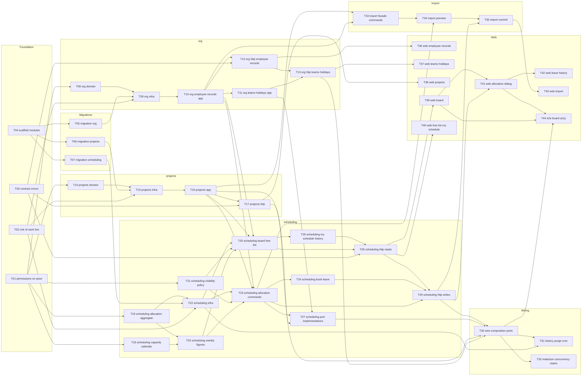

# Epic — resource-scheduling

> **PRD:** [PRD.md](../PRD.md) · **Design:** [sad.md](../sad.md) · **Data model:** [data-model.md](../data-model.md) · **API:** [openapi.yaml](../contracts/openapi.yaml) · **ADRs:** [adr/](../adr/)

## Goal

Ship the Team Availability Board: users who plan see every resource's allocated hours against real capacity week by week, find who is free over the next N weeks, and plan allocations and leave with overbooking warnings, on top of the intranet's first reusable employee and project records (PRD §2). Every allocation change of the last 12 months stays traceable, and sick-leave and departure details never reach viewers without the permission (PRD §6.1).

## Scope

- **In:** surfaces `[backend-service, web-frontend]` (sad frontmatter, ADR-0001). Kernel (`Actor` permissions, cross-module IDs, `Today`), `@arv/db` `UnitOfWorkLive`, shared contract errors (ADR-0010), three new modules `org`, `projects`, `scheduling` (ADR-0003) with their schemas, the api host wiring + monthly purge Cron Trigger, and the web features `org`, `projects`, `scheduling`.
- **Out (PRD §3):** time tracking, skills, finances, drag-and-drop/day-level editing, scenarios, tracker sync, managing roles and permissions (separate feature — a stub permission source is used until it ships), team-scoped permissions, several holiday calendars, leave approval, reopening projects, half-day leave. Rate limiting is also out (sad §8, divergence from PRD §6.1).

## Task map

Same DAG as [tasks.json](./tasks.json). T01–T04 have no dependencies and start in parallel; within each module domain work starts as soon as T01 lands, alongside the migrations.

**Phases** (longest-path depth; tasks in one phase can run in parallel unless their `files_hint` overlaps or they are migrations):

| Phase | Tasks |
|---|---|
| 1 | T01, T02, T03, T04 |
| 2 | T05, T06, T07, T08, T14, T18, T19, T21 |
| 3 | T09, T15, T20, T22 |
| 4 | T10, T16 |
| 5 | T11, T12, T17, T23, T25, T33 |
| 6 | T13, T24, T26, T27, T34, T36, T38 |
| 7 | T28, T37 |
| 8 | T29, T39, T40 |
| 9 | T30, T35, T41 |
| 10 | T31, T32, T42, T43, T44 |

## Tasks

See [tracker.md](./tracker.md) for status. Machine contract: [tasks.json](./tasks.json).

| # | Task | Layer | Est. | Blocked by | DoD (short) |
|---|---|---|---|---|---|
| T01 | [Carry the permission set on Actor and resolve it per request](./t01-permissions-on-actor.md) | wiring | M | — | Unit tests: an Actor built by the middleware carries exactly the stub's grants for that user, and an… |
| T02 | [Implement UnitOfWorkLive with a CurrentTx FiberRef read by query()](./t02-unit-of-work-live.md) | infra | M | — | Integration test (real `arv_test` DB): two writes inside `transactional` followed by a failure leave no… |
| T03 | [Add Forbidden, ConfirmationRequired, detailed Conflict and ValidationError contract errors](./t03-contract-errors.md) | ports | M | — | Unit tests: each new error maps to its status and a body that validates against the OpenAPI `ApiError`… |
| T04 | [Scaffold org, projects and scheduling modules and register them](./t04-scaffold-modules.md) | wiring | S | — | `pnpm check:modules` passes with the three new edges and no cycle. |
| T05 | [Promote the org schema: teams, employee_records, public_holidays](./t05-migration-org.md) | migration | S | T04 | Generated SQL matches the staged `.up.sql` files column for column (differences listed in the PR, if any). |
| T06 | [Promote the projects schema: projects](./t06-migration-projects.md) | migration | S | T04 | Generated SQL matches the staged `.up.sql`. |
| T07 | [Promote the scheduling schema: allocations, segments, history, import_runs](./t07-migration-scheduling.md) | migration | S | T04 | Generated SQL matches the staged `.up.sql` files. |
| T08 | [Model EmployeeRecord, Team and PublicHoliday with their validation rules](./t08-org-domain.md) | domain | M | T01 | Table-driven unit tests cover every AC-20 rule (0, negative, 61 h, no working day, end before start) and… |
| T09 | [Add org Drizzle repositories and test fixtures](./t09-org-infra.md) | infra | M | T02, T05, T08 | Integration tests: version mismatch updates 0 rows; a second login link hits the unique index and surfaces… |
| T10 | [Implement employee-record use cases, the CapacityImpactCheck port and the org facade](./t10-org-employee-records-app.md) | app | L | T09 | Use-case tests with in-memory fakes: AC-19a, AC-19b (names the record already linked), AC-19, AC-20, AC-22… |
| T11 | [Implement team and public-holiday use cases](./t11-org-teams-holidays-app.md) | app | M | T10 | Use-case tests: AC-19d (create, rename, «platform » refused, remove-with-members refused naming the… |
| T12 | [Expose employee-record endpoints with end-date redaction](./t12-org-http-employee-records.md) | ports | M | T03, T10 | Api integration tests (workerd + `arv_test`): create → 201, invalid hours → 400 naming the rule, second… |
| T13 | [Expose team and public-holiday endpoints](./t13-org-http-teams-holidays.md) | ports | M | T11, T12 | Api integration tests: duplicate team name → 409, remove team with members → 409 with count, holiday… |
| T14 | [Model Project with type, name comparison and open/closed on a date](./t14-projects-domain.md) | domain | S | T01 | Unit tests: open on the close date, closed the day after; close date before today rejected; «Atlas» vs… |
| T15 | [Add the projects Drizzle repository and fixtures](./t15-projects-infra.md) | infra | S | T02, T06, T14 | Integration tests: find-open-by-name ignores a closed project with the same key; list by ids returns names… |
| T16 | [Implement create and close-with-preview use cases, the ProjectClosingHook port and the projects facade](./t16-projects-app.md) | app | M | T15 | Use-case tests: AC-23, AC-24 refusal, AC-26 `Forbidden`, close-date-before-today refused, closing an… |
| T17 | [Expose project endpoints with leave-project redaction in the list](./t17-projects-http.md) | ports | M | T03, T16 | Api integration tests: duplicate open name → 409, close without confirm → 409 `ConfirmationRequired`,… |
| T18 | [Implement tick arithmetic and the capacity calendar](./t18-scheduling-capacity-calendar.md) | domain | L | T01 | Rule-table tests with the PRD rows: AC-08 (40 h/wk from Wednesday → 24 h; holiday Thursday → 32 h), AC-19… |
| T19 | [Model the Allocation aggregate of effective-dated segments with its rules](./t19-scheduling-allocation-aggregate.md) | domain | L | T01 | Table-driven tests for each AC-09 rule, AC-13 (names the 15th), AC-11, AC-21b. |
| T20 | [Compute weekly figures, cell states, overbooking and the free-list ranking](./t20-scheduling-weekly-figures.md) | domain | L | T18, T19 | Rule-table tests: AC-10 (32 h cap, 24 + 16 → 8 h over), AC-04 (overbooked week = 0, period from today),… |
| T21 | [Implement the scheduling permission and visibility policy](./t21-scheduling-visibility-policy.md) | domain | M | T01 | Table-driven tests over every permission combination × {own, other} resource asserting what is visible… |
| T22 | [Add scheduling Drizzle repositories and fixtures](./t22-scheduling-infra.md) | infra | L | T02, T07, T19 | Integration tests: stale version → 0 rows → `Conflict` (AC-07b); deleting an allocation keeps its history… |
| T23 | [Implement create, change and remove allocation use cases](./t23-scheduling-allocation-commands.md) | app | L | T10, T16, T20, T21, T22 | Use-case tests (fakes for org/projects facades and repos): AC-07 (saved with last changed by/at), AC-07a,… |
| T24 | [Implement the book-leave use case](./t24-scheduling-book-leave.md) | app | M | T23 | Use-case tests: AC-15 (5 days at full daily capacity; conflicting work allocation named even when the week… |
| T25 | [Implement the board and free-list queries](./t25-scheduling-board-free-list.md) | app | L | T10, T16, T20, T21, T22 | Use-case tests with fakes: AC-01 rows/columns and default window, AC-02 filters, AC-03 refusal, AC-04… |
| T26 | [Implement the my-schedule and allocation-history queries](./t26-scheduling-my-schedule-history.md) | app | M | T25 | Use-case tests: AC-17, AC-18 (not set up as a resource), AC-16 ordering with trim attributed to the… |
| T27 | [Implement CapacityImpactCheck and ProjectClosingHook in scheduling](./t27-scheduling-port-implementations.md) | app | M | T11, T16, T23 | Use-case tests: AC-19c lists the overbooked weeks and writes no history; AC-27 Monday holiday affects only… |
| T28 | [Expose board, free-list, my-schedule, allocation and history read endpoints](./t28-scheduling-http-reads.md) | ports | M | T03, T25, T26 | Api integration tests: board 200 with default window, window out of range → 400, free list bad weeks → 400… |
| T29 | [Expose allocation and leave write endpoints](./t29-scheduling-http-writes.md) | ports | M | T23, T24, T28 | Api integration tests: create 201, overbooking → 409 `ConfirmationRequired` then 201 with `confirm: true`,… |
| T30 | [Wire scheduling's port implementations in the composition root](./t30-wire-composition-ports.md) | wiring | M | T13, T17, T27, T29 | Api integration tests through the real composition root: contract-hours change that overbooks → 409… |
| T31 | [Add the monthly allocation-history purge and its Cron Trigger](./t31-history-purge-cron.md) | wiring | M | T22, T30 | Integration test with a fixed clock: entries older than 12 months deleted, newer kept, rerun deletes… |
| T32 | [Add the QG-2 redaction matrix and the concurrent-save test](./t32-redaction-concurrency-matrix.md) | tests | L | T30 | Matrix covers every read operation in openapi.yaml (test enumerates them and fails if one is missing). |
| T33 | [Add org and projects import commands that join the caller's unit of work](./t33-import-facade-commands.md) | app | M | T10, T16 | Integration test: calling both commands inside one `transactional` and then failing leaves no rows in… |
| T34 | [Implement import parsing, validation and the preview](./t34-import-preview.md) | app | L | T23, T33 | Unit tests per problem-row reason (AC-31) and the counts of a clean file (AC-30); AC-33 names missing… |
| T35 | [Implement the one-time import commit and its endpoints](./t35-import-commit.md) | app | M | T29, T34 | Api integration tests: unconfirmed upload → 409 `ConfirmationRequired` with the preview; confirmed →… |
| T36 | [Build the employee-record screens](./t36-web-employee-records.md) | ui | L | T12 | Route/component tests (existing web test setup): validation errors rendered per rule (AC-20),… |
| T37 | [Build the teams and public-holiday screens](./t37-web-teams-holidays.md) | ui | M | T13 | Route/component tests: duplicate name and remove-with-members messages (AC-19d), holiday confirm dialog… |
| T38 | [Build the project list, create and close-with-preview screens](./t38-web-projects.md) | ui | M | T17 | Route/component tests: AC-24 message, close preview lists trims and removals and resubmits with `confirm:… |
| T39 | [Build the schedule board with the week window and filters in the URL](./t39-web-board.md) | ui | L | T28 | Route/component tests: every cell state renders its text label (QS-7), URL params drive the loader call,… |
| T40 | [Build the free-list and my-schedule screens](./t40-web-free-list-my-schedule.md) | ui | M | T28 | Route/component tests: AC-05 message on bad input, ordering of results (AC-04), own leave type shown… |
| T41 | [Build the allocation create, change and remove dialog](./t41-web-allocation-dialog.md) | ui | L | T29, T39 | Route/component tests: overbooking confirm flow (AC-10), conflict message with current values (AC-07b),… |
| T42 | [Build the leave dialog and the allocation history panel](./t42-web-leave-history.md) | ui | M | T41 | Route/component tests: leave-day conflict confirm names the work allocations (AC-15), history renders trim… |
| T43 | [Build the import upload, preview and confirm screen](./t43-web-import.md) | ui | M | T35 | Route/component tests: problem rows listed (AC-31), confirm resubmits the file (AC-30), already-imported… |
| T44 | [Add the board end-to-end test with the accessibility audit](./t44-e2e-board-a11y.md) | tests | M | T30, T39, T41 | `pnpm test:e2e` green with zero axe violations on the board. |

**Total:** 44 tasks, ~26.5 person-days. Above the 8–20 guideline for size M because the feature spans three modules plus a web surface; keeping each task ≤ 1 day and one PR wins over the count.

## Risks / Hard rules

- **Module boundaries** (CLAUDE.md, ADR-0003): modules call each other only through facades; edges are only `org → identity`, `scheduling → org`, `scheduling → projects`. The org → scheduling and projects → scheduling calls go through host-wired ports (ADR-0007) — never a direct import. No cross-schema foreign keys.
- **Migrations are drizzle-generated**: migration tasks write `schema.ts` and run `pnpm db:generate`; staged `.up.sql` files are the spec, staged `.down.sql` files are documentation only.
- **Permissions checked in application use cases, per request** (ADR-0004, AC-14); redaction before any DTO is built (sad §8). T32's matrix is the regression net — a new read endpoint must be added to it.
- **Exact arithmetic** (ADR-0009): integer minutes stored, 1/420-minute ticks computed, rounding only for display. No floats in domain code.
- **Past plans are never rewritten** (AC-09b, AC-25): every allocation command goes through the segment aggregate (ADR-0008).
- **Version pins and new packages** (CLAUDE.md): `@axe-core/playwright` is approved (sad §8); any spreadsheet parser package needs Tech Lead approval first (sad §11).

## Open inputs before or during implementation

| Input | Blocks | Owner |
|---|---|---|
| Real planning-spreadsheet sample + format (PRD §8, sync report D-6) | T34, T35, T43 | PM |
| May a spreadsheet parser package be added? (sad §11) | T34 | Tech Lead |
| Sign-off on `ValidationError` as a contract error (sync report D-3; amend ADR-0010) | T03 | Tech Lead |
| Read-permission matrix for list endpoints (sync report D-5) | T32 sign-off (not its start) | Security Lead |
| Owners and team capacity (sad §11 «deadline, effort budget and team not quantified») | scheduling the phases | PM |
| Authentication source + roles/permissions feature (sad §11 High) | launch, not these tasks (stub source in T01) | Tech Lead |
