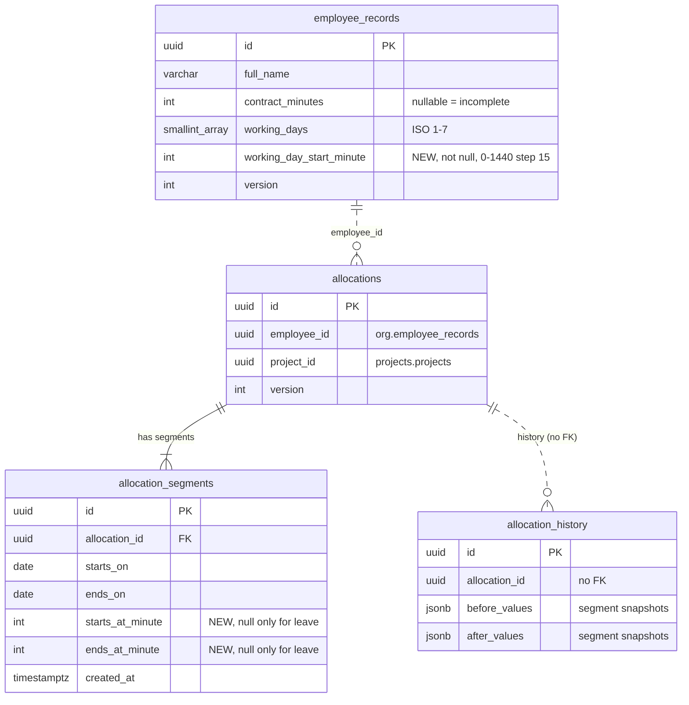

# Data model — schedule-daily-view

<!-- Generated by generate-data-model (mode: brownfield delta). Migrations are STAGED under
docs/features/schedule-daily-view/migrations/ (NOT the live packages/migrations/drizzle tree);
implement-tasks promotes them. -->

> **Inputs:** [PRD](./PRD.md) §4–§6.1 (AC-21–AC-27b) · [SAD](./sad.md) §2 (stage 3 override), §4 choice 3–4, §5, §6 flows 1–12, §7 release sequence, §10 QG-4, §11 · [ADR-0002](./adr/0002-store-daily-time-interval-as-minutes-on-segments-and-drop-the-rate.md) (minutes from midnight, no rate) · [ADR-0003](./adr/0003-replace-the-rate-without-converting-pre-production-allocations.md) (no conversion) · base model: [resource-scheduling data-model](../resource-scheduling/data-model.md).
> **Decisions taken in this pass (author, 2026-11-22):**
> 1. `allocation_segments.rate_period` is **dropped** with `rate_minutes`. A segment is leave exactly when its interval is NULL. The domain still names that kind `full-day` (ADR-0002 «leave keeps a full-day kind» holds in the domain, not as a column).
> 2. `org.employee_records.working_day_start_minute` is added NOT NULL in **one** migration. A `DEFAULT 540` backfills existing rows and is dropped in the same migration, so the table keeps no business default. 09:00 for a new record is set in the org domain (AC-27). This extends the SAD §2 pre-production override from `scheduling` to `org`.

## Scope

Stages 1 and 2 add **no stored data**. Per-day figures, per-day overbooking, the day view, the free list and the gesture outcome table are all computed on read (SAD §4 choice 2, resource-scheduling ADR-0005). **Stage 3** changes two existing tables and adds none:

| Table | Change | Source |
|---|---|---|
| `scheduling.allocation_segments` | + `starts_at_minute`, + `ends_at_minute`; − `rate_minutes`, − `rate_period` | ADR-0002, ADR-0003, AC-23, AC-24 |
| `org.employee_records` | + `working_day_start_minute` | ADR-0002, AC-27, AC-27b |

Every other table (`teams`, `public_holidays`, `projects`, `allocations`, `allocation_history`, `import_runs`) is unchanged.

## ER diagram

Only the tables this feature touches, plus their parents. Solid lines are FKs inside one schema; dotted lines are ID references across schemas (no FK, repo ADR 0001).



## Entities

### `scheduling.allocation_segments` (changed)

**Aggregate root:** `allocations` (resource-scheduling ADR-0008). Segments are effective-dated: a change of interval on a started allocation ends the current segment yesterday and opens a new one from today (AC-23, flow 11). That is the same mechanism as a rate change today.

| Column | Type | Constraints | Notes |
|---|---|---|---|
| `id` | UUID | PK, `DEFAULT uuidv7()` | unchanged |
| `allocation_id` | UUID | NOT NULL, FK → `allocations(id)` ON DELETE CASCADE | unchanged, indexed |
| `starts_on` | DATE | NOT NULL | unchanged |
| `ends_on` | DATE | NOT NULL | unchanged |
| **`starts_at_minute`** | INTEGER | NULL | **new.** Daily start, in minutes from midnight in the company time zone (BRIEF B-01 #10). NULL only for leave. |
| **`ends_at_minute`** | INTEGER | NULL | **new.** Daily end, in minutes from midnight; `1440` = 24:00. NULL only for leave. Hours per day = `ends_at_minute − starts_at_minute` (the only definition, ADR-0002). |
| ~~`rate_minutes`~~ | ~~INTEGER~~ | — | **dropped** (ADR-0002: no stored rate) |
| ~~`rate_period`~~ | ~~VARCHAR(8)~~ | — | **dropped** (decision 1 above). Leave = interval NULL. |
| `created_at` | TIMESTAMPTZ | NOT NULL `DEFAULT now()` | unchanged |

**Domain invariants (no `CHECK`, `.claude/rules/backend/db.md`)**, enforced in `scheduling/domain` and covered by rule-table tests (QG-1, QG-4):
- Both minutes are NULL, or both are set. NULL ⇔ the allocation is on a leave-type project (AC-15, AC-22, AC-23 «the leave form asks for no times»).
- `0 ≤ starts_at_minute < ends_at_minute ≤ 1440`, both multiples of 15 (AC-24). At most 24 hours follows from that.
- An interval may lie outside working hours (AC-26). That is not a storage rule.

**Why INTEGER, not `time` or `smallint`:** ADR-0002 option 1 (integer arithmetic with ticks, ADR-0009). It matches `contract_minutes`, and 24:00 is plain `1440`.

**Access patterns (no new index):**
- Timeline for one day (flow 10): `ends_on >= :day AND starts_on <= :day` → existing `idx_allocation_segments_ends_on_starts_on`.
- Day view window (flows 1, 4): same window predicate → same index.
- Per-resource time-overlap and overbooking check on save (flow 11): `allocations.employee_id = :id` → `idx_allocations_employee_id`, then segments by `allocation_id` → `idx_allocation_segments_allocation_id`.
- Overlap detection compares minutes **in memory** after the date-window read. No query filters or sorts on the minute columns, so they get no index.

### `org.employee_records` (changed)

**Aggregate root:** itself. Optimistic `version` / `last_changed_*` already cover the new field (SAD §8 concurrency). No `updated_at` is added.

| Column | Type | Constraints | Notes |
|---|---|---|---|
| … | | | existing columns unchanged (see [resource-scheduling data-model](../resource-scheduling/data-model.md)) |
| **`working_day_start_minute`** | INTEGER | NOT NULL, **no default** | **new.** Minutes from midnight; 540 = 09:00. Existing rows are backfilled to 540 by the migration. A new record gets 540 from the org domain unless set otherwise (AC-27). |

**Domain invariants (no `CHECK`)**, in `org/domain` (`EmployeeRecord.workingDayStart`):
- a multiple of 15 (AC-27b);
- `working_day_start_minute + daily capacity ≤ 1440` (AC-27b, «must end by 24:00»). Daily capacity comes from `contract_minutes` and `working_days`. For an incomplete record (`contract_minutes` NULL, AC-06), only the step rule applies.
- The working-day end is **computed, never stored** (ADR-0002). It may fall off a 15-minute step for part-timers (AC-27b).

**Access patterns:** read with the record through `OrgApi`'s employment terms (SAD §4 choice 3). No query filters on it, so no index.

## Indexes

No index is added or dropped. Each new read is served by an existing index:

| Index (existing) | Columns | Query it serves in this feature |
|---|---|---|
| `scheduling.idx_allocation_segments_ends_on_starts_on` | `(ends_on, starts_on)` | Day view window ≤ 4 weeks (flows 1, 4, 8); timeline one day (flow 10); free list (flow 6); gesture outcome table window (flows 3, 9) |
| `scheduling.idx_allocations_employee_id` | `(employee_id)` | Per-resource overbooking and time-overlap check on every save (flows 2, 7, 11); own schedule and own timeline (flows 8, 10) |
| `scheduling.idx_allocation_segments_allocation_id` | `(allocation_id)` | Load an allocation's segments (every save; FK index) |

The QG-4 count check (below) is a one-off full scan per environment, so it gets no index.

## Migrations (staged)

| Staged file | What it does |
|---|---|
| [`20261122120000_alter_allocation_segments_time_interval.up.sql`](./migrations/20261122120000_alter_allocation_segments_time_interval.up.sql) | Guard (aborts if any work segment exists), adds the two minute columns, drops `rate_minutes` and `rate_period` |
| [`…120000….down.sql`](./migrations/20261122120000_alter_allocation_segments_time_interval.down.sql) | Documentation only. Restores the rate columns and maps each interval back to a daily rate. |
| [`20261122120001_alter_employee_records_working_day_start.up.sql`](./migrations/20261122120001_alter_employee_records_working_day_start.up.sql) | Adds `working_day_start_minute` NOT NULL with a one-shot `DEFAULT 540`, then drops the default |
| [`…120001….down.sql`](./migrations/20261122120001_alter_employee_records_working_day_start.down.sql) | Documentation only. Drops the column. |

**Promote-time recipe (implement-tasks):** the repo's migrations are drizzle-kit generated, and these files are a spec.
1. In `modules/scheduling/src/infrastructure/schema.ts`, remove `rateMinutes` and `ratePeriod` and add `startsAtMinute: integer()` and `endsAtMinute: integer()`. In `modules/org/src/infrastructure/schema.ts`, add `workingDayStartMinute: integer().notNull()` with **no** `.default()`.
2. Run `pnpm db:generate`. That gives one migration `0006_*.sql` for both modules.
3. Hand-edit the generated SQL before it is applied anywhere:
   - **Prepend the guard `DO` block** from the `…120000` up file.
   - Replace the bare `ADD COLUMN "working_day_start_minute" integer NOT NULL` with the two statements from the `…120001` up file. A bare NOT NULL fails on a table with rows.

   The snapshot stays consistent: the final state has no default.
4. `pnpm db:generate` must then report no changes, and `pnpm db:status` must be clean. Run `pnpm test:integration`.

### Stage 3 release SQL (runbook, not a migration)

These go with the SAD §7 release sequence. They are kept here because they depend on the columns above. **Step 0 is a human decision** («are these test data?»), and SQL can't make it.

```sql
-- §7 step 0 (before migrating) — what would be deleted; review the list, stop in production if it is not test data
SELECT a.id, a.employee_id, a.project_id, s.starts_on, s.ends_on, s.rate_minutes, s.rate_period
FROM scheduling.allocations a JOIN scheduling.allocation_segments s ON s.allocation_id = a.id
WHERE s.rate_period <> 'full-day';

-- §7 step 1 — delete work (non-leave) allocations; segments cascade. History is kept only for surviving
-- leave allocations: this also clears entries of already-removed allocations (no FK, they outlive removal),
-- whose snapshots carry the old rate shape
BEGIN;
DELETE FROM scheduling.allocation_history h
  WHERE h.allocation_id NOT IN (SELECT allocation_id FROM scheduling.allocation_segments WHERE rate_period = 'full-day');
DELETE FROM scheduling.allocations a
  WHERE EXISTS (SELECT 1 FROM scheduling.allocation_segments s WHERE s.allocation_id = a.id AND s.rate_period <> 'full-day');
COMMIT;

-- §7 step 4 — QG-4 count check (after migrating); every count must be 0
SELECT
  count(*) FILTER (WHERE (starts_at_minute IS NULL) <> (ends_at_minute IS NULL))        AS half_set,
  count(*) FILTER (WHERE starts_at_minute >= ends_at_minute
                      OR starts_at_minute % 15 <> 0 OR ends_at_minute % 15 <> 0
                      OR starts_at_minute < 0 OR ends_at_minute > 1440)                  AS invalid_interval
FROM scheduling.allocation_segments;
-- plus, through the api or a join on projects.projects.kind by hand: 0 non-leave allocations with a NULL interval
```

Before step 1 runs, check that no allocation has segments of both kinds. A leave allocation is a single `full-day` segment and can't become work, so mixed allocations are not expected.

### History snapshots (code impact, not schema)

`allocation_history.before_values` / `after_values` are opaque JSONB snapshots, so the schema doesn't change. `drizzle-history-repository.ts` decodes them with `Schema.decodeUnknownSync(Schema.NullOr(Schema.Array(Segment)))`. After step 1, history rows of **leave** allocations survive with the old shape (`rateMinutes: null, ratePeriod: 'full-day'`). If the stage 3 `Segment` schema doesn't accept that shape, opening such history becomes a defect (500).

**Required at implementation:** the snapshot decoder accepts the legacy leave shape and reads it as a segment with no interval, covered by a unit test. The alternative is a one-off data migration that rewrites the keys inside the JSONB arrays. It is rejected because the decoder change is smaller and reversible. All other history is deleted in step 1, including that of already-removed allocations, and needs nothing.

## Seeds

None. No bootstrap or lookup data. Demo data is re-seeded with intervals after the release (SAD §7 step 5). That is a runbook step, not a migration.

## Test fixtures

The seed helpers in `@arv/db/testing` use raw SQL, so they change with the schema. Fixtures never go in migrations. PII guard: `Test User`, `user-<n>@example.test`.

- `seedAllocations(...)` in `packages/db/src/testing/seed-scheduling.ts`: the segment seed type drops `rateMinutes` / `ratePeriod` and gains `startsAtMinute: number | null` / `endsAtMinute: number | null`. The `INSERT` column list changes to match. For a leave fixture, both are `null`.
- `seedEmployeeRecords(...)` in `packages/db/src/testing/seed-org.ts`: gains an optional `workingDayStartMinute` that defaults to `540` **in the helper**, because the column has no DB default. It is inserted and returned as `workingDayStartMinute`.
- `apps/api/test/integration/scheduling/import.test.ts` selects `s.rate_minutes, s.rate_period`. It switches to the interval columns when the import format changes (PRD §8 default: start and end time per row).
- New rule-table rows (QG-1, QG-4) live in `modules/scheduling/src/domain/*.test.ts` and `modules/org/src/domain/*.test.ts`. They are pure and need no fixtures.
