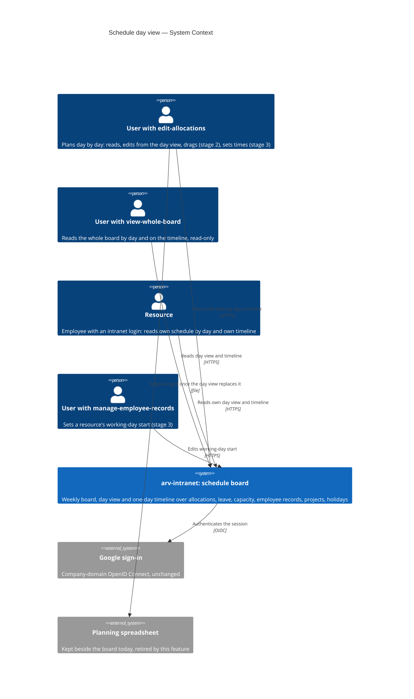
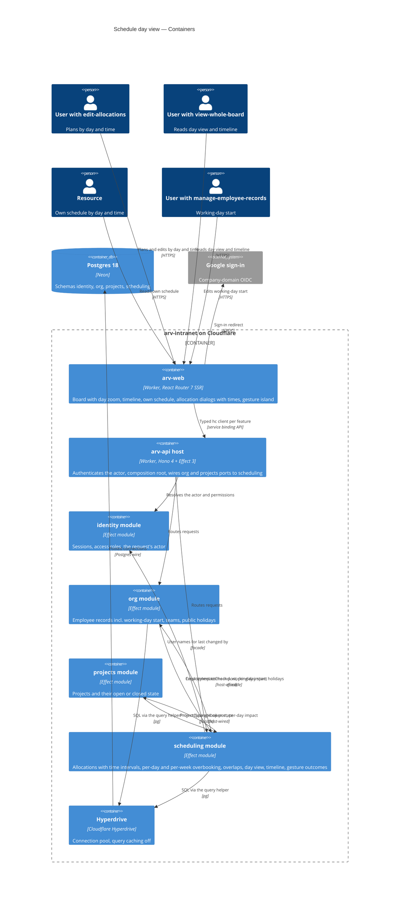
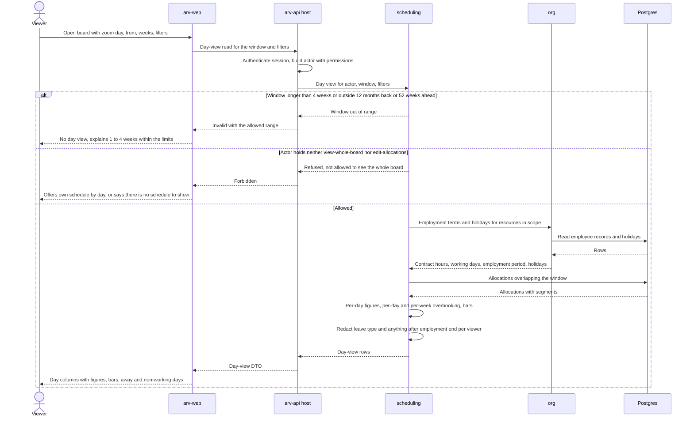
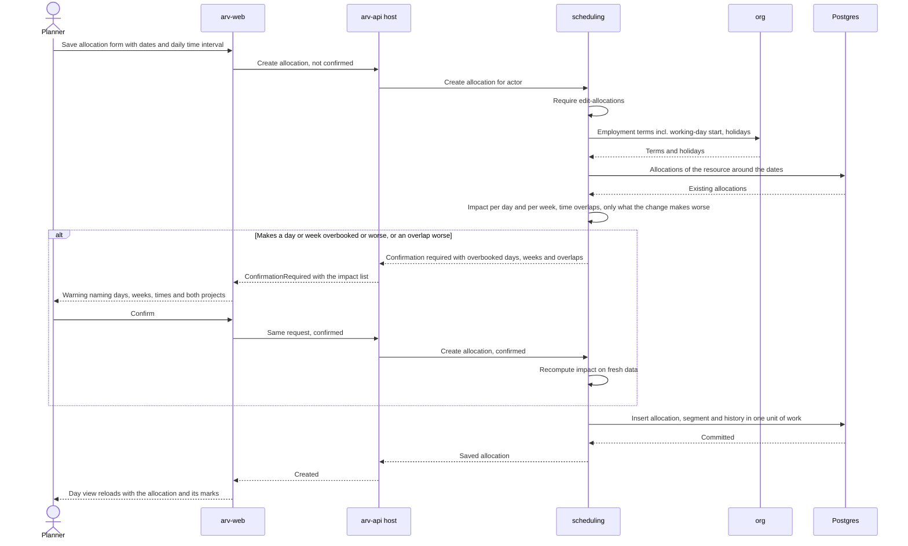
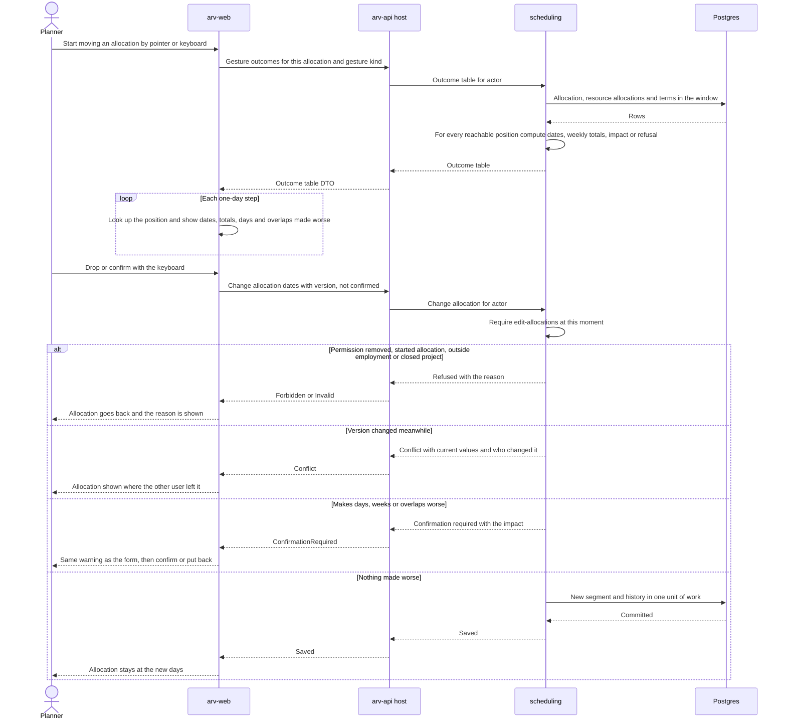
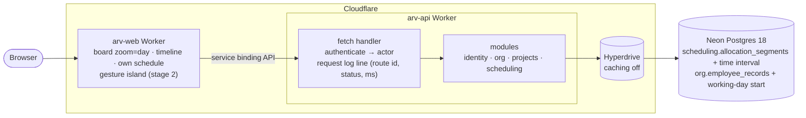

# Software Architecture Document — schedule-daily-view

<!-- Stages 04-05 → see sdlc/plugin/skills/architecture-design/SKILL.md -->
<!-- 12 Arc42 sections. Empty sections — <!-- N/A: <one-line reason> -->. -->
<!-- C4 Context (L1) lives inline in §3. C4 Container (L2) lives inline in §5. -->
<!-- §6 Runtime view seeds the primary flow(s) here; complete-sequence-diagrams (stage 06) then -->
<!--    fills §6 with every critical flow / §5 AC — no cap. -->
<!-- Numbers in §10 come VERBATIM from PRD §6 NFR — no inventing, no rounding. -->

## 1. Introduction and goals

**Intent.** We turn the schedule board into a **day view** of one to four weeks with one column per day. It shows each resource's allocated hours against their daily capacity, their allocations as bars across the days they cover, and leave days and public holidays (PRD §1, Approach C — Staged Day View, Gesture Editing). One overbooking rule, judged per day as well as per week, holds on the weekly board, the day view, the free list and every save warning (PRD §2). The feature ships in three stages:

- **Stage 1** — the read view, plus selecting days or clicking a bar to open the existing forms.
- **Stage 2** — moving and stretching an allocation by whole days, by dragging or with the keyboard. It is funded only if the planning spreadsheet is still in use at the recount 2 weeks after stage 1.
- **Stage 3 — time of day** (part of the current iteration, not gated by the recount). Every allocation except leave gets a required daily **time interval**, and the weekly rate is removed. Each employee record gains a working-day start, a **time overlap** warning joins the overbooking warning, and a one-day **timeline** is added.

The feature serves the ~5 users with the edit-allocations permission, who plan, and the ~30 resources who read their own schedule. Stages 1–2 add no stored data, because per-day figures are already computed from existing inputs. Stage 3 adds two stored fields. No allocation is converted: stage 3 reaches production before any real allocation exists, and test allocations are deleted ([ADR-0003](./adr/0003-replace-the-rate-without-converting-pre-production-allocations.md)).

**Top quality goals (1-liners; full scenarios in §10):**

1. **QG-1 Calculation correctness at day precision** — 100% of daily figures, per-day and per-week overbooking verdicts and (stage 3) time-overlap verdicts match the capacity rules, computed exactly and judged on exact figures. One rule set serves the board, the day view, the free list and every warning (PRD §6).
2. **QG-2 Confidentiality at day precision** — leave type, leave project, employment end date and anything after it never reach a viewer without the matching permission. That includes stage 3's times of allocations and working hours, in every view: day view, grouping by project, read-only details, own schedule and timeline (PRD §6.1).
3. **QG-3 Responsiveness at target scale** — day view p95 ≤ 1500 ms for 100 resources × 4 weeks, gesture save p95 ≤ 500 ms, gesture preview within 300 ms of each one-day step, and one-day timeline p95 ≤ 1000 ms for 100 resources (PRD §6).
4. **QG-4 Stage 3 data correctness** — after the stage 3 release, 100% of non-leave allocations carry a valid time interval and none carries a rate. This replaces the PRD's «Migration correctness», because nothing is converted (ADR-0003; full scenario in §10).

**Stakeholders.**

| Role | Interest | Sign-off owner? |
|---|---|---|
| Users with the edit-allocations permission (PMs, delivery managers, team leads — the people who plan) | Plan day by day on the board itself and retire the planning spreadsheet; gestures with the same warnings they trust | No |
| Users with the view-whole-board permission | Read the whole board by day and (stage 3) by time of day | No |
| Resources (~30 scheduled employees with an intranet login) | Read their own schedule by day and on the timeline, including their own leave type | No |
| Users with the manage-employee-records permission | Set each resource's working-day start (stage 3, US-10) | No |
| PM (PRD owner — dmitro.b) | Goals and the spreadsheet KPI hold; consulted on §10 quality goals and §11 severities; owns the stage 2 funding checkpoint | Yes (§10) |
| Tech Lead | SAD approval, ADRs, module graph, the stage 3 migration and its precondition (ADR-0003) | Yes |
| Security Lead | Mandatory security review: health-related absence at day precision, per-day overbooking, working-pattern profiling (PRD §6.1) | Yes |

**Decision overrides.**

- Decision override: no conversion of existing allocations at stage 3. PRD AC-28, the NFR «Migration correctness» and the stage 3 override's «existing weekly-rate allocations converted» (PRD §1) do not apply. Rationale (author, 2026-11-22): «Проєкт ще не на проді, наразі створені аллокації лише тестові, я можу видалити їх при розробці, і нам не доведеться їх мігрувати». Valid only while stage 3 reaches production before any real allocation does ([ADR-0003](./adr/0003-replace-the-rate-without-converting-pre-production-allocations.md); precondition risk in §11).
- Decision override: PRD §8's two conversion questions (rounding a converted weekly rate; telling planners about migration overlaps and lower holiday-week totals) are closed by ADR-0003 rather than answered. Rationale: nothing is converted. They return if the ADR-0003 precondition breaks.
- Decision override: no rate limit on allocation changes, although PRD §6.1 says gestures count toward «the existing limit of 120 allocation changes per minute per user». Rationale: that limit was removed from the resource-scheduling MVP and does not exist. Each change is attributed in history, and the Security Lead confirms or reverses this at the mandatory security review (§8, §11).

## 2. Constraints

**Technical** (pinned in the repo and unchanged by this feature; see `ARCHITECTURE.md`, `package.json`, `apps/*/wrangler.jsonc` and [resource-scheduling SAD §2](../resource-scheduling/sad.md#2-constraints)).
- Runtime: Cloudflare Workers (Workers Paid plan limits on CPU time, subrequests and bundle size). Two deployables: `arv-web` (public) and `arv-api` (private, reachable only through the web Worker's `API` service binding). This feature adds no deployable and no binding.
- API: Hono 4.13.13 + Effect 3.22.2. Web: React Router 7.18.4 (SSR, loaders and actions), React 19.2, Tailwind CSS 4.3.3, shadcn components over Base UI in `apps/web/app/shared/ui`, theme tokens in `apps/web/app/app.css`, `lucide-react` icons.
- Tooling: TypeScript 5.9.3 (pinned below 7 for React Router 7), Vitest 4.1 (pinned for the Workers Vitest plugin), Playwright 1.64.0 with `@axe-core/playwright` 4.14.0 in `e2e/`, Biome, pnpm, Turbo.
- Data: Postgres 18 (Neon in production) through Hyperdrive with query caching **disabled**; Drizzle ORM 0.45 and drizzle-kit 0.31. Migrations are **generated by drizzle-kit** from each module's `schema.ts` into `packages/migrations/drizzle/` and are never edited once applied.
- Architecture: modular monolith with hexagonal modules (repo [ADR 0001](../../adr/0001-modular-monolith.md)). One Postgres schema per module, with no foreign keys, joins or queries across schemas. The module graph is `org → identity`, `scheduling → identity, org, projects`, and this feature **adds no module edge**. Transactions on Hyperdrive stay short and never await network calls.
- Inherited feature decisions that stay in force ([resource-scheduling ADRs](../resource-scheduling/adr/)):
  - 0002 — the board is server-rendered with its window in the URL.
  - 0005 — capacity and overbooking are computed on read in pure domain functions.
  - 0007 — host-wired ports for org's capacity check and projects' closing hook.
  - 0008 — an allocation is one aggregate of effective-dated segments with a `version`.
  - 0009 — integer minutes are stored and integer 1/420-minute ticks are computed.
  - 0010 — warn-then-confirm by re-sending with `confirm: true`.
- **Override — stage 3 migration and contract (pre-production only):** the stage 3 migration drops the rate columns in one step instead of expand → contract (`.claude/rules/backend/db.md`), and the allocation contract loses the weekly rate non-additively (ARCHITECTURE.md «changes are additive only»). This is allowed only because scheduling holds no production data yet ([ADR-0003](./adr/0003-replace-the-rate-without-converting-pre-production-allocations.md), §11). If the precondition breaks, the normal rules apply. A rollback is a new forward migration, never a schema rollback.
- **No new package without approval** (CLAUDE.md). `apps/web` has no drag-and-drop or gesture package today; choosing one is PRD §8's open question (§11).

**Organisational.**
- No hard deadline (PRD §1). Effort budget and team composition are not quantified.
- **Build order: stage 1 → stage 3 → stage 2.** Stage 3 is part of the current iteration and is built while the stage 1 recount runs. Stage 2 is built last, and only if the recount 2 weeks after stage 1 funds it (at least one planner still keeps the spreadsheet, PRD §7). As a result, stage 2 gestures are designed only for daily time intervals and time overlaps, never for a weekly rate. The weekly-rate wording of AC-19 applies only if this order changes.
- Stage 3 converts nothing: it must reach production before any real allocation exists there, and test allocations are deleted before its migration ([ADR-0003](./adr/0003-replace-the-rate-without-converting-pre-production-allocations.md); precondition risk in §11).

**Conventions.**
- [`CLAUDE.md`](../../../CLAUDE.md), [`ARCHITECTURE.md`](../../../ARCHITECTURE.md) and `.claude/rules/*` (backend, frontend, infra). Layer imports are enforced by Biome `noRestrictedImports`.
- Errors: domain `Schema.TaggedError` → the module's presenter → shared contract errors (`NotFound`, `Conflict`, `ConfirmationRequired`, `Invalid`, `Refused`). Database failures are defects (`Effect.orDie` → 500). Contract changes are additive.
- Tests sit next to the code. Api integration tests run in `apps/api/test/integration/<module>/` against workerd and the real `arv_test` database; e2e tests live in `e2e/tests/scheduling/`.
- Conventional Commits scoped by module or package: `scheduling`, `org`, `contracts`, `web`, `migrations`.

**Regulatory / external.**
- Data classification **confidential** (PRD §6.1): named employees' daily workload and absences. Sick leave is health-related.
- Controls carried from PRD §6.1 and the board:
  - Leave type and leave project are shown only to holders of see-leave-reasons and to the resource themselves; everyone else sees «away».
  - Employment end date, and the allocations, overbooking and (stage 3) times and working hours after it, are shown only to holders of manage-employee-records or edit-allocations.
  - No new permissions.
  - Permissions are checked at every save, not at sign-in.
- **Security review required** before stage 1 and before stage 3 ships. Day-precision absence, per-day overbooking and working-pattern profiling are accepted residual risks flagged for that review.

## 3. Context and scope

<!-- brownfield: no docs/architecture-map.md yet. Current architecture read from the authored ARCHITECTURE.md, repo ADR 0001, the resource-scheduling SAD + ADR-0001…0010, and an sdlc:explorer scan of modules/scheduling, modules/org, packages/contracts/src/scheduling, apps/web/app/features/scheduling, apps/api and e2e/ (2026-11-22, HEAD 27e2b52). Run /sdlc:map-architecture to persist a map. -->

The weekly schedule board (resource-scheduling) shipped. The ~5 people who plan still keep the planning spreadsheet next to it, mainly to see the plan **day by day** (PRD §1, survey 2026-11). The day view brings that day-level picture onto the board, together with per-day overbooking, editing from the day and (stage 3) the time of day, so that the spreadsheet can be retired. The system boundary is unchanged: everything runs inside arv-intranet, which already owns allocations, capacity, employee records, projects and public holidays. The feature adds **no new external system**. The trust boundary stays the public web Worker. Selected days, dropped positions, keyboard moves and typed times are untrusted until the private api validates them, and every save is authorised at that moment.

**External systems (in / out):**

| Actor or system | Type | Interaction |
|---|---|---|
| User with the edit-allocations permission (who plans; includes view-whole-board) | Person | Reads the day view and timeline; selects days or clicks a bar to open the allocation and leave forms; (stage 2) moves and stretches allocations by dragging or keyboard; (stage 3) gives allocations a daily time interval |
| User with the view-whole-board permission | Person | Reads the day view (by resource or by project) and the timeline; sees allocation details read-only |
| Resource (with an intranet login linked to their employee record) | Person | Reads their own schedule by day and on their own timeline, including their own leave type |
| User with the manage-employee-records permission | Person | (Stage 3) sets a resource's working-day start on the employee record |
| Google (company-domain sign-in) | System (external) | Authenticates the browser session (identity ADR-0003); unchanged by this feature |
| Planning spreadsheet | Data source (external file) | Kept by planners next to the board today; **retired** by this feature (PRD §7 KPI), with no integration |

**C4 Context (L1):**



## 4. Solution strategy

**Target surface(s) (the first decision — what's being built):** `[backend-service, web-frontend]`. This is the same pair as [resource-scheduling ADR-0001](../resource-scheduling/adr/0001-build-backend-service-and-web-frontend-surfaces.md); the feature **extends** both existing containers and adds no new one, so it gets no new ADR (blast-radius gate 1 of 3: multi-module only).

- **backend-service** — the private `arv-api` Worker:
  - `scheduling` gains the day-view and timeline reads, per-day overbooking, the time-overlap check, the time interval on allocations and (stage 2) the gesture outcome table;
  - `org` gains the working-day start;
  - `@arv/contracts/scheduling` and `@arv/contracts/org` grow additively, except where stage 3 removes the weekly rate.
- **web-frontend** — the public `arv-web` Worker's `features/scheduling` (and `features/org` for the working-day start) consumes that contract and authors none.

**Top strategic choices (the seeds for ADRs):**

1. **UI-architecture: the day view and the timeline are server-rendered zooms of the board URL** ([ADR-0001](./adr/0001-render-day-view-and-timeline-as-ssr-zooms-of-the-board-url.md)).
   - The day view is the board route with `zoom=day`, `from` and `weeks=1..4`, keeping `team`, `project` and `view=people|project`.
   - The timeline is its own route with `date=` and the same filters.
   - The own schedule takes the same params.
   - Each view is one loader call to one bounded api read: ≤ 4 weeks of days, or one day.
   - Switching zoom is a navigation that keeps the first week and the filters (AC-01).
   - Forms open from the day view through the existing allocation and leave dialogs and route actions.
   - Stage 2 gestures are a client island on the rendered page, absent on phones (PRD §3).
   - Screens reuse `apps/web/app/shared/ui` (shadcn over Base UI) and the `app.css` theme tokens: no new design system and no new component library. A new primitive is justified only where none fits (a draggable bar, a time axis).
   - Serves QG-3 (bounded payload) and keeps the api private.

2. **One per-day rule set behind every figure and warning** (extends [resource-scheduling ADR-0005](../resource-scheduling/adr/0005-compute-capacity-and-availability-on-read.md); no new ADR, because PRD goal 2 leaves no alternative). `scheduling/domain` judges overbooking per day **and** per week in one function: a day is over its daily capacity, and a week is over its capacity or contains an overbooked day. «Made worse» is per day and per week (AC-08), and from stage 3 the domain adds time overlaps with the same rule (AC-25). The free list counts free hours day by day (AC-07). The same functions serve:
   - the weekly board and the own schedule;
   - the day view and the timeline;
   - the free list;
   - every save warning: allocation and leave forms, gestures;
   - org's `CapacityImpactCheck` (employee record and holiday edits);
   - projects' `ProjectClosingHook`.

   Nothing is stored. Figures are computed on read in integer ticks and shown rounded to the half hour. Serves QG-1.

3. **Store the daily time interval as minutes from midnight on allocation segments and drop the rate** ([ADR-0002](./adr/0002-store-daily-time-interval-as-minutes-on-segments-and-drop-the-rate.md)).
   - `scheduling.allocation_segments` gets `starts_at_minute` / `ends_at_minute`: 0–1440, multiples of 15, NULL only for leave.
   - `rate_minutes` and `rate_period` `day`/`week` are removed, so hours per day equal the interval's length.
   - `org.employee_records` gets `working_day_start_minute`, default 540 = 09:00. Working hours end at start + daily capacity, computed and never stored.
   - A change of interval on a started allocation is a new effective-dated segment from today (AC-23, resource-scheduling ADR-0008).
   - `scheduling` reads the working-day start through `OrgApi`'s employment terms. No new module edge.

4. **No conversion of existing allocations at stage 3** ([ADR-0003](./adr/0003-replace-the-rate-without-converting-pre-production-allocations.md)). Scheduling is not in production yet and every existing allocation is test data. Stage 3 reaches production before any real allocation does, so its drizzle-generated migration replaces the rate with the interval directly, and test allocations are deleted first. AC-28 and the NFR «Migration correctness» therefore do not apply (§1 decision override, §11 precondition risk). If real allocations reach production first, the fallback is expand → convert → contract (ADR-0003 option 2).

5. **Stage 2 gestures preview from a server-computed outcome table, fetched once per gesture** ([ADR-0004](./adr/0004-precompute-gesture-outcomes-once-per-gesture-on-the-server.md)).
   - At gesture start (pointer or keyboard), the web asks `scheduling` for every reachable position in the visible window: the resulting dates, weekly totals, the days and weeks made worse, the overlaps created or lengthened, or the reason a position is refused.
   - Each one-day step is a local lookup, which meets the 300 ms target.
   - The drop is the ordinary save with `version` and `confirm` (resource-scheduling ADR-0010), recomputed on fresh data and checked for permission at that moment (AC-17, AC-18).
   - The drag-and-drop support itself (a new package needs approval) is PRD §8's open question, decided before stage 2 starts (§11).

Each tactical decision in later sections should be traceable to one of these strategic seeds. Tactical decisions that *contradict* a strategic choice are red flags — surface them in §11 Risks.

## 5. Building block view

The feature follows the repo's **modular monolith with hexagonal modules** (repo ADR 0001) with no divergence. It adds **no module, no module edge and no deployable**; it extends `scheduling` and `org`, their contracts and the web's `scheduling` and `org` feature folders. Every new rule is a pure function in `scheduling/domain`, as [resource-scheduling ADR-0005](../resource-scheduling/adr/0005-compute-capacity-and-availability-on-read.md) requires. Every new read and command is an Effect use case in `scheduling/application`, reached through Hono routes in `scheduling/http`. The day view, the timeline, their own-schedule equivalents and the gesture outcome table are **dedicated reads** beside the unchanged weekly board read ([ADR-0005](./adr/0005-serve-day-view-and-timeline-through-dedicated-reads.md)). The module's presenter applies the visibility policy before any DTO is built. `scheduling` gets the working-day start from `org` only through `OrgApi`'s employment terms, never from `org`'s tables. The host-wired ports of [resource-scheduling ADR-0007](../resource-scheduling/adr/0007-invert-capacity-and-close-checks-through-host-wired-ports.md) keep their shape; only the rule behind them becomes per-day.

**Internal decomposition** (new or changed parts only; S1/S2/S3 = the stage that brings it):

```
modules/scheduling/src/
├── domain/
│   ├── daily-figures.ts      S1  per resource-day cell (allocated vs daily capacity, away, non-working,
│   │                             overbooked) and allocation bars spanning days; reuses capacity.ts
│   ├── overbooking.ts        S1  judged per day AND per week; «made worse» per day and per week (AC-08);
│   │                             a week with an overbooked day is overbooked; changeImpact names days
│   ├── free-list.ts          S1  free hours summed day by day (AC-07)
│   ├── working-hours.ts      S3  working-day start + daily capacity → working hours (AC-27, AC-27b)
│   ├── time-overlap.ts       S3  overlaps between non-leave intervals per day; «made worse» (AC-25)
│   ├── allocation.ts         S3  segment carries a time interval (minutes from midnight) instead of a rate
│   ├── gesture-outcomes.ts   S2  every reachable move / edge position → dates, weekly totals, impact or
│   │                             refusal reason (ADR-0004)
│   └── visibility.ts         S1/S3  unchanged rules, applied to day cells, times and working hours
├── application/
│   ├── day-view.ts           S1  read: window ≤ 4 weeks, by resource (project grouping is done in the web)
│   ├── timeline.ts           S3  read: one day, by resource
│   ├── my-schedule.ts        S1/S3  own schedule gains the day zoom and own timeline
│   ├── gesture-outcomes.ts   S2  read: outcome table for one allocation and gesture kind
│   ├── allocations/*         S1/S3  per-day impact in every save; time interval in create/change (AC-23)
│   ├── capacity-impact-check.ts, project-closing-hook.ts   S1  per-day impact (AC-07)
│   └── import-*              S3  rows carry start/end time; rows with a weekly rate are refused (PRD §8)
├── infrastructure/schema.ts  S3  allocation_segments: starts_at_minute, ends_at_minute; rate columns
│                                 removed (ADR-0002, ADR-0003)
└── http/routes.ts, presenter.ts  new read routes; impact details gain days and overlaps

modules/org/src/
├── domain/                   S3  EmployeeRecord.workingDayStart (15-minute step; start + daily capacity ≤ 24:00)
├── application/org-api.ts    S3  employment terms carry the working-day start
└── infrastructure/schema.ts  S3  employee_records.working_day_start_minute (default 540)

packages/contracts/src/
├── scheduling/               S1  day-view DTO, impact list + overbookedDays; S2 outcome table;
│                             S3  timeline DTO, time interval on allocations, timeOverlaps; weekly rate removed
└── org/                      S3  working-day start on the employee record DTOs

apps/web/app/features/
├── scheduling/
│   ├── routes/board.tsx      S1  zoom=day&weeks=1..4 (ADR-0001)
│   ├── routes/timeline.tsx   S3  date=, grouped by resource
│   ├── routes/my-schedule.tsx S1/S3  day zoom and own timeline (phone: vertical list, AC-30)
│   ├── components/day-*      S1  day grid, day cell, allocation bar, read-only details popover
│   ├── components/timeline-* S3  time axis, blocks, working hours, overlap marks
│   ├── components/allocation-dialog.tsx  S3  start / end time in 15-minute steps, no weekly rate
│   └── components/gesture-*  S2  pointer and keyboard gesture island over the day grid
└── org/                      S3  working-day start field on the employee record form
```

**C4 Container (L2):**



## 6. Runtime view

architecture-design seeds the three riskiest flows here; `/sdlc:complete-sequence-diagrams` then covers every PRD §5 acceptance criterion. Participants are the §5 containers. Messages are semantic: endpoint paths and status codes arrive with `api-forge`.

**Critical flow 1: Open the day view with per-viewer redaction** (US-01, US-04; AC-01–AC-05, AC-12; ADR-0001, ADR-0005)



**Critical flow 2: Save an allocation that overbooks a day and overlaps another** (US-02, US-03, US-09; AC-06, AC-08, AC-10, AC-23, AC-25; resource-scheduling ADR-0010)



**Critical flow 3: Move an allocation by gesture** (stage 2; US-05–US-07; AC-13–AC-18, AC-20; ADR-0004)



## 7. Deployment view

The feature ships inside the two existing Cloudflare Workers, which are serverless and scaled by Cloudflare per request. It adds **no Worker, binding, Cron Trigger or Hyperdrive config**: `arv-web` gains routes and components in `features/scheduling` and `features/org`, and `arv-api` gains reads and rules in `scheduling` and `org`. The monthly history purge (`0 3 1 * *`) is unchanged.

- **Stage 1** has **no database migration**: per-day figures are computed from existing inputs.
- **Stage 3** has **one drizzle-generated migration** ([ADR-0002](./adr/0002-store-daily-time-interval-as-minutes-on-segments-and-drop-the-rate.md), [ADR-0003](./adr/0003-replace-the-rate-without-converting-pre-production-allocations.md)):
  - `scheduling.allocation_segments` gains `starts_at_minute` and `ends_at_minute` and loses `rate_minutes` and the `day`/`week` rate periods (leave keeps `full-day`);
  - `org.employee_records` gains `working_day_start_minute` with default 540.

Because the stage 3 migration drops columns, it is **not additive** (§2 override). Rolling back past it is done with a new forward migration, as `.claude/rules/backend/db.md` requires, never with a schema rollback. This is acceptable only because scheduling holds no production data yet (ADR-0003).

**Stage 3 release sequence** (every environment, previews included):
0. **Guard** — count allocations in the environment that are not test data. In production a non-zero count **stops the release**, and the ADR-0003 fallback (expand → convert → contract) is built first (§11).
1. Delete test allocations: non-leave allocations, their segments and history.
2. Apply the migration through `@arv/migrations` (`pnpm db:migrate`).
3. Deploy `arv-api`, then `arv-web`.
4. **QG-4 count check** — 0 non-leave segments without a time interval and 0 segments carrying a rate (§10).
5. Re-seed demo data with time intervals where needed.

**Precondition:** stage 3 reaches production before any real allocation exists there (§11).



**Monitoring:**
- **Request duration** — the api host gets a middleware that writes **one structured JSON log line per request**: the route id (the Hono route pattern, e.g. `GET /scheduling/day-view`), the status and the duration in ms. It contains **no personal data**: no names, dates, query strings or leave types. Workers Observability (already enabled) computes p95 per route id against PRD §6:
  - day view ≤ 1500 ms;
  - allocation save, including gesture saves, ≤ 500 ms;
  - one-day timeline ≤ 1000 ms.

  The PRD §7 KPI «Day view latency p95» is read from it weekly. The line replaces `hono/logger` and also closes the same gap left by resource-scheduling (§11).
- **Alerts** (architect's estimates, not PRD numbers): p95 above its PRD target for 1 hour on the day-view, timeline or allocation-save route; 5xx share above 1% over 15 minutes.
- **Availability** — 99.5% monthly, measured by the intranet uptime monitor (PRD §6).
- **Gesture feedback** (stage 2) — not a production metric. It is the automated browser performance test in CI that PRD §6 names (§10).

**Scaling thresholds:**
- Day view at the PRD scale: 100 resources × 4 weeks = 2,800 resource-days per request, a third of the weekly board's 100 × 12 weeks = 8,400 (resource-scheduling §7).
- Timeline: 100 resource-days per request. Gesture outcome table: one resource and a few dozen positions per gesture.
- All of these stay well inside the compute-on-read budget of resource-scheduling ADR-0005. Revisit when resources exceed ~1,000, or when CPU time per day-view request approaches 50% of the Workers CPU limit. CPU time per request is recorded in the pre-release load test at 100 resources × 4 weeks.

## 8. Crosscutting concepts

The feature **inherits every convention** of [resource-scheduling SAD §8](../resource-scheduling/sad.md#8-crosscutting-concepts): authentication and authorization through the per-request actor; error handling with `NotFound` / `Conflict` / `ConfirmationRequired` / `Invalid` / `Refused`; UUIDv7 IDs; untrusted text rendered as plain text; no new locale handling; no outbox or events. The rows below are what this feature **adds or changes**.

| Concept | Convention | Where defined |
|---|---|---|
| Logging | One structured JSON line per api request, written by host middleware: route id (Hono route pattern), status, duration in ms. **No personal data**: no names, dates, query strings, leave types or times. It replaces `hono/logger`, and defects are still logged with their `Cause` by `runEffect`. | §7; `apps/api/src/index.ts` |
| Authorization | No new permissions (PRD §6.1). The day view and the timeline need `scheduling:view-whole-board` (or `scheduling:edit-allocations`, which includes it); otherwise only the actor's own schedule is served. Opening forms, gestures and gesture outcome tables need `scheduling:edit-allocations`. The working-day start needs `org:manage-employee-records`. Permissions are checked in application use cases at every save, including each drop (AC-18). | resource-scheduling ADR-0004; identity ADR-0005 |
| Visibility / redaction | The existing domain visibility policy is applied before any DTO is built, to every new view: day cells, allocation bars, the read-only details popover (AC-11), grouping by project (AC-01b), the own schedule, the timeline and the gesture outcome table. Leave type and leave project become «away» unless the viewer holds `scheduling:see-leave-reasons` or is the resource. After an employment end date, viewers without `org:manage-employee-records` or `scheduling:edit-allocations` get zero daily capacity and no allocations, no overbooking, no end mark, **no time blocks and no working hours** (AC-05, AC-29). | PRD §6.1; resource-scheduling §8 |
| Overbooking and overlap rule | One pure rule set in `scheduling/domain`: a day is overbooked when its allocated hours exceed its daily capacity, and a week when its hours exceed its capacity or it contains an overbooked day. A change makes a day worse when that day's hours over grow, and a week worse when its hours over grow or it gains an overbooked day (AC-08). From stage 3, a change makes overlaps worse on a day that gains an overlap or whose overlapping time grows (AC-25). Leave never takes part in an overlap; work on a leave day is caught by overbooking only. Judged on exact ticks. | §4 choice 2; resource-scheduling ADR-0005 |
| Warn-then-confirm | Unchanged mechanism: re-send with `confirm: true`, and the server recomputes. The `AllocationImpact` details grow **additively**: `overbookedDays[]` (date, hours over), `overbookedWeeks[]` (now naming their overbooked days) and, from stage 3, `timeOverlaps[]` (date, from–to, both projects). The same list is used by allocation and leave saves from forms and gestures, contract-hours / working-days edits (`CapacityImpactCheck`), adding a holiday, closing a project and the import. | resource-scheduling ADR-0010 |
| Hour and time arithmetic | Hours stay integer minutes, computed in 1/420-minute ticks. A time interval is a pair of integer **minutes from midnight** (0–1440, multiples of 15). Hours per day are its length. Working hours are the working-day start plus the daily capacity, computed exactly and shown exactly even off a 15-minute step (AC-27b). Figures are shown rounded to the nearest half hour; times are shown exactly. | [ADR-0002](./adr/0002-store-daily-time-interval-as-minutes-on-segments-and-drop-the-rate.md); resource-scheduling ADR-0009 |
| Dates and time zone | Business dates stay `date` values. Times of day are **wall-clock** times in the one company time zone (`COMPANY_TIME_ZONE`), the same zone «today» and public holidays use. On a daylight-saving change day an interval's length is still its wall-clock difference. A day view week is an ISO week, Monday to Sunday. | BRIEF B-01 #10; resource-scheduling §8 |
| Concurrency | Unchanged: an optimistic `version` on allocations and on employee records, which also covers the working-day start. A stale save, including a drop, fails with `Conflict` plus the current values and who changed them. Open views and gesture outcome tables are **not** updated live; they refresh after the user's next save, refusal or reload (AC-17). | resource-scheduling ADR-0008 |
| Accessibility | Every day state (free, booked, overbooked, away, non-working) and every timeline state (overlap, outside working hours) carries a text label and a `lucide-react` icon, never colour alone. Theme tokens keep text contrast ≥ 4.5:1. Every gesture has a keyboard equivalent with the same preview and an escape that cancels (AC-20). The existing `@axe-core/playwright` audit runs on the day view and the timeline. | PRD §6 |
| Device support | Desktop-first. On phones (390 px) the board's day view and timeline are view-only with horizontal scrolling and no gesture island. The own schedule shows one week, and the own timeline is a vertical list (AC-30). | PRD §3, §6 |
| Rate limiting | **Not implemented** (inherited from resource-scheduling). PRD §6.1 says gestures count toward «the existing limit of 120 allocation changes per minute per user», but no such limit exists. Each gesture is one attributed history entry, and the Security Lead decides on a limit at the mandatory security review (§11; PRD divergence). | PRD §6.1 (diverges) |

## 9. Architecture decisions

| # | Title | Status | Section |
|---|---|---|---|
| [0001](./adr/0001-render-day-view-and-timeline-as-ssr-zooms-of-the-board-url.md) | Render the day view and the timeline server-side as zooms of the board URL | Accepted | §4 |
| [0002](./adr/0002-store-daily-time-interval-as-minutes-on-segments-and-drop-the-rate.md) | Store the daily time interval as minutes from midnight on allocation segments and drop the rate | Accepted | §4 |
| [0003](./adr/0003-replace-the-rate-without-converting-pre-production-allocations.md) | Replace the rate with the time interval without converting allocations, because none exist in production yet | Accepted | §4 |
| [0004](./adr/0004-precompute-gesture-outcomes-once-per-gesture-on-the-server.md) | Precompute a gesture's outcomes once per gesture on the server | Accepted | §4 |
| [0005](./adr/0005-serve-day-view-and-timeline-through-dedicated-reads.md) | Serve the day view and the timeline through dedicated reads beside the board | Accepted | §5 |

ADR files live under `docs/features/schedule-daily-view/adr/NNNN-<title>.md`.

Decisions this feature builds on and keeps in force:
- [resource-scheduling ADRs](../resource-scheduling/adr/): 0001 surfaces, 0002 SSR board with the window in the URL, 0004 permissions on the actor, 0005 compute on read, 0007 host-wired ports, 0008 effective-dated segments, 0009 minutes and ticks, 0010 confirm by re-sending.
- Repo [ADR 0001](../../adr/0001-modular-monolith.md).

Five ADRs is below the 10–15 typical for an L feature. That is deliberate: the feature extends an existing architecture rather than founding one, and the per-day rule, the surfaces and the crosscutting conventions inherit existing ADRs instead of re-deciding them.

## 10. Quality requirements

Each top goal from §1 is expanded into a full scenario. Numbers are quoted verbatim from PRD §6. Approved by the PM (PRD owner) on 2026-11-22.

**QG-1. Calculation correctness at day precision**
- **When:** any daily figure, per-day or per-week overbooking verdict, or (stage 3) time-overlap verdict is computed for a day-view cell, a weekly board cell, the own schedule, the free list, the timeline, a gesture outcome or a save warning. This covers partial weeks, public holidays, part-time working days, leave days and employment periods that start or end mid-week.
- **Then:** «100% of daily figures, of per-day and per-week overbooking verdicts and of time-overlap verdicts (stage 3) match the capacity rules (working days, holidays, part-timers, employment period, leave); figures are computed exactly, shown rounded to the nearest half hour (so rounded days need not add up to the shown week), and overbooking is judged on exact figures» (PRD §6).
- **How verify:** «automated rule-table tests in CI» (PRD §6) — table-driven tests in `modules/scheduling/src/domain/*.test.ts` (`daily-figures`, `overbooking`, `free-list`, `time-overlap`, `working-hours`, `gesture-outcomes`) and `modules/org/src/domain/*.test.ts`, run by `pnpm test` on every PR. At least the PRD examples are rows:
  - AC-06: Wednesday over by 8 h, and the week 40/40 overbooked because of Wednesday;
  - AC-07: 8, 8, 16, 8, 0 → Wednesday overbooked and 8 free hours;
  - AC-08: no confirmation when nothing gets worse;
  - AC-13: moving by working days skips holidays;
  - AC-21: «6/8», free 13:00–14:00 and 16:00–17:00;
  - AC-25: 09:00–13:00 + 11:00–12:00 → overlap 11:00–12:00, warned only when made worse;
  - AC-26: outside working hours, no warning;
  - AC-27: 08:00 start → 08:00–16:00;
  - AC-27b: 09:00 + 6 h 24 min → ends at 15:24.

**QG-2. Confidentiality at day precision**
- **When:** a viewer without `scheduling:see-leave-reasons` opens the day view (by resource or by project), an allocation's read-only details, or the timeline; or a viewer holding neither `org:manage-employee-records` nor `scheduling:edit-allocations` looks at a resource whose employment period ends inside the window.
- **Then:**
  - «viewers without the see-leave-reasons permission see only «away», never the type or the leave project; the resource themselves sees their own type» (PRD §6.1);
  - «viewers without the manage-employee-records or edit-allocations permission see zero daily capacity after the end date with no allocations, no overbooking and no end mark» (PRD §6.1), and on the timeline «after an employment end date no blocks and no working hours» (AC-29).

  Measured as: 0 api responses contain a leave type, leave-project name, employment end date, or an allocation, time block or working hours after that date, for a viewer not entitled to them.
- **How verify:** api integration tests in `apps/api/test/integration/scheduling/` (workerd + `arv_test`). They call every new read (day view, own day view, timeline, own timeline, gesture outcomes) for each permission combination and assert on the **response body**, not the UI. The mandatory security review (PRD §6.1) signs off the test matrix before stage 1 and before stage 3.

**QG-3. Responsiveness at target scale**
- **When:** production traffic at «100 resources × 4 weeks» for the day view and «100 resources» for the timeline (PRD §6); a gesture on «a 100-resource × 4-week board» (PRD §6).
- **Then:**
  - «Latency p95, open the day view (100 resources × 4 weeks)» «≤ 1500 ms»;
  - «Latency p95, save a dragged or keyboard change (incl. overbooking check)» «≤ 500 ms»;
  - «Latency p95, open a one-day timeline (100 resources)» «≤ 1000 ms»;
  - gesture feedback: the preview «updates within 300 ms of each one-day step» (PRD §6).
- **How verify:**
  - «server request-duration metric for the day-view request, production», «… for allocation saves, production» and «… for the timeline request, production» (PRD §6). These are the structured per-request log line queried by route id in Workers Observability (§7), and also the weekly read of the PRD §7 KPI.
  - For gestures, an «automated browser performance test in CI on a 100-resource × 4-week board» (PRD §6): a Playwright test in `e2e/tests/scheduling/` that seeds the board, starts a keyboard move, and asserts the preview's updated text is visible within 300 ms of each arrow-key step.

**QG-4. Stage 3 data correctness: no allocation without a time interval**
- **When:** the stage 3 migration has been applied in an environment, and from then on on every save or import.
- **Then:** 100% of non-leave allocation segments have a valid time interval (start < end, 15-minute steps, ending by 24:00), no segment carries a rate, and leave segments have none. The PRD's «Migration correctness» target does not apply, because no allocation is converted ([ADR-0003](./adr/0003-replace-the-rate-without-converting-pre-production-allocations.md)).
- **How verify:**
  - domain validation of the interval (AC-24), covered by rule-table tests and an api integration test that saves and imports invalid intervals (any column-level constraint is left to `/sdlc:generate-data-model`);
  - a count check after release: 0 non-leave segments without an interval, run in each environment as part of the §7 release sequence.

**Additional quality scenarios (from PRD §6):**

- **QS-5 Concurrency** — *When* two users with edit-allocations change the same allocation, by gesture or by form, one after the other; *Then* «0 lost updates»: the first change is kept, and the second is refused with the current values and who changed them (AC-17); *How verify:* «automated concurrent-save test in CI (AC-17)», an api integration test that saves twice with the same `version` through the gesture save path and asserts one success and one `Conflict`.
- **QS-6 Availability** — *When* measured over a calendar month; *Then* «99.5% monthly (same as the board)»; *How verify:* «intranet uptime monitor, monthly SLO window».
- **QS-7 Accessibility** — *When* the day view or the timeline renders any state, or a user moves or stretches an allocation without a pointer; *Then* «every gesture has a keyboard equivalent; free, booked, overbooked, away and non-working days are distinguishable without colour; text contrast ≥ 4.5:1»; *How verify:* «automated accessibility audit of the day view in CI, plus a keyboard-only run of AC-20». That is `expectNoAxeViolations` in the day-view and timeline e2e specs, plus a keyboard-only Playwright spec of AC-20.
- **QS-8 Device support** — *When* the day view, own schedule or timeline is opened at a 390 px viewport; *Then* «the day view of the own schedule (one week) is fully readable and the board's day view is view-only with horizontal scrolling; the board's one-day timeline is likewise view-only with horizontal scrolling, and the own timeline is a vertical list (AC-30); no gestures on phones»; *How verify:* «manual check at a 390 px viewport in the pre-release review of each stage».

## 11. Risks and technical debt

<!-- Severity column literals: Low / Medium / High for regular risks; "Open question" for open decisions (owner + due mandatory). -->

| Risk / debt | Severity | Mitigation | Owner |
|---|---|---|---|
| Open architectural decision (PRD §8): which drag-and-drop support does the web adopt for stage 2? A new package needs approval and is hard to reverse | Open question | Resolve before stage 2 starts; PRD default: decided in architecture, recorded only once stage 2 is funded. It only produces positions and steps; previews and rules come from the outcome table (ADR-0004). Pick a version that passes pnpm's minimum release age | Tech Lead |
| Open question (PRD §8): is an undo action needed in stage 2, or is the change history enough? | Open question | Resolve at the post-stage-1 checkpoint; default: history only. An undo would be one more ordinary save of the previous dates with `version`, with no architecture change | PM |
| Open question (PRD §8): how are planners told that some weeks show as overbooked after per-day overbooking ships with no change to the plan (AC-07)? | Open question | Resolve before stage 1 ships; default: release note plus a one-time list of newly overbooked days. Likely moot if scheduling's first production launch includes stages 1 and 3 together (ADR-0003), because no earlier plan would exist | PM |
| Open question (PRD §8): what evidence supports the time-of-day scope (stage 3)? | Open question | Resolve before stage 3 starts; default: author decision recorded in PRD §1 | PM |
| Open question (PRD §8): is dragging blocks on the timeline (15-minute steps) part of stage 3, or does it follow stage 2's funding? | Open question | Resolve before stage 3 starts; default: follows stage 2, and stage 3 changes times through the form. If adopted, the outcome table of ADR-0004 extends to 15-minute positions on one day | PM |
| Open question (PRD §8): how does the allocation import accept times once the weekly rate is removed? | Open question | Resolve before stage 3 starts; default: one start and end time per row, and rows with a weekly rate are refused with an explanation (§5 import) | PM + Tech Lead |
| **ADR-0003 precondition broken:** real allocations reach production before stage 3 is deployed there, so the no-conversion migration would lose real plans | High | Scheduling's production launch waits for stage 3, or the fallback conversion (ADR-0003 option 2: expand → convert → contract) is built before stage 3 ships. The stage 3 release runbook counts non-test allocations in production before migrating and stops if any exist (§7) | Tech Lead |
| KPI timing: the spreadsheet recount «2 weeks after stage 1 ships» (PRD §7) assumes stage 1 in production; with no production launch before stage 3 (ADR-0003), the recount and the stage 2 funding checkpoint move to 2 weeks after the first production launch (stages 1 + 3) | Medium | PM re-dates the recount in the roadmap; no architecture change | PM |
| Redaction regressions: a new read (day view, own day view, timeline, own timeline, details popover, gesture outcomes) leaks a leave type, leave project, employment end date, or times or working hours after it (QG-2) | High | Visibility policy in the domain, applied before DTOs (§8); QG-2 response-body test matrix over every new read × permission combination; security review before stage 1 and stage 3 | Tech Lead |
| Per-day overbooking changes what every view and warning shows and amends resource-scheduling AC-01, AC-04, AC-10, AC-15, AC-19c, AC-27. A port left on its no-op default (resource-scheduling ADR-0007) would silently skip day-level warnings on employee-record, holiday or project-close edits | Medium | One rule set (§4 choice 2) with rule-table tests (QG-1); api integration tests through the real composition root for the capacity-impact and project-closing paths with day-level expectations; resource-scheduling e2e board spec updated | Tech Lead |
| Stage 3 removes the weekly rate: a **non-additive** change to the allocation contract, the allocation form, the import format and the stored segments | Medium | Acceptable only before production (ADR-0003); web and api released together in the §7 sequence; contract tests updated in the same PR | Tech Lead |
| Rate limiting not implemented although PRD §6.1 cites «the existing limit of 120 allocation changes per minute per user»; gestures make bulk changes easier | Medium | Each gesture is one attributed history entry; Security Lead confirms or reverses the absence at the mandatory security review (§8; PRD divergence, decision override) | Security Lead |
| Accepted residual privacy risks (PRD §6.1): on which days someone is away; the exact first day of zero capacity after an unannounced departure; working-pattern profiling from times and working hours | Medium | Same audience as the board, no new permission; flagged for the security review; redaction rules of QG-2 hold | Security Lead |
| Stale gesture outcome table: another user's save between gesture start and drop makes the preview wrong | Low | The drop's `version` check refuses with current values (AC-17); the table is fetched per gesture, never cached across gestures | Tech Lead |
| The 300 ms gesture performance test is timing-sensitive and may flake in CI | Low | Measure on the seeded 100 × 4 board with the outcome table preloaded, assert per step, retry once; failures are investigated, not muted | Tech Lead |
| Brownfield drift: no `docs/architecture-map.md`; this SAD read `ARCHITECTURE.md`, the resource-scheduling SAD and a scan at `27e2b52` | Low | Run `/sdlc:map-architecture`; update `ARCHITECTURE.md` (the per-request log line, the impact list) in the same PR as the code | Tech Lead |

**Accepted debt (acceptable in v1, plan to fix later):**
- No rate limiting on allocation changes (PRD §6.1 divergence, inherited from resource-scheduling).
- No live updates: open day views and timelines show other users' changes only after the next save, refusal or reload (AC-17).
- The structured per-request log line (§7) arrives with this feature; until then resource-scheduling's latency targets had no production metric.
- PRD §8's two conversion questions (rounding converted rates; telling planners about migration overlaps) are closed by ADR-0003 rather than answered; they return if the ADR-0003 precondition breaks.

## 12. Glossary

Domain terms are canonical in [`CONTEXT.md`](../../../CONTEXT.md). The definitions below are short reminders, and CONTEXT wins on any difference. Terms marked † were introduced by this SAD and are not in CONTEXT yet. They are implementation vocabulary, except «made worse», which is a candidate for `/sdlc:fix-term`.

| Term | Meaning |
|---|---|
| Allocation | A planned assignment of a resource to a project for a date range at one fixed time interval per day (from stage 3), except leave, which has none. It is modelled as one aggregate of effective-dated segments (resource-scheduling ADR-0008). Not logged time, not project membership. |
| Allocation segment † | One effective-dated part of an allocation. From stage 3 it carries a time interval instead of a rate, so a change «from today» starts a new segment and past segments never change. |
| Availability | Capacity minus allocated hours over a period. The free list counts it day by day, so one overbooked day does not hide free hours on other days (AC-07). |
| Capacity | The working hours a resource has in a period: contract hours minus public holidays, zero outside the employment period. Leave is not subtracted. |
| Closed project | A project whose close date has passed; it accepts no new, changed or removed allocations. |
| Contract hours | The fixed weekly hours from a resource's contract, spread evenly over their working days. |
| Daily capacity | A resource's capacity on one date: contract hours ÷ working days, or zero on a non-working day, a public holiday or outside the employment period. A day above it is overbooked. |
| Day view | A zoom of the schedule board showing one to four weeks with a column per day. Served as `zoom=day` on the board URL (ADR-0001) through its own read (ADR-0005). Not the timeline. |
| Employee record | The shared record of an employee in the `org` module. From stage 3 it also holds the working-day start. |
| Employment period | From a resource's start date to their end date; outside it capacity is zero. |
| Gesture island † | The client-side code on the server-rendered day view that turns pointer or keyboard input into whole-day moves and edge stretches (stage 2). It is absent on phones. |
| Gesture outcome table † | The server-computed list of every reachable position of one allocation during one gesture, each with its dates, weekly totals, the days, weeks and overlaps it makes worse, or its refusal reason (ADR-0004). |
| Impact list † | The details of a `ConfirmationRequired` response: overbooked days, overbooked weeks (naming their days) and, from stage 3, time overlaps, each limited to what the change makes worse (§8). |
| Leave | An absence booked in whole working days as an allocation to a leave-type project. It has no time interval: on the timeline it fills the resource's working hours, and it is never part of a time overlap. Viewers without see-leave-reasons see «away», except the resource themselves. |
| Made worse † | The rule that a warning names only what a change worsens. A day is made worse when its hours over daily capacity grow. A week is made worse when its hours over capacity grow or it gains an overbooked day. Overlaps are made worse on a day that gains an overlap or whose overlapping time grows (AC-08, AC-25). |
| Minutes from midnight † | The stored form of a time of day: an integer 0–1440 in 15-minute steps (ADR-0002). 540 is 09:00 and 1440 is 24:00. |
| Overbooking | A week whose allocated hours exceed its capacity, or a day whose allocated hours exceed its daily capacity. A week containing an overbooked day is itself overbooked. |
| Permission | A named right to perform one action, granted through access roles. This feature adds none. |
| Project | Anything a resource's hours can be booked against, including leave. |
| Public holiday | A company-wide non-working date on the single holiday list. |
| Resource | An employee whose working hours can be allocated to projects. Not a user. |
| Route id † | The Hono route pattern recorded in the per-request log line (§7), used to compute p95 per view. |
| Team | A named group of resources under one team lead, used to filter the board. |
| Tick † | The internal unit of hour arithmetic, 1/420 of a minute (resource-scheduling ADR-0009). |
| Time interval | The daily start and end time of an allocation other than leave, in 15-minute steps, at most 24 hours, the same on every working day it covers. Its length is the allocation's hours per day. |
| Time overlap | A stretch of one day when two allocations of the same resource both fall. It is allowed after confirmation and marked on the timeline, the day view and the own day view. Not overbooking. |
| Timeline | A one-day view of the schedule board on a time-of-day axis, always grouped by resource, opened from the day view. |
| User | A person on the access list who signs in with a company-domain Google account. |
| Working hours | One continuous span from a resource's working-day start (09:00 unless set otherwise) to that start plus their daily capacity. Booking outside it is allowed and only marked on the timeline. |

