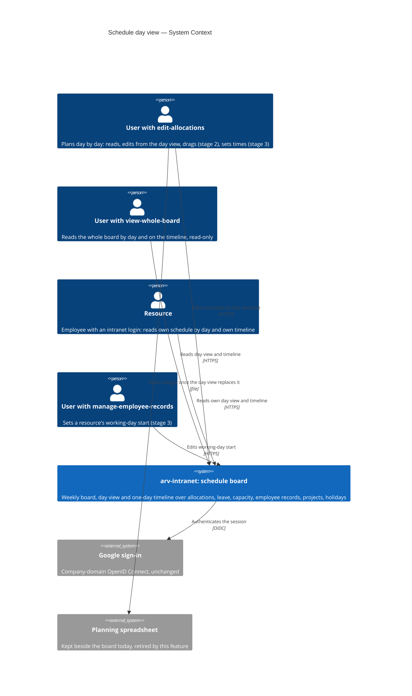
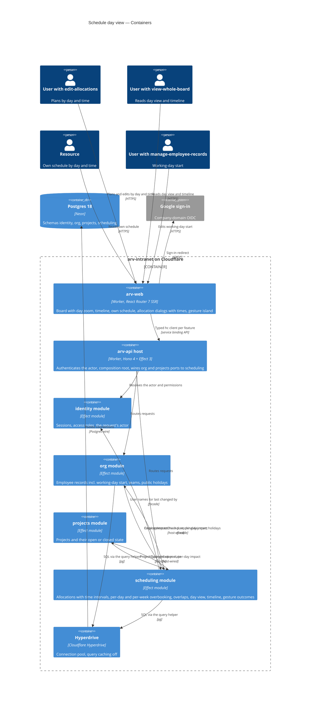
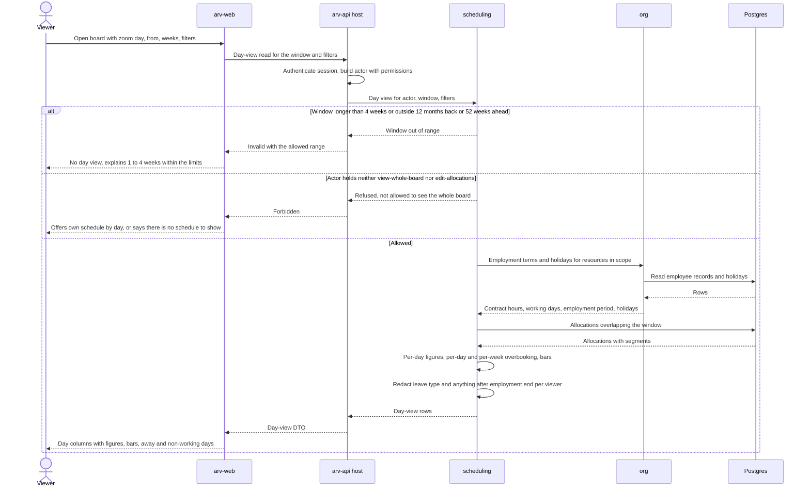
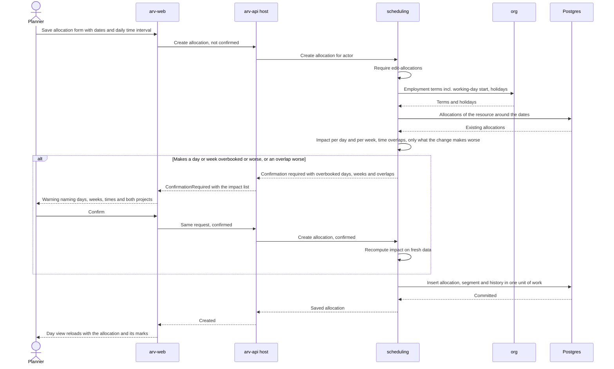
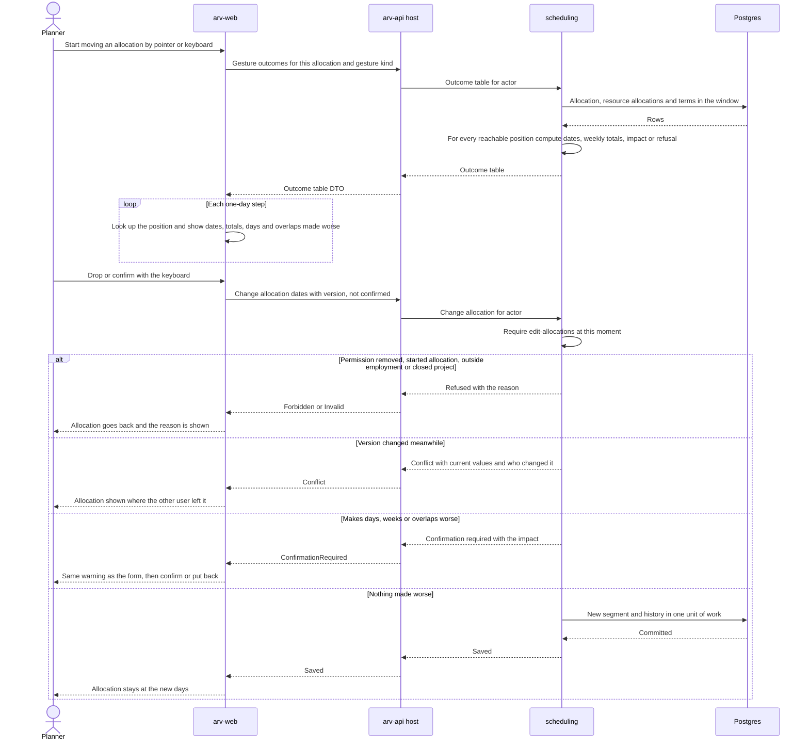

# Software Architecture Document — schedule-daily-view

<!-- Stages 04-05 → see sdlc/plugin/skills/architecture-design/SKILL.md -->
<!-- 12 Arc42 sections. Empty sections — <!-- N/A: <one-line reason> -->. -->
<!-- C4 Context (L1) lives inline in §3. C4 Container (L2) lives inline in §5. -->
<!-- §6 Runtime view seeds the primary flow(s) here; complete-sequence-diagrams (stage 06) then -->
<!--    fills §6 with every critical flow / §5 AC — no cap. -->
<!-- Numbers in §10 come VERBATIM from PRD §6 NFR — no inventing, no rounding. -->

## 1. Introduction and goals

**Intent.** We turn the schedule board into a **day view** of one to four weeks with one column per day. It shows each resource's allocated hours against their daily capacity, their allocations as bars across the days they cover, and leave days and public holidays (PRD §1, Approach C — Staged Day View, Gesture Editing). One overbooking rule, judged per day as well as per week, holds on the weekly board, the day view, the free list and every save warning (PRD §2). The feature ships in three stages:

- **Stage 1** — the read view, plus selecting days or clicking a bar to open the existing forms.
- **Stage 2** — moving and stretching an allocation by whole days, by dragging or with the keyboard. It is funded only if the planning spreadsheet is still in use at the recount 2 weeks after stage 1.
- **Stage 3 — time of day** (part of the current iteration, not gated by the recount). Every allocation except leave gets a required daily **time interval**, and the weekly rate is removed and converted. Each employee record gains a working-day start, a **time overlap** warning joins the overbooking warning, and a one-day **timeline** is added.

The feature serves the ~5 users with the edit-allocations permission, who plan, and the ~30 resources who read their own schedule. Stages 1–2 add no stored data, because per-day figures are already computed from existing inputs. Stage 3 adds two stored fields and converts every existing allocation, past ones included.

**Top quality goals (1-liners; full scenarios in §10):**

1. **QG-1 Calculation correctness at day precision** — 100% of daily figures, per-day and per-week overbooking verdicts and (stage 3) time-overlap verdicts match the capacity rules, computed exactly and judged on exact figures. One rule set serves the board, the day view, the free list and every warning (PRD §6).
2. **QG-2 Confidentiality at day precision** — leave type, leave project, employment end date and anything after it never reach a viewer without the matching permission. That includes stage 3's times of allocations and working hours, in every view: day view, grouping by project, read-only details, own schedule and timeline (PRD §6.1).
3. **QG-3 Responsiveness at target scale** — day view p95 ≤ 1500 ms for 100 resources × 4 weeks, gesture save p95 ≤ 500 ms, gesture preview within 300 ms of each one-day step, and one-day timeline p95 ≤ 1000 ms for 100 resources (PRD §6).
4. **QG-4 Stage 3 conversion correctness** — 100% of existing allocations get a time interval whose hours per day match their rate rule, and every conversion is recorded in the history (PRD §6, AC-28). This is the feature's only irreversible step: it rewrites past figures too.

**Stakeholders.**

| Role | Interest | Sign-off owner? |
|---|---|---|
| Users with the edit-allocations permission (PMs, delivery managers, team leads — the people who plan) | Plan day by day on the board itself and retire the planning spreadsheet; gestures with the same warnings they trust | No |
| Users with the view-whole-board permission | Read the whole board by day and (stage 3) by time of day | No |
| Resources (~30 scheduled employees with an intranet login) | Read their own schedule by day and on the timeline, including their own leave type | No |
| Users with the manage-employee-records permission | Set each resource's working-day start (stage 3, US-10) | No |
| PM (PRD owner — dmitro.b) | Goals and the spreadsheet KPI hold; consulted on §10 quality goals and §11 severities; owns the stage 2 funding checkpoint | Yes (§10) |
| Tech Lead | SAD approval, ADRs, module graph, the stage 3 conversion | Yes |
| Security Lead | Mandatory security review: health-related absence at day precision, per-day overbooking, working-pattern profiling (PRD §6.1) | Yes |

<!-- Decision overrides (¶4) — populated by the Step-7 critic resolution loop, empty otherwise. -->

## 2. Constraints

**Technical** (pinned in the repo and unchanged by this feature; see `ARCHITECTURE.md`, `package.json`, `apps/*/wrangler.jsonc` and [resource-scheduling SAD §2](../resource-scheduling/sad.md#2-constraints)).
- Runtime: Cloudflare Workers (Workers Paid plan limits on CPU time, subrequests and bundle size). Two deployables: `arv-web` (public) and `arv-api` (private, reachable only through the web Worker's `API` service binding). This feature adds no deployable and no binding.
- API: Hono 4.13.13 + Effect 3.22.2. Web: React Router 7.18.4 (SSR, loaders and actions), React 19.2, Tailwind CSS 4.3.3, shadcn components over Base UI in `apps/web/app/shared/ui`, theme tokens in `apps/web/app/app.css`, `lucide-react` icons.
- Tooling: TypeScript 5.9.3 (pinned below 7 for React Router 7), Vitest 4.1 (pinned for the Workers Vitest plugin), Playwright 1.64.0 with `@axe-core/playwright` 4.14.0 in `e2e/`, Biome, pnpm, Turbo.
- Data: Postgres 18 (Neon in production) through Hyperdrive with query caching **disabled**; Drizzle ORM 0.45 and drizzle-kit 0.31. Migrations are **generated by drizzle-kit** from each module's `schema.ts` into `packages/migrations/drizzle/` and are never edited once applied.
- Architecture: modular monolith with hexagonal modules (repo [ADR 0001](../../adr/0001-modular-monolith.md)). One Postgres schema per module, with no foreign keys, joins or queries across schemas. The module graph is `org → identity`, `scheduling → identity, org, projects`, and this feature **adds no module edge**. Transactions on Hyperdrive stay short and never await network calls.
- Inherited feature decisions that stay in force ([resource-scheduling ADRs](../resource-scheduling/adr/)):
  - 0002 — the board is server-rendered with its window in the URL.
  - 0005 — capacity and overbooking are computed on read in pure domain functions.
  - 0007 — host-wired ports for org's capacity check and projects' closing hook.
  - 0008 — an allocation is one aggregate of effective-dated segments with a `version`.
  - 0009 — integer minutes are stored and integer 1/420-minute ticks are computed.
  - 0010 — warn-then-confirm by re-sending with `confirm: true`.
- **No new package without approval** (CLAUDE.md). `apps/web` has no drag-and-drop or gesture package today; choosing one is PRD §8's open question (§11).

**Organisational.**
- No hard deadline (PRD §1). Effort budget and team composition are not quantified.
- **Build order: stage 1 → stage 3 → stage 2.** Stage 3 is part of the current iteration and is built while the stage 1 recount runs. Stage 2 is built last, and only if the recount 2 weeks after stage 1 funds it (at least one planner still keeps the spreadsheet, PRD §7). As a result, stage 2 gestures are designed only for daily time intervals and time overlaps, never for a weekly rate. The weekly-rate wording of AC-19 applies only if this order changes.
- Stage 3 rewrites every existing allocation and changes past figures (AC-28). Its release needs the PM's planner communication in place (PRD §8 open questions, §11).

**Conventions.**
- [`CLAUDE.md`](../../../CLAUDE.md), [`ARCHITECTURE.md`](../../../ARCHITECTURE.md) and `.claude/rules/*` (backend, frontend, infra). Layer imports are enforced by Biome `noRestrictedImports`.
- Errors: domain `Schema.TaggedError` → the module's presenter → shared contract errors (`NotFound`, `Conflict`, `ConfirmationRequired`, `Invalid`, `Refused`). Database failures are defects (`Effect.orDie` → 500). Contract changes are additive.
- Tests sit next to the code. Api integration tests run in `apps/api/test/integration/<module>/` against workerd and the real `arv_test` database; e2e tests live in `e2e/tests/scheduling/`.
- Conventional Commits scoped by module or package: `scheduling`, `org`, `contracts`, `web`, `migrations`.

**Regulatory / external.**
- Data classification **confidential** (PRD §6.1): named employees' daily workload and absences. Sick leave is health-related.
- Controls carried from PRD §6.1 and the board:
  - Leave type and leave project are shown only to holders of see-leave-reasons and to the resource themselves; everyone else sees «away».
  - Employment end date, and the allocations, overbooking and (stage 3) times and working hours after it, are shown only to holders of manage-employee-records or edit-allocations.
  - No new permissions.
  - Permissions are checked at every save, not at sign-in.
- **Security review required** before stage 1 and before stage 3 ships. Day-precision absence, per-day overbooking and working-pattern profiling are accepted residual risks flagged for that review.

## 3. Context and scope

<!-- brownfield: no docs/architecture-map.md yet. Current architecture read from the authored ARCHITECTURE.md, repo ADR 0001, the resource-scheduling SAD + ADR-0001…0010, and an sdlc:explorer scan of modules/scheduling, modules/org, packages/contracts/src/scheduling, apps/web/app/features/scheduling, apps/api and e2e/ (2026-11-22, HEAD 27e2b52). Run /sdlc:map-architecture to persist a map. -->

The weekly schedule board (resource-scheduling) shipped. The ~5 people who plan still keep the planning spreadsheet next to it, mainly to see the plan **day by day** (PRD §1, survey 2026-11). The day view brings that day-level picture onto the board, together with per-day overbooking, editing from the day and (stage 3) the time of day, so that the spreadsheet can be retired. The system boundary is unchanged: everything runs inside arv-intranet, which already owns allocations, capacity, employee records, projects and public holidays. The feature adds **no new external system**. The trust boundary stays the public web Worker. Selected days, dropped positions, keyboard moves and typed times are untrusted until the private api validates them, and every save is authorised at that moment.

**External systems (in / out):**

| Actor or system | Type | Interaction |
|---|---|---|
| User with the edit-allocations permission (who plans; includes view-whole-board) | Person | Reads the day view and timeline; selects days or clicks a bar to open the allocation and leave forms; (stage 2) moves and stretches allocations by dragging or keyboard; (stage 3) gives allocations a daily time interval |
| User with the view-whole-board permission | Person | Reads the day view (by resource or by project) and the timeline; sees allocation details read-only |
| Resource (with an intranet login linked to their employee record) | Person | Reads their own schedule by day and on their own timeline, including their own leave type |
| User with the manage-employee-records permission | Person | (Stage 3) sets a resource's working-day start on the employee record |
| Google (company-domain sign-in) | System (external) | Authenticates the browser session (identity ADR-0003); unchanged by this feature |
| Planning spreadsheet | Data source (external file) | Kept by planners next to the board today; **retired** by this feature (PRD §7 KPI), with no integration |

**C4 Context (L1):**



## 4. Solution strategy

**Target surface(s) (the first decision — what's being built):** `[backend-service, web-frontend]`. This is the same pair as [resource-scheduling ADR-0001](../../resource-scheduling/adr/0001-build-backend-service-and-web-frontend-surfaces.md); the feature **extends** both existing containers and adds no new one, so it gets no new ADR (blast-radius gate 1 of 3: multi-module only).

- **backend-service** — the private `arv-api` Worker:
  - `scheduling` gains the day-view and timeline reads, per-day overbooking, the time-overlap check, the time interval on allocations and (stage 2) the gesture outcome table;
  - `org` gains the working-day start;
  - `@arv/contracts/scheduling` and `@arv/contracts/org` grow additively, except where stage 3 removes the weekly rate.
- **web-frontend** — the public `arv-web` Worker's `features/scheduling` (and `features/org` for the working-day start) consumes that contract and authors none.

**Top strategic choices (the seeds for ADRs):**

1. **UI-architecture: the day view and the timeline are server-rendered zooms of the board URL** ([ADR-0001](./adr/0001-render-day-view-and-timeline-as-ssr-zooms-of-the-board-url.md)).
   - The day view is the board route with `zoom=day`, `from` and `weeks=1..4`, keeping `team`, `project` and `view=people|project`.
   - The timeline is its own route with `date=` and the same filters.
   - The own schedule takes the same params.
   - Each view is one loader call to one bounded api read: ≤ 4 weeks of days, or one day.
   - Switching zoom is a navigation that keeps the first week and the filters (AC-01).
   - Forms open from the day view through the existing allocation and leave dialogs and route actions.
   - Stage 2 gestures are a client island on the rendered page, absent on phones (PRD §3).
   - Screens reuse `apps/web/app/shared/ui` (shadcn over Base UI) and the `app.css` theme tokens: no new design system and no new component library. A new primitive is justified only where none fits (a draggable bar, a time axis).
   - Serves QG-3 (bounded payload) and keeps the api private.

2. **One per-day rule set behind every figure and warning** (extends [resource-scheduling ADR-0005](../../resource-scheduling/adr/0005-compute-capacity-and-availability-on-read.md); no new ADR, because PRD goal 2 leaves no alternative). `scheduling/domain` judges overbooking per day **and** per week in one function: a day is over its daily capacity, and a week is over its capacity or contains an overbooked day. «Made worse» is per day and per week (AC-08), and from stage 3 the domain adds time overlaps with the same rule (AC-25). The free list counts free hours day by day (AC-07). The same functions serve:
   - the weekly board and the own schedule;
   - the day view and the timeline;
   - the free list;
   - every save warning: allocation and leave forms, gestures;
   - org's `CapacityImpactCheck` (employee record and holiday edits);
   - projects' `ProjectClosingHook`.

   Nothing is stored. Figures are computed on read in integer ticks and shown rounded to the half hour. Serves QG-1.

3. **Store the daily time interval as minutes from midnight on allocation segments and drop the rate** ([ADR-0002](./adr/0002-store-daily-time-interval-as-minutes-on-segments-and-drop-the-rate.md)).
   - `scheduling.allocation_segments` gets `starts_at_minute` / `ends_at_minute`: 0–1440, multiples of 15, NULL only for leave.
   - `rate_minutes` and `rate_period` `day`/`week` are removed, so hours per day equal the interval's length.
   - `org.employee_records` gets `working_day_start_minute`, default 540 = 09:00. Working hours end at start + daily capacity, computed and never stored.
   - A change of interval on a started allocation is a new effective-dated segment from today (AC-23, resource-scheduling ADR-0008).
   - `scheduling` reads the working-day start through `OrgApi`'s employment terms. No new module edge.

4. **No conversion of existing allocations at stage 3** ([ADR-0003](./adr/0003-replace-the-rate-without-converting-pre-production-allocations.md)). Scheduling is not in production yet and every existing allocation is test data. Stage 3 reaches production before any real allocation does, so its drizzle-generated migration replaces the rate with the interval directly, and test allocations are deleted first. AC-28 and the NFR «Migration correctness» therefore do not apply (§1 decision override, §11 precondition risk). If real allocations reach production first, the fallback is expand → convert → contract (ADR-0003 option 2).

5. **Stage 2 gestures preview from a server-computed outcome table, fetched once per gesture** ([ADR-0004](./adr/0004-precompute-gesture-outcomes-once-per-gesture-on-the-server.md)).
   - At gesture start (pointer or keyboard), the web asks `scheduling` for every reachable position in the visible window: the resulting dates, weekly totals, the days and weeks made worse, the overlaps created or lengthened, or the reason a position is refused.
   - Each one-day step is a local lookup, which meets the 300 ms target.
   - The drop is the ordinary save with `version` and `confirm` (resource-scheduling ADR-0010), recomputed on fresh data and checked for permission at that moment (AC-17, AC-18).
   - The drag-and-drop support itself (a new package needs approval) is PRD §8's open question, decided before stage 2 starts (§11).

Each tactical decision in later sections should be traceable to one of these strategic seeds. Tactical decisions that *contradict* a strategic choice are red flags — surface them in §11 Risks.

## 5. Building block view

The feature follows the repo's **modular monolith with hexagonal modules** (repo ADR 0001) with no divergence. It adds **no module, no module edge and no deployable**; it extends `scheduling` and `org`, their contracts and the web's `scheduling` and `org` feature folders. Every new rule is a pure function in `scheduling/domain`, as [resource-scheduling ADR-0005](../../resource-scheduling/adr/0005-compute-capacity-and-availability-on-read.md) requires. Every new read and command is an Effect use case in `scheduling/application`, reached through Hono routes in `scheduling/http`. The day view, the timeline, their own-schedule equivalents and the gesture outcome table are **dedicated reads** beside the unchanged weekly board read ([ADR-0005](./adr/0005-serve-day-view-and-timeline-through-dedicated-reads.md)). The module's presenter applies the visibility policy before any DTO is built. `scheduling` gets the working-day start from `org` only through `OrgApi`'s employment terms, never from `org`'s tables. The host-wired ports of [resource-scheduling ADR-0007](../../resource-scheduling/adr/0007-invert-capacity-and-close-checks-through-host-wired-ports.md) keep their shape; only the rule behind them becomes per-day.

**Internal decomposition** (new or changed parts only; S1/S2/S3 = the stage that brings it):

```
modules/scheduling/src/
├── domain/
│   ├── daily-figures.ts      S1  per resource-day cell (allocated vs daily capacity, away, non-working,
│   │                             overbooked) and allocation bars spanning days; reuses capacity.ts
│   ├── overbooking.ts        S1  judged per day AND per week; «made worse» per day and per week (AC-08);
│   │                             a week with an overbooked day is overbooked; changeImpact names days
│   ├── free-list.ts          S1  free hours summed day by day (AC-07)
│   ├── working-hours.ts      S3  working-day start + daily capacity → working hours (AC-27, AC-27b)
│   ├── time-overlap.ts       S3  overlaps between non-leave intervals per day; «made worse» (AC-25)
│   ├── allocation.ts         S3  segment carries a time interval (minutes from midnight) instead of a rate
│   ├── gesture-outcomes.ts   S2  every reachable move / edge position → dates, weekly totals, impact or
│   │                             refusal reason (ADR-0004)
│   └── visibility.ts         S1/S3  unchanged rules, applied to day cells, times and working hours
├── application/
│   ├── day-view.ts           S1  read: window ≤ 4 weeks, by resource (project grouping is done in the web)
│   ├── timeline.ts           S3  read: one day, by resource
│   ├── my-schedule.ts        S1/S3  own schedule gains the day zoom and own timeline
│   ├── gesture-outcomes.ts   S2  read: outcome table for one allocation and gesture kind
│   ├── allocations/*         S1/S3  per-day impact in every save; time interval in create/change (AC-23)
│   ├── capacity-impact-check.ts, project-closing-hook.ts   S1  per-day impact (AC-07)
│   └── import-*              S3  rows carry start/end time; rows with a weekly rate are refused (PRD §8)
├── infrastructure/schema.ts  S3  allocation_segments: starts_at_minute, ends_at_minute; rate columns
│                                 removed (ADR-0002, ADR-0003)
└── http/routes.ts, presenter.ts  new read routes; impact details gain days and overlaps

modules/org/src/
├── domain/                   S3  EmployeeRecord.workingDayStart (15-minute step; start + daily capacity ≤ 24:00)
├── application/org-api.ts    S3  employment terms carry the working-day start
└── infrastructure/schema.ts  S3  employee_records.working_day_start_minute (default 540)

packages/contracts/src/
├── scheduling/               S1  day-view DTO, impact list + overbookedDays; S2 outcome table;
│                             S3  timeline DTO, time interval on allocations, timeOverlaps; weekly rate removed
└── org/                      S3  working-day start on the employee record DTOs

apps/web/app/features/
├── scheduling/
│   ├── routes/board.tsx      S1  zoom=day&weeks=1..4 (ADR-0001)
│   ├── routes/timeline.tsx   S3  date=, grouped by resource
│   ├── routes/my-schedule.tsx S1/S3  day zoom and own timeline (phone: vertical list, AC-30)
│   ├── components/day-*      S1  day grid, day cell, allocation bar, read-only details popover
│   ├── components/timeline-* S3  time axis, blocks, working hours, overlap marks
│   ├── components/allocation-dialog.tsx  S3  start / end time in 15-minute steps, no weekly rate
│   └── components/gesture-*  S2  pointer and keyboard gesture island over the day grid
└── org/                      S3  working-day start field on the employee record form
```

**C4 Container (L2):**



## 6. Runtime view

architecture-design seeds the three riskiest flows here; `/sdlc:complete-sequence-diagrams` then covers every PRD §5 acceptance criterion. Participants are the §5 containers. Messages are semantic: endpoint paths and status codes arrive with `api-forge`.

**Critical flow 1: Open the day view with per-viewer redaction** (US-01, US-04; AC-01–AC-05, AC-12; ADR-0001, ADR-0005)



**Critical flow 2: Save an allocation that overbooks a day and overlaps another** (US-02, US-03, US-09; AC-06, AC-08, AC-10, AC-23, AC-25; resource-scheduling ADR-0010)



**Critical flow 3: Move an allocation by gesture** (stage 2; US-05–US-07; AC-13–AC-18, AC-20; ADR-0004)



## 7. Deployment view

The feature ships inside the two existing Cloudflare Workers, which are serverless and scaled by Cloudflare per request. It adds **no Worker, binding, Cron Trigger or Hyperdrive config**: `arv-web` gains routes and components in `features/scheduling` and `features/org`, and `arv-api` gains reads and rules in `scheduling` and `org`. The monthly history purge (`0 3 1 * *`) is unchanged.

- **Stage 1** has **no database migration**: per-day figures are computed from existing inputs.
- **Stage 3** has **one drizzle-generated migration** ([ADR-0002](./adr/0002-store-daily-time-interval-as-minutes-on-segments-and-drop-the-rate.md), [ADR-0003](./adr/0003-replace-the-rate-without-converting-pre-production-allocations.md)):
  - `scheduling.allocation_segments` gains `starts_at_minute` and `ends_at_minute` and loses `rate_minutes` and the `day`/`week` rate periods (leave keeps `full-day`);
  - `org.employee_records` gains `working_day_start_minute` with default 540.

Because the stage 3 migration drops columns, it is **not additive**. Rolling the api back past it needs a schema rollback, which is acceptable only because scheduling holds no production data yet (ADR-0003).

**Stage 3 release sequence** (every environment, previews included):
1. Delete test allocations: non-leave allocations, their segments and history.
2. Apply the migration through `@arv/migrations` (`pnpm db:migrate`).
3. Deploy `arv-api`, then `arv-web`.
4. Re-seed demo data with time intervals where needed.

**Precondition:** stage 3 reaches production before any real allocation exists there (§11).


**Monitoring:**
- **Request duration** — the api host gets a middleware that writes **one structured JSON log line per request**: the route id (the Hono route pattern, e.g. `GET /scheduling/day-view`), the status and the duration in ms. It contains **no personal data**: no names, dates, query strings or leave types. Workers Observability (already enabled) computes p95 per route id against PRD §6:
  - day view ≤ 1500 ms;
  - allocation save, including gesture saves, ≤ 500 ms;
  - one-day timeline ≤ 1000 ms.

  The PRD §7 KPI «Day view latency p95» is read from it weekly. The line replaces `hono/logger` and also closes the same gap left by resource-scheduling (§11).
- **Alerts** (architect's estimates, not PRD numbers): p95 above its PRD target for 1 hour on the day-view, timeline or allocation-save route; 5xx share above 1% over 15 minutes.
- **Availability** — 99.5% monthly, measured by the intranet uptime monitor (PRD §6).
- **Gesture feedback** (stage 2) — not a production metric. It is the automated browser performance test in CI that PRD §6 names (§10).

**Scaling thresholds:**
- Day view at the PRD scale: 100 resources × 4 weeks = 2,800 resource-days per request, a third of the weekly board's 100 × 12 weeks = 8,400 (resource-scheduling §7).
- Timeline: 100 resource-days per request. Gesture outcome table: one resource and a few dozen positions per gesture.
- All of these stay well inside the compute-on-read budget of resource-scheduling ADR-0005. Revisit when resources exceed ~1,000, or when CPU time per day-view request approaches 50% of the Workers CPU limit. CPU time per request is recorded in the pre-release load test at 100 resources × 4 weeks.

## 8. Crosscutting concepts

The feature **inherits every convention** of [resource-scheduling SAD §8](../resource-scheduling/sad.md#8-crosscutting-concepts): authentication and authorization through the per-request actor; error handling with `NotFound` / `Conflict` / `ConfirmationRequired` / `Invalid` / `Refused`; UUIDv7 IDs; untrusted text rendered as plain text; no new locale handling; no outbox or events. The rows below are what this feature **adds or changes**.

| Concept | Convention | Where defined |
|---|---|---|
| Logging | One structured JSON line per api request, written by host middleware: route id (Hono route pattern), status, duration in ms. **No personal data**: no names, dates, query strings, leave types or times. It replaces `hono/logger`, and defects are still logged with their `Cause` by `runEffect`. | §7; `apps/api/src/index.ts` |
| Authorization | No new permissions (PRD §6.1). The day view and the timeline need `scheduling:view-whole-board` (or `scheduling:edit-allocations`, which includes it); otherwise only the actor's own schedule is served. Opening forms, gestures and gesture outcome tables need `scheduling:edit-allocations`. The working-day start needs `org:manage-employee-records`. Permissions are checked in application use cases at every save, including each drop (AC-18). | resource-scheduling ADR-0004; identity ADR-0005 |
| Visibility / redaction | The existing domain visibility policy is applied before any DTO is built, to every new view: day cells, allocation bars, the read-only details popover (AC-11), grouping by project (AC-01b), the own schedule, the timeline and the gesture outcome table. Leave type and leave project become «away» unless the viewer holds `scheduling:see-leave-reasons` or is the resource. After an employment end date, viewers without `org:manage-employee-records` or `scheduling:edit-allocations` get zero daily capacity and no allocations, no overbooking, no end mark, **no time blocks and no working hours** (AC-05, AC-29). | PRD §6.1; resource-scheduling §8 |
| Overbooking and overlap rule | One pure rule set in `scheduling/domain`: a day is overbooked when its allocated hours exceed its daily capacity, and a week when its hours exceed its capacity or it contains an overbooked day. A change makes a day worse when that day's hours over grow, and a week worse when its hours over grow or it gains an overbooked day (AC-08). From stage 3, a change makes overlaps worse on a day that gains an overlap or whose overlapping time grows (AC-25). Leave never takes part in an overlap; work on a leave day is caught by overbooking only. Judged on exact ticks. | §4 choice 2; resource-scheduling ADR-0005 |
| Warn-then-confirm | Unchanged mechanism: re-send with `confirm: true`, and the server recomputes. The `AllocationImpact` details grow **additively**: `overbookedDays[]` (date, hours over), `overbookedWeeks[]` (now naming their overbooked days) and, from stage 3, `timeOverlaps[]` (date, from–to, both projects). The same list is used by allocation and leave saves from forms and gestures, contract-hours / working-days edits (`CapacityImpactCheck`), adding a holiday, closing a project and the import. | resource-scheduling ADR-0010 |
| Hour and time arithmetic | Hours stay integer minutes, computed in 1/420-minute ticks. A time interval is a pair of integer **minutes from midnight** (0–1440, multiples of 15). Hours per day are its length. Working hours are the working-day start plus the daily capacity, computed exactly and shown exactly even off a 15-minute step (AC-27b). Figures are shown rounded to the nearest half hour; times are shown exactly. | [ADR-0002](./adr/0002-store-daily-time-interval-as-minutes-on-segments-and-drop-the-rate.md); resource-scheduling ADR-0009 |
| Dates and time zone | Business dates stay `date` values. Times of day are **wall-clock** times in the one company time zone (`COMPANY_TIME_ZONE`), the same zone «today» and public holidays use. On a daylight-saving change day an interval's length is still its wall-clock difference. A day view week is an ISO week, Monday to Sunday. | BRIEF B-01 #10; resource-scheduling §8 |
| Concurrency | Unchanged: an optimistic `version` on allocations and on employee records, which also covers the working-day start. A stale save, including a drop, fails with `Conflict` plus the current values and who changed them. Open views and gesture outcome tables are **not** updated live; they refresh after the user's next save, refusal or reload (AC-17). | resource-scheduling ADR-0008 |
| Accessibility | Every day state (free, booked, overbooked, away, non-working) and every timeline state (overlap, outside working hours) carries a text label and a `lucide-react` icon, never colour alone. Theme tokens keep text contrast ≥ 4.5:1. Every gesture has a keyboard equivalent with the same preview and an escape that cancels (AC-20). The existing `@axe-core/playwright` audit runs on the day view and the timeline. | PRD §6 |
| Device support | Desktop-first. On phones (390 px) the board's day view and timeline are view-only with horizontal scrolling and no gesture island. The own schedule shows one week, and the own timeline is a vertical list (AC-30). | PRD §3, §6 |
| Rate limiting | **Not implemented** (inherited from resource-scheduling). PRD §6.1 says gestures count toward «the existing limit of 120 allocation changes per minute per user», but no such limit exists. Each gesture is one attributed history entry, and the Security Lead decides on a limit at the mandatory security review (§11; PRD divergence). | PRD §6.1 (diverges) |

## 9. Architecture decisions

<!-- 🎯 Навіщо: ЗВОРОТНИЙ ІНДЕКС на папку adr/. `ls adr/` дає файли, §9 дає семантику —    -->
<!--           чому вони існують, до якого зрізу SAD привʼязані, у якому статусі.           -->
<!-- 📋 Що писати: таблиця з 4 колонками. Один рядок на ADR. Mixed status — це OK.         -->
<!-- 📌 Приклад: «0001 | Зберігати урок як таблицю блоків | Accepted | §4».                -->

| # | Title | Status | Section |
|---|---|---|---|
| <NNNN> | <imperative — e.g. "Use sliding window for rate limiting"> | Accepted | §<N> |
| <NNNN> | <imperative — e.g. "Co-locate outbox worker in API process"> | Accepted | §<N> |

ADR files live under `docs/features/<slug>/adr/NNNN-<title>.md`.

## 10. Quality requirements

<!-- 🎯 Навіщо: ДЕРЕВО ЯКОСТЕЙ (Quality Tree) — беремо мету з §1 і розкладаємо на          -->
<!--           конкретні листя: тести, метрики, конфіги, drill-и. ⭐ Без §10 §1 — це       -->
<!--           маніфест. З §10 кожна декларація мапиться на щось, ЩО МОЖНА ДОВЕСТИ.        -->
<!-- 📋 Що писати: на кожну якість з §1 — When / Then / How verify. Числа з PRD §6 NFR     -->
<!--           ДОСЛІВНО (не округлюй p95 ≤250мс до ≤300мс — це F6-помилка критика).        -->
<!-- 📌 Приклад: «p95 ≤500 мс на UPDATE блоку, перевіримо k6 load test 100 req/s».        -->

Each top-3 goal from §1 expanded into a full scenario:

**QG-1. <quality attribute>**
- **When:** <trigger condition>
- **Then:** <expected behavior with numbers from PRD NFR>
- **How verify:** <test / chaos drill / load test / observability>

**QG-2. <quality attribute>**
- **When:** <trigger>
- **Then:** <expected>
- **How verify:** <how>

**QG-3. <quality attribute>**
- **When:** <trigger>
- **Then:** <expected>
- **How verify:** <how>

## 11. Risks and technical debt

<!-- 🎯 Навіщо: ⭐ збирає ВСЕ, що може зламатись — і не лише технічне. Без §11 ризики   -->
<!--           обговорюються на стендапах і губляться; борг лишається у голові того,    -->
<!--           хто його прийняв.                                                          -->
<!-- 📋 Що писати: таблиця ризик/борг — серйозність — мітигація — власник. Технічний    -->
<!--           борг окремою секцією.                                                      -->
<!-- 📌 Приклад: «EM не пушить — member не оновлює дані | High | …». Перший ризик —      -->
<!--           часто продуктовий, не технічний. Це нормально.                            -->

<!-- Severity column literals: Low / Medium / High for regular risks; "Open question" for rows
     created by Step-7 `Save as Open Question` resolutions (see references/socratic-loop.md). -->

| Risk / debt | Severity | Mitigation | Owner |
|---|---|---|---|
| <e.g. Outbox lag may reach hours during downstream outage> | Medium | <Alert >10 min, on-call playbook, retry backoff> | <DevOps> |
| <e.g. No event schema versioning in v1> | Medium | <ADR-NNNN planned for v2, graceful handling of unknown fields> | <Backend> |
| Open architectural decision: <decision-headline> | Open question | Resolve before <stage trigger or YYYY-MM-DD>; <inline rationale from Step-7 Save-as-OQ> | <owner> |

**Accepted debt (acceptable in v1, plan to fix later):**
- <e.g. Goal entity is not versioned (immutable) — OK for v1, may need audit versioning in v2>

## 12. Glossary

<!-- 🎯 Навіщо: ⭐ СЛОВНИК ДОМЕНУ, який припиняє суперечки через рік («checkpoint —      -->
<!--           weekly чи biweekly? Quarter — календарний чи фіскальний?»).                -->
<!-- 📋 Що писати: таблиця термін / значення. Бізнес-терміни + технічні вперемішку.       -->
<!--           Один термін може мати дві мови у заголовку: «Goal (Обʼєктив)».              -->
<!-- 📌 Приклад: «Lesson | урок усередині курсу, що складається з блоків (text, video)». -->

| Term | Meaning |
|---|---|
| <e.g. Goal> | <quarterly intent in statement form> |
| <e.g. KR> | <Key Result — measurable target linked to a Goal> |
| <e.g. Checkpoint> | <bi-weekly progress update on a KR> |
