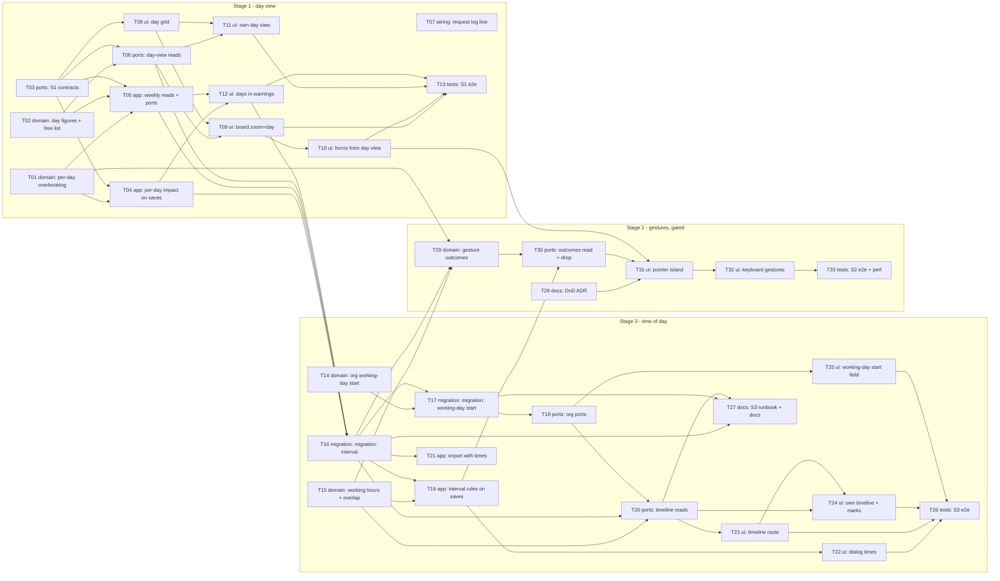

# Epic — schedule-daily-view

> **PRD:** [PRD.md](../PRD.md) · **Design:** [sad.md](../sad.md) · **Data model:** [data-model.md](../data-model.md) · **API:** [openapi.yaml](../contracts/openapi.yaml) ([sync report](../contracts/api-sync-report.md)) · **ADRs:** [adr/](../adr/)
> Size **L** (`.size`) · surfaces `[backend-service, web-frontend]` (sad.md frontmatter) → layers domain · infra · app · ports · **ui** · migration · tests · wiring · docs.

## Goal

The people who plan see and change the plan day by day on the board itself. One rule judges overbooking per day and per week everywhere, so the planning spreadsheet can be retired ([PRD §2](../PRD.md#2-goals)). Stage 3 adds the time of day and the time-overlap warning. Stage 2 adds moving and stretching by drag or keyboard, if the recount funds it.

## Scope

- **In:** `modules/scheduling` (domain, application, http, infrastructure), `modules/org` (working-day start), `@arv/contracts/scheduling` and `/org`, `apps/web/app/features/scheduling` and `/org`, the api host's request log line, two staged migrations, e2e specs, the stage 3 runbook.
- **Out:** everything in [PRD §3](../PRD.md#3-non-goals): uneven hours within one allocation, part-day leave, per-employee time zones, reassignment by drag, multi-select, gestures on phones, undo. Also out: **AC-28** and the «Migration correctness» NFR, cancelled by [ADR-0003](../adr/0003-replace-the-rate-without-converting-pre-production-allocations.md) and the SAD §1 override. No task converts allocations. T16's guard and the T27 runbook protect the precondition.

**Build order (SAD §2): stage 1 → stage 3 → stage 2.** Stage 2 is designed for time intervals only. Within a stage, the DAG decides.

## Task map

Same DAG as [tasks.json](./tasks.json). Parallel starts: **T01 · T02 · T03 · T07** (stage 1), **T14 · T15** (stage 3 domain, any time), **T28** (stage 2 decision). Migration lane: T16 → T17 (serialized).

## Tasks

See [tracker.md](./tracker.md) for status and estimates. Machine contract: [tasks.json](./tasks.json).

| # | Task | Layer | Blocked by | DoD (short) |
|---|---|---|---|---|
| [T01](./t01-per-day-overbooking-rule.md) | Judge overbooking per day and per week, with per-day «made worse», in scheduling/domain | domain | — | Rule-table tests in overbooking.test.ts pass for the AC-06 row (Wednesday over by 8 h, week 40/40 overbooked because of Wednesday) and the AC-08 rows (nothing made worse → no confirmation), and pnpm lint + typecheck are clean. |
| [T02](./t02-day-figures-and-free-list.md) | Compute day cells, multi-day allocation bars and the per-day free list in scheduling/domain | domain | — | Rule-table tests pass for AC-01 (4/8 on a working day, away on the leave day, holiday and weekend non-working, one bar across the covered days) and AC-07 (8, 8, 16, 8, 0 → Wednesday overbooked, 8 free hours), and lint + typecheck are clean. |
| [T03](./t03-s1-contract-shapes.md) | Add the stage 1 contract shapes (day view, per-day impact) to @arv/contracts/scheduling and the base contract | ports | — | Contract schema tests decode the openapi.yaml S1 examples for DayView, MyDayView, DayCell, BoardCell.overbookedDays, AllocationImpact.overbookedDays and WeekOver.overbookedDays; the change is additive and lint + typecheck are clean. |
| [T04](./t04-per-day-impact-on-saves.md) | Warn per day on allocation and leave saves (create, change, leave) and map overbookedDays in the presenter | app | T01, T03 | An api integration test reproduces AC-06 (409 confirmation naming Wednesday +8 h and the 40/40 week, then saved with confirm: true) and AC-08 (saved without confirmation), and unit tests for create/change/leave pass. |
| [T05](./t05-per-day-rule-in-weekly-reads-and-ports.md) | Apply the per-day rule to the weekly board, own schedule, free list and the org/projects host-wired checks | app | T01, T02, T03 | Integration tests through the real composition root show a pre-existing daily overload as an overbooked week naming its day on getBoard and getMySchedule, the free list counting 8 free hours for the 8-8-16-8-0 week, and employee-record, holiday and project-close warnings naming the overbooked days (AC-07). |
| [T06](./t06-day-view-reads.md) | Serve GET /scheduling/day-view and /scheduling/my-schedule/day-view with redaction applied before the DTO | ports | T02, T03 | Integration tests return the AC-01 fixture's cells and bars, 400 window_out_of_range for 5 weeks or outside the limits (AC-03), 403 or the own view for a user without view-whole-board (AC-04), and the redaction matrix shows no leave type, leave project, end date or post-end allocation for an unentitled viewer (AC-05, QG-2). |
| [T07](./t07-request-duration-log-line.md) | Replace hono/logger with a one-line structured request log (route id, status, ms) in the api host | wiring | — | A unit test shows one JSON line per request with the Hono route pattern, status and duration, and no query string, name, date or leave type; hono/logger is gone and ARCHITECTURE.md describes the line. |
| [T08](./t08-day-grid-components.md) | Build the day grid components: rows by resource and by project, day cells, multi-day bars, states with icons | ui | T03 | Component tests render the AC-01 fixture (4/8, away, non-working, one labelled bar, overbooked work-on-leave day), the AC-01b project grouping (per-project totals, leave under one «away» group for unentitled viewers), and every state carries a text label and a lucide icon. |
| [T09](./t09-board-day-zoom-route.md) | Add zoom=day to the board route: window toolbar (1–4 weeks, earlier/later), zoom switch keeping filters, out-of-range state | ui | T06, T08 | Route tests show the loader calling getDayView for zoom=day&from&weeks, switching back to weeks starting at the same first week with the same filters (AC-01), no further step offered at a limit (AC-02), the explanation instead of a view for an out-of-range link (AC-03), and the own view offered to a user without view-whole-board (AC-04). |
| [T10](./t10-start-change-from-day-view.md) | Open the existing forms from the day view: select a day range to prefill, click a bar to edit, read-only details for viewers | ui | T09 | Component tests show that selecting Tuesday–Thursday in one row opens the allocation (or leave) dialog with that resource and those dates (AC-09), clicking a bar opens its edit dialog (AC-10), and a view-only user gets the read-only popover with leave redacted and nothing opens on selection (AC-11). |
| [T11](./t11-own-schedule-day-zoom.md) | Add the day zoom to the own schedule (1–4 weeks, two by default, one on a phone, own leave type, read-only) | ui | T06, T08 | Route and component tests show the own day view with the resource's leave type and overbooked days over 1–4 weeks (two by default, one at 390 px) with no edit affordance (AC-12), and a non-resource told they have no schedule (AC-04). |
| [T12](./t12-overbooked-days-in-warnings-and-board.md) | Name overbooked days in every confirmation dialog and on the weekly board cells | ui | T04, T05 | Component tests show the AC-06 warning naming Wednesday +8 h and the week 40/40 with its day, the weekly cell «40/40» in the overbooked state naming Wednesday (AC-07), employee-record and holiday warnings naming days, and no dialog when the action returns saved (AC-08). |
| [T13](./t13-s1-e2e.md) | Add stage 1 e2e: day-view spec with an axe audit, and update the weekly board spec for per-day overbooking | tests | T09, T10, T11, T12 | pnpm test:e2e passes day-view.spec.ts (AC-01 view and switch back, AC-06 warn then confirm, AC-09 prefilled form, AC-11 read-only, AC-12 own view) with expectNoAxeViolations on the day view, and board.spec.ts passes with per-day overbooking. |
| [T14](./t14-org-working-day-start-domain.md) | Add the working-day start to EmployeeRecord in org/domain (09:00 default, 15-minute step, ends by 24:00) | domain | — | Rule-table tests pass: default 540 on a new record, 08:00 accepted giving 08:00–16:00 (AC-27), off-step and 17:00 + 8 h refused with a tagged error, and 09:00 + 6 h 24 min ending at 15:24 accepted (AC-27b). |
| [T15](./t15-working-hours-and-time-overlap-domain.md) | Add working-hours.ts and time-overlap.ts (per-day overlaps, «made worse») to scheduling/domain | domain | — | Rule-table tests pass: AC-21 «6/8» with free 13:00–14:00 and 16:00–17:00, AC-25 09:00–13:00 + 11:00–12:00 → overlap 11:00–12:00 warned only when made worse (new overlap or growing overlap time, incl. extending onto new days), leave never overlapping, and AC-26 outside working hours marked with no warning. |
| [T16](./t16-migration-scheduling-time-interval.md) | Promote staged migration 120000: replace the rate with the daily time interval in scheduling storage, domain and contract | migration | T04, T05, T06, T12 | The drizzle-generated migration (with the guard DO block prepended) applies cleanly on arv_test, pnpm db:generate then reports no changes and db:status is clean, pnpm test:integration passes, and a unit test decodes a legacy leave history snapshot (rateMinutes null, ratePeriod full-day) as a segment with no interval. |
| [T17](./t17-migration-org-working-day-start.md) | Promote staged migration 120001: add org.employee_records.working_day_start_minute (one-shot DEFAULT 540, dropped) | migration | T14, T16 | The drizzle-generated migration, hand-edited to add the column with DEFAULT 540 and then drop the default, applies on a seeded arv_test (existing rows get 540), db:generate reports no changes, the repository round-trips workingDayStartMinute, and pnpm test:integration passes. |
| [T18](./t18-org-working-day-start-ports.md) | Expose the working-day start through @arv/contracts/org, the employee-record routes and OrgApi employment terms | ports | T17 | Integration tests show PATCH with 08:00 saving and returning working hours 08:00–16:00 with capacity unchanged (AC-27), 17:00 or an off-step start refused as Invalid with the explanation (AC-27b), a created record starting at 09:00, and OrgApi employment terms carrying the start. |
| [T19](./t19-interval-rules-on-saves.md) | Validate the time interval on allocation saves, apply interval changes from today, and add time overlaps to the impact | app | T15, T16 | Integration tests show an off-step or end-not-after-start interval refused as Invalid (AC-24), an interval change on a started allocation creating a segment from today with past days kept (AC-23), the AC-25 overlap returned as timeOverlaps naming both projects and saved after confirm, and the AC-26 17:00–19:00 save with no warning. |
| [T20](./t20-timeline-reads.md) | Serve GET /scheduling/timeline and /scheduling/my-schedule/timeline, and mark overlaps on day-view cells | ports | T15, T16, T18 | Integration tests return the AC-21 fixture (working hours 09:00–17:00, two blocks, 6/8), leave filling working hours as «away» on AC-22's day, 400 for a date outside the limits, 404 not_a_resource on the own timeline for a non-resource, DayCell.timeOverlap set on the AC-25 day, and the redaction matrix shows no blocks or working hours after an end date for an unentitled viewer (AC-29). |
| [T21](./t21-import-time-per-row.md) | Accept a start and end time per import row and refuse rows with a weekly rate | app | T16 | Import preview and commit tests accept rows with start/end times in 15-minute steps, refuse rate rows and invalid intervals with an explanation, and the import integration test selects starts_at_minute/ends_at_minute instead of the rate columns. |
| [T22](./t22-allocation-dialog-times.md) | Finish the allocation dialog for time of day: 15-minute start/end, hours per day and total, errors, overlaps in the warning | ui | T19 | Component tests show start/end in 15-minute steps with hours per day and total, no rate field (AC-23), the end-after-start and 15-minute messages without saving (AC-24), the confirmation listing the AC-25 overlap with both projects, and the leave dialog asking for no times. |
| [T23](./t23-board-timeline-route.md) | Build the one-day timeline route and components: time axis, blocks, working hours, free time, away, out-of-hours and overlap marks | ui | T20 | Route and component tests render AC-21 (09:00–17:00, blocks 09:00–13:00 and 14:00–16:00, 6/8, free spans, axis at least 08:00–18:00 widened to fit), AC-22 (leave as «away» over working hours, holiday non-working, work on leave overbooked), AC-26 out-of-hours mark, day stepping within limits, and the out-of-range explanation. |
| [T24](./t24-own-timeline-and-day-overlap-marks.md) | Add the own timeline (vertical list at 390 px) and overlap marks on the day view and own day view | ui | T20, T23 | Component tests show the own timeline with working hours, timed blocks, own leave type and overlap/overbooking marks and no edit affordance, rendered as a vertical list at 390 px (AC-30), and the day cell showing the overlap mark (AC-25). |
| [T25](./t25-working-day-start-field.md) | Add the working-day start field to the employee record dialog | ui | T18 | Component tests show the field in 15-minute steps defaulting to 09:00, working hours shown as start + daily capacity exactly (15:24 for 6 h 24 min), and the AC-27b refusal message from the action. |
| [T26](./t26-s3-e2e.md) | Add stage 3 e2e: timeline spec with an axe audit, booking with a time and an overlap warning, working-day start | tests | T22, T23, T24, T25 | pnpm test:e2e passes timeline.spec.ts (AC-21 timeline, AC-25 warn-then-confirm and mark, AC-27 working-day start change reflected, AC-30 own timeline) with expectNoAxeViolations on the timeline. |
| [T27](./t27-s3-release-runbook-and-docs.md) | Write the stage 3 release runbook (ADR-0003 guard, QG-4 count check) and fold the S3 delta into the base contract and ARCHITECTURE.md | docs | T16, T17, T20 | The runbook lists SAD §7 steps 0–5 with the data-model SQL (non-test count guard that stops production, delete test allocations, migrate, deploy api then web, QG-4 counts all 0, re-seed), the base openapi shows the interval-shaped AllocationSegment and timeOverlaps, and ARCHITECTURE.md records the impact list and the new reads. |
| [T28](./t28-decide-drag-and-drop-support.md) | Decide the drag-and-drop support for the gesture island and record it as an ADR | docs | — | An Accepted ADR names the chosen approach (a package with a version that passes pnpm's minimum release age, or native pointer events), its approval, and its alternatives. |
| [T29](./t29-gesture-outcomes-domain.md) | Compute every reachable move and edge position of a gesture by working days in gesture-outcomes.ts | domain | T01, T15, T16 | Rule-table tests pass: AC-13 two-step move skipping weekends and holidays and keeping the working-day count, AC-14 started allocation refused for move/start edge and end edge before today, AC-15 positions carrying days/weeks made worse and overlaps, AC-16 positions past the employment end or on a closed project refused with the reason, and AC-19 end edge keeping the interval and hours per day. |
| [T30](./t30-gesture-outcomes-read-and-drop.md) | Serve GET /scheduling/allocations/{id}/gesture-outcomes and harden the gesture drop on PATCH (version, confirm, permission at drop) | ports | T29, T19 | Integration tests return the outcome table for an editor and 403/404 otherwise (D-1), a drop saved with the history entry (AC-13), past/employment/closed-project drops refused (AC-14, AC-16), two drops with the same version giving one success and one Conflict with current values (AC-17, QS-5), and a drop after the role lost edit-allocations refused (AC-18). |
| [T31](./t31-pointer-gesture-island.md) | Build the pointer gesture island over the day grid: move and edge drags with a live preview, drop to save, confirm or revert | ui | T28, T30, T10 | Component tests show the outcome table fetched once at gesture start, each one-day step updating dates, weekly totals and impacts from it, a drop saving through the action, the confirmation on impact (AC-15), and revert with the server's message on refusal, conflict or lost permission (AC-14, AC-16, AC-17, AC-18); no island renders at 390 px. |
| [T32](./t32-keyboard-gestures.md) | Add keyboard move and stretch to the gesture island (arrow keys, confirm, Escape to cancel) | ui | T31 | Component tests show focus on a bar, choosing move/start/end, arrow keys stepping by working days with the same preview, Enter saving with the same rules and warnings, and Escape cancelling with nothing changed (AC-20). |
| [T33](./t33-s2-e2e-and-perf.md) | Add stage 2 e2e: drag and keyboard specs, a keyboard-only axe run, and the 300 ms preview performance test | tests | T32 | pnpm test:e2e passes gestures.spec.ts (AC-13 move, AC-15 confirm/cancel, AC-17 two sessions, AC-20 keyboard-only with no axe violations) and gestures-perf.spec.ts asserts the preview updates within 300 ms of each arrow-key step on a seeded 100-resource × 4-week board. |

## AC coverage

Every PRD §5 AC maps to ≥1 task except **AC-28**, which is N/A by decision (ADR-0003; SAD §6 coverage table). If the ADR-0003 precondition breaks, add an expand → convert → contract task chain (ADR-0003 option 2) before T16.

## Risks / Hard rules

- **Module boundaries** (CLAUDE.md, SAD §5): no new module edge. Scheduling reads the working-day start only through `OrgApi`. Layer imports follow the Biome `noRestrictedImports` overrides.
- **Migrations are drizzle-generated.** T16 and T17 promote the staged files as a spec through `pnpm db:generate` plus the documented hand-edits. They are never hand-written, and an applied migration is never edited.
- **ADR-0003 precondition (High, SAD §11):** stage 3 reaches production before any real allocation. The T16 guard and the T27 runbook step 0 stop the release otherwise.
- **Redaction (High, QG-2):** every new read (T06, T20, T30) extends the response-body redaction matrix in the same PR.
- **Non-additive contract change (S3):** rate removal in T16 is allowed only before production. The api and web ship together (SAD §7).
- **No new package without approval:** only T28 may introduce one (drag-and-drop), and only after its ADR is accepted.
- **Rate limiting** stays absent (SAD §8 divergence) until the security review decides. A security review is required before stage 1 and before stage 3 ship.
- **Open questions blocking tasks:** PRD §8 import format (T21), drag-and-drop support (T28), stage 2 funding (T28–T33).
